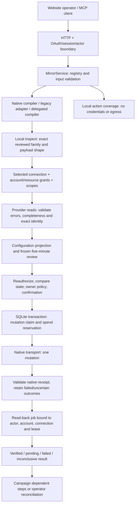

# Action contracts: implementation, evidence and remaining work

Review date: 2026-09-18. This is an all-platform **contract inventory and targeted implementation pass**, continuing the earlier audit. It is not a second manual audit of every line or a claim of universal provider support.

## Executive assessment

The reported Google campaign-asset failure was a missing contract, not a broken URL and not the telemetry conflict fixed in `368a6a9`. This change adds reviewed create/update/remove contracts for campaign, ad-group, customer and asset-group associations. A realistic synthetic batch links **six sitelinks, four callouts and one structured snippet**, on both RPC and legacy surfaces, then verifies every association. Nothing in a real ad account was linked during this work.

The same journey is now implemented for existing Microsoft extensions at account, Search campaign and ad-group levels. The contract reads the exact parent, asset content and association membership, enforces owner activation/deletion policies, handles null success slots in indexed error arrays and verifies membership/absence. It does not implement Microsoft asset creation or media ingestion.

Additional corrections give Apple, GA4, GTM and Search Console writes actual read-back contracts; preserve asynchronous GA4 pending/failure states; bind verification to the current worker lease; poll using reads only; and apply deletion policy to Google POST operations containing removes. Documented read-only POST routes that were incorrectly blocked have narrow risk declarations.

**The request to execute every provider action is not complete.** The reproducible inventory contains 3,223 local catalog/action-enum rows across 20 gateways, including aliases and delegated workflows. It records 1,066 mapped writes without reviewed contracts, 107 unmapped actions, 50 unqualified reads and eight input-dependent legacy adapters. Of 1,109 methods in 22 pinned public Discovery/OpenAPI/WSDL documents, 396 have no corresponding AMCP action. These are distinct denominators, not additive unique features. Providers without a complete captured schema have an unknown denominator, not zero missing functionality.

AMCP has useful foundations: exact actor/account grants, frozen reviews, durable mutation claims, explicit money policies, server-side media transfer, native and normalized reporting, scheduled delivery, and an isolated release assembler. Tests exercise many of these boundaries. They do not establish provider approval, live compatibility for every payload, deployment correctness or delivery outcomes.

## Scope, provenance and working copies

| Item | Verified value |
|---|---|
| Edited repository | `C:/Users/abdom/Downloads/AMCP Final With Claude recos - Copy/implementation-Codex-branch` |
| Remote | `https://github.com/magdyezy1/AMCP.git` |
| Authorized branch | `Codex-branch` only |
| Pinned starting revision | `368a6a921661315d1e6164bb37b955256cb4d41a`; clean at start |
| Starting tracked files | 418; new source/report files are listed separately in the file ledger |
| Worktrees for this clone | One worktree, this checkout |
| Parent development directory | Separate checkout on `codex`, baseline `b8b34aa364e9cbae73e7c1e07396101f55744538`, pre-existing changes; not edited |
| Old release checkout | Parent `.release/AMCP`, branch `codex/amcp-website`, baseline `067871481d79fc59a6cb976d8a13b62d409e283a`; not edited |
| Runtime | Windows/PowerShell; Node 24.19.0; npm 11.17.0; TypeScript 7.0.2 |
| Dependency installation | Lockfile-based `npm.cmd ci --ignore-scripts --no-audit --no-fund` in disposable release copies |
| WSDL generator | Bundled Python 3.12.14, standard library only; explicitly selected through `AMCP_SCHEMA_PYTHON` |
| Deployment shape | Node HTTP/website/stateless MCP or stdio; Docker/Railway configuration; durable SQLite/media storage required by existing deployment design |
| Repository instructions | No applicable `AGENTS.md` found; user instructions constrain branch, provider access and publication |
| Authority boundary | Code and branch push authorized. No live ad mutations, secret collection, production database access, provider applications or deployment changes performed |

All implementation in this pass is the delta from the pinned revision. Existing state projection work is retained and tested. Historical reviewer reports and test totals were not treated as current acceptance evidence. A later Git commit identifies the published delta; release manifest hashes below identify the tested working tree before commit.

The file ledger is [ALL-ACTIONS-FILE-COVERAGE.csv](ALL-ACTIONS-FILE-COVERAGE.csv): 435 files (418 baseline plus 17 new), classified as 25 manually reviewed, 31 partly reviewed, 344 mechanically validated and 35 excluded with a reason. It distinguishes manual review, partial review, mechanical validation and exclusions. In particular, `.mirror/RESULTS/live-read-samples.json` was not opened or copied: it can contain historical private provider responses. The release assembler injects an empty synthetic replacement. Credentials, live databases, environment secrets and unrelated personal files were excluded.

## Product and architecture

AMCP lets a website operator or an external MCP client discover approved accounts, assemble advertising workflows, move media server-side, request reports and execute explicitly reviewed provider mutations. A workspace account selection is an AMCP grant; it is separate from OAuth consent, vendor access tier, manager routing, quota and editorial approval. None of those facts can be inferred from a catalog row or HTTP 403 alone.



Key sources of truth and trust boundaries:

- `server/http-app.ts`, `server/mcp.ts`, website/session/OAuth modules authenticate entry. These were regression-tested, not comprehensively re-audited in this pass.
- `src/catalog.ts`, generated catalogs and vendor metadata describe discovery. They are untrusted provider-derived evidence; they do not authorize execution. Legacy/RPC aliases converge on compiled native requests.
- `src/reviewed-routes.ts` centralizes route-family membership for both inspection and the coverage ledger. Shape validation, scope, before-state, spending and receipts remain separate mandatory contracts. This removes a second hand-maintained allowlist from the diagnostic path.
- `src/write-review.ts`, `src/review-state.ts`, `src/preflight.ts`, `src/spend-policy.ts` enforce the review transaction. Raw responses are validated before response envelopes are projected away. Real names, budgets, schedules, targeting and ordered arrays remain configuration.
- `src/store.ts` stores encrypted connection credentials, reviews, mutation claims, jobs, ownership observations, reporting definitions and audit records. No new database/schema migration is introduced by this change.
- `src/write-verification.ts`, `src/service.ts:93`, `src/worker.ts:30` and `src/campaign-runner.ts:20` separate an accepted write from a verified configuration or completed asynchronous job. Verification never clears or reuses a submitted mutation claim.
- Existing `src/media-*`, reporting/export modules and provider transport remain the execution paths for media and reports. Sheets/Drive are separately authorized services, not interchangeable with Google sign-in, Ads or Analytics scopes. Those paths were regression-tested, not newly live-qualified here.

Provider-returned names, copy, reports and metadata remain untrusted data. The new inventory neither executes their instructions nor exposes credentials. Its response is bounded to 100 rows, with local search and explicit unsupported states.

## Findings register: confirmed and corrected

Severity describes impact before this patch. No P0 is established. Confidence is high for the stated local reproductions; live-provider acceptance remains unverified.

| ID | Severity and consequence | Trigger, expected / actual before change | Correction and exact starting points | Evidence |
|---|---|---|---|---|
| C01 | P1 product release blocker for the requested asset-link journey; no mutation bypass | Correct `campaignAssets:mutate` request reached inspect but received `WRITE_CONTRACT_UNAVAILABLE`. Expected a scoped reviewed association contract. This was an incomplete capability, not a malformed route. | `src/google-asset-links.ts:9`, `:56`, `:88`, `:105`; all four association families, both aliases, exact content/parent/membership reads and exact receipt/read-back. | `tests/google-asset-links.test.ts`: eleven-item pack, CRUD, foreign IDs, duplicates, real content changes, query telemetry, malformed/partial results, concurrency and replay. |
| C02 | P1 safeguard correctness; a reviewed destructive request could miss an owner restriction | Google removes use HTTP POST; deriving destruction only from DELETE/catalog flags did not consistently represent them. | `src/execution-risk.ts:46`, `src/spend-policy.ts:135`: derive destruction from validated native operations and re-evaluate current policy even for a stored review with an old flag. | `tests/action-contracts.test.ts`; `tests/google-asset-links.test.ts` owner deletion test, including a frozen false flag. |
| C03 | P2 workflow incompleteness; accepted measurement writes lacked useful read-back | Apple/GA4/GTM/GSC mutations could return an accepted receipt with unsupported verification. A created asynchronous export was not necessarily complete. | `src/measurement-writes.ts:122`, `:148`; exact account/property identities, explicit pending/failed/active phases; GTM publish reads **live** version; scoped deletion absence. | `tests/measurement-writes.test.ts`: every current GTM write action, Apple, GSC and GA4; wrong IDs/live versions, permission errors, pending and failed jobs. |
| C04 | P2 recovery correctness; pending jobs could stop progressing or failed steps keep appearing to verify | Worker completion did not distinguish eventual verification from final acceptance; campaign state mapped failure back to verifying. | `src/worker.ts:30` bounded read-only retries, `src/service.ts:93` current-lease authority, `src/campaign-runner.ts:20` terminal failure handling. | Worker poll-limit/stale-lease cases in `tests/measurement-writes.test.ts`; `tests/campaign-recovery.test.ts` prevents child advancement and mutation replay. |
| C05 | P2 advertised-read availability | Exact documented Google root planning RPCs, GA4 report-task query, Criteo recommendations and Business Profile lookup POSTs did not all satisfy independent read classification. | `src/execution-risk.ts:11`; `src/scope.ts` exact Google root paths. Qualified methods only; no general POST exemption. | `tests/action-contracts.test.ts`, `tests/delegated-native.test.ts`; positive paths plus mutation lookalikes/cross-account negatives. |
| C06 | P2 missing Microsoft extension workflow | Existing extensions could not be associated through AMCP. Library existence did not establish campaign membership. | `src/microsoft-associations.ts:9`, `:22`, `:33`, `:63`; set/delete plus exact native discovery, source/content review and membership verification. All 16 documented type flags compile; content and parent/provider eligibility still validated at runtime. | `tests/microsoft-associations.test.ts`: account/campaign/ad-group eleven-item fixtures, type constraints, grants, policy, partial/lost outcomes, duplicates, content/membership changes. |
| C07 | P2 provider response correctness | Microsoft indexed `PartialErrors: [null]` denotes a success slot, but both the native validator and generic review outcome logic rejected it. | `src/microsoft-native.ts` response/outcome validators and `src/write-review.ts:39`: ignore only documented null slots, preserve non-null errors and receipt requirements. The generic exception applies only to Microsoft's root `PartialErrors`. | Initial association run reproduced the failure; corrected run passed. Null plus an error, false slots, missing receipts and uncertain transport are negative fixtures. |
| C08 | P2 activation acknowledgment for newly added contracts | A link may start serving without a `status` field; keyword matching alone cannot identify its effect. | `src/preflight.ts`, `src/write-impact.ts`, `src/spend-policy.ts`: explicit serving impact, spend acknowledgment for association changes and conservative owner activation enforcement. | Missing-spend-confirmation regressions for Google and Microsoft; no egress before acknowledgment. |

The earlier telemetry fix remains in `src/review-state.ts:39`. Google hashes configuration-bearing `results`, not `queryResourceConsumption`; exact resource rows are sorted by identity, and incomplete pages are refused before normalization. This pass adds optional **derived exact-target** absence for new links and removal verification. It does not permit arbitrary empty snapshots or sort all arrays as sets.

### Reproducible requested workflow

Use synthetic IDs in tests; discover actual IDs and permissions separately for a real account. The first call below is local inspection only:

```json
{
  "action": "inspect",
  "gateway": "google_ads_native_action",
  "arguments": {
    "action": "google_ads_v23_campaign_asset_mutate_campaign_assets",
    "account_id": "123",
    "payload": {
      "operations": [{"create": {
        "campaign": "customers/123/campaigns/100",
        "asset": "customers/123/assets/200",
        "fieldType": "SITELINK"
      }}],
      "partialFailure": false
    }
  }
}
```

`prepare` with the same arguments reads exact provider state. Review the returned content, account, parent status and impact; execute only that returned `review_id` / `idempotency_key`, with `confirmed` and `spend_change_confirmed` true. `amcp_campaign action=verify` reads the original receipt's associations. Repeat operations for the six/four/one batch; no asset upload or new asset creation is necessary when the desired assets already exist. Omitted create status is treated as potentially enabled, not silently rewritten to paused.

## Platform capability matrix

The complete per-action matrix is [ACTION-CONTRACT-COVERAGE.csv](ACTION-CONTRACT-COVERAGE.csv), with implementation, path, source, test references, reason and qualification. [VENDOR-METHOD-COVERAGE.json](VENDOR-METHOD-COVERAGE.json) includes every method in each pinned public spec, including absent local routes, and source URL/capture date/hash.

| Gateway | Rows | R | W | M | B | U | Q | I | Local |
|---|---:|---:|---:|---:|---:|---:|---:|---:|---:|
| adjust_native_action | 29 | 0 | 0 | 0 | 0 | 29 | 0 | 0 | 0 |
| amazon_native_action | 0 | 0 | 0 | 0 | 0 | 0 | 0 | 0 | 0 |
| amcp_native_action | 77 | 0 | 0 | 0 | 0 | 22 | 0 | 0 | 55 |
| amcp_platform_workspace | 3 | 0 | 0 | 0 | 0 | 0 | 0 | 0 | 3 |
| apple_ads_native_action | 23 | 20 | 3 | 0 | 0 | 0 | 0 | 0 | 0 |
| commerce_native_action | 31 | 0 | 0 | 0 | 0 | 31 | 0 | 0 | 0 |
| criteo_native_action | 108 | 51 | 0 | 0 | 54 | 3 | 0 | 0 | 0 |
| dv360_native_action | 173 | 77 | 12 | 1 | 81 | 0 | 2 | 0 | 0 |
| ga4_native_action | 24 | 16 | 2 | 0 | 0 | 6 | 0 | 0 | 0 |
| google_ads_native_action | 456 | 169 | 74 | 2 | 195 | 0 | 8 | 8 | 0 |
| google_business_native_action | 59 | 28 | 0 | 0 | 23 | 8 | 0 | 0 | 0 |
| google_search_console_native_action | 16 | 6 | 4 | 0 | 0 | 6 | 0 | 0 | 0 |
| gtm_native_action | 108 | 39 | 40 | 0 | 27 | 2 | 0 | 0 | 0 |
| linkedin_native_action | 287 | 145 | 11 | 0 | 130 | 0 | 1 | 0 | 0 |
| meta_native_action | 591 | 419 | 14 | 4 | 148 | 0 | 6 | 0 | 0 |
| microsoft_ads_native_action | 28 | 14 | 14 | 0 | 0 | 0 | 0 | 0 | 0 |
| reddit_native_action | 51 | 38 | 8 | 0 | 5 | 0 | 0 | 0 | 0 |
| snapchat_native_action | 412 | 269 | 23 | 4 | 108 | 0 | 8 | 0 | 0 |
| tiktok_native_action | 561 | 299 | 12 | 4 | 221 | 0 | 25 | 0 | 0 |
| x_ads_native_action | 186 | 95 | 16 | 1 | 74 | 0 | 0 | 0 | 0 |

`R` means a mapped independently classified read, not a live-tested response for every field. `W` means membership in a reviewed family, **not** unconditional support for every payload. `M` routes require the media workflow. `B` is a mapped write with no family, `U` unmapped, `Q` unqualified read and `I` an input-dependent adapter. Local workflow rows are reported separately. Counts include aliases and must not be advertised as unique business capabilities. All rows have `live_qualification: unverified`.

Practical boundaries and acceptance evidence:

| Platform | Main local path and prerequisites | Current limits / evidence |
|---|---|---|
| Google Ads | Separate Ads OAuth, developer token, selected customer/manager route; campaign/budget/targeting/entity writes, media bridge and four asset-link families | Tests qualify the stated families, 11-link journey and real state conflicts. Temporary resource IDs, arbitrary mixed mutate services and hundreds of other catalog writes remain outside these contracts. Actual asset eligibility/approval is provider-dependent. |
| Meta | Selected ad account, matching Page/identity/media and provider scopes; campaigns, ad sets, creatives and ads | Existing media/creative chain fixtures pass. Additional formats, business administration, product catalogs, audience uploads and other operations are not implied by 591 catalog rows. |
| TikTok | Selected advertiser, authorized identity, native media and campaign hierarchy | Existing image/video/creative fixtures and readiness tests; format/pixel/shop constraints and numerous native actions remain partial. Public portal rendering did not yield a complete current contract. |
| Snapchat | Selected ad account, media, profiles and correct creative type | Existing creative PUT/PATCH protections retained; shared-creative changes need impact review. All 412 action variants are not qualified by those fixtures. |
| LinkedIn | Selected ad account plus organization/media bindings; version 202605; REST.li contracts | Campaign/group/creative and constrained non-feed DSC path tested. Other posts/formats/organization operations remain blocked. Current provider version availability must be checked before migrating the pin. |
| X | Account, promotion identity, processed media/library assets, v12 contracts | Existing website-card/nullcast Tweet/library/promotion workflows retained. Shared edits, promotions and targeting retain review and recovery checks. Other cards/formats/batches remain partial. |
| Microsoft | OAuth, separate developer token, verified parent customer header; Search hierarchy and extension associations | 28 native JSON actions, against 291 SOAP-described methods. All 16 extension type flags compile; only association behavior is qualified, not creation/ingestion of every extension format. Reporting jobs are separate native account-bound workflows. |
| Apple Ads | Authorized Ads identity and selected ad account; native currency units | Campaign writes now read back exactly. Ad-group, keyword, negative-keyword and ad writes remain unsupported even though reads exist. |
| Reddit | v3 selected account, funded/authorized hierarchy; constrained native writes | Classic campaign/ad-group/ad and audience subset tested; media/posts/new formats remain separate gaps. 105 pinned vendor methods exceed the local catalog denominator. |
| DV360 | OAuth and selected advertiser/project access, v4 | Campaign/insertion-order/line-item/creative families and media bridge exist. Assigned targeting, bulk/custom bidding, scheduling and other resource-specific operations need contracts. |
| GA4 | Analytics OAuth and selected property; explicit dimensions/metrics/date semantics | Native/normalized reports, two export-job creates and polling; created ≠ complete. Many Admin API methods are not mapped. Definition match and ACTIVE are required for verification. |
| GTM / Google tag | Selected account/container/workspace and operation-specific edit/delete/publish scopes | 40 current create/update/delete/version/publish actions have read-back fixtures. Version read-back does not reconstruct every compiled tag. Account permission changes, special workspace actions and other catalog entries remain outside review. |
| Search Console | Exact URL/domain property and webmaster scope | Site/sitemap registration/removal and organic reads; registration does not prove ownership or indexing. A 403 is not absence. |
| Drive / Sheets | Separate selected Drive file or Sheets destination connection; server-side transfer/export | Existing media/reporting workflows and scheduling tests retained. These are embedded AMCP workflows, not full native Drive/Sheets APIs. No private link or spreadsheet was used live in this pass. |
| Business Profile | Separate Google scope, exact account/location | Exact search/verification-options POST reads qualified. Location mutation/admin/verification actions need explicit contracts and scopes; no applications submitted. |
| Criteo | Native account/retailer scope and application approval | Documented recommendation/bid reads corrected. All 54 mapped writes remain without reviewed families. |
| Adjust / Commerce | Catalog evidence only for captured actions | No executable mapping for 29/31 rows respectively. Provider identity, onboarding, auth and business semantics require adapter work; do not sell these as ready. |
| Amazon | Empty/incomplete capture | No local native action denominator established. API family, approval and credentials are external prerequisites; zero rows does not mean complete coverage. |

## Product and methodology improvements

### Implemented in this pass

1. **One route-family declaration for diagnostics and execution.** Before: a mapped action could look supported until prepare failed. After: `amcp_workspace action=contracts` exposes the exact local status with no credential/network requirement, and `amcp_write inspect` validates the actual payload. Examples cover all 18 declared write families. Acceptance: no catalog/action enum omitted; no example requires network; status never grants authorization. Small change, no framework or datastore replacement.
2. **Review associations as workflows, not URLs.** Before: asset existence was confused with usable membership. After: discover → exact account/parent/content/membership snapshot → review impact → claim → set/remove → verify membership. Eleven-item Google and Microsoft fixtures reproduce actual intent. Tradeoff: extra scoped reads and conservative refusal of missing/ambiguous state; this protects content and account selection.
3. **Separate accepted, processing, verified and failed.** Before: a job receipt could strand dependent steps. After: bounded background read polling and terminal failure propagation. Acceptance: pending-to-ACTIVE advances once; FAILED blocks children; 12-run limit is visible; stale lease/grant cannot publish; mutation count stays one. No new queue/service is needed.
4. **Measure the uncatalogued denominator.** Before: local catalog completeness could hide vendor methods absent from AMCP. After: pinned method inventory includes unmapped operations with source hashes. Acceptance: adding/removing a pinned method changes the checked ledger; ambiguous mappings never become permissions. Tradeoff: large generated artifacts, but reproducible and inspectable.
5. **Validate guidance as executable examples.** Before: one example per gateway missed internal families. After: all 18 families have credential-free inspect fixtures; actual Google GAQL asset fields have a 242-field official-reference fixture and regeneration/check command. This catches guide/schema drift without claiming live acceptance.

### Concrete remaining tickets and rollout order

Effort assumptions: S = roughly 1–2 engineering days; M = 3–7; L = multiple weeks per family, excluding provider approval. Estimates assume access to official contracts and the current SQLite/Node design. A whole platform is not one ticket. Every `B`, `U`, `Q` and `I` row in the machine ledger remains a named backlog entry; the tickets below group shared prerequisites without dropping those rows.

| Ticket / priority / effort | Current problem → improved workflow | Modules and acceptance criteria | Dependencies, migration, tradeoffs and rollback |
|---|---|---|---|
| A01 P1 S | Qualify the new Google and Microsoft link contracts on provider test accounts before release claims | Use existing sandbox harness with separate test identities; inspect exact asset IDs/content, link paused parent, verify all pairs, read policy failures, reconcile one lost response. Archive redacted versioned evidence and provider request IDs. | Needs explicit live authorization, credentials/access and existing assets. No production asset deletion. Keep writes disabled in deployment until qualified; roll back code without clearing claims. |
| A02 P1 M | Remove remaining serving/deletion/read-back gaps in **existing** write families before broad expansion | Enumerate supported exact payload variants from family tests; add positive/negative read-back for every delete/batch/special patch. Assert permission revocation after each await, one mutation after timeout and truthful unsupported verification. | Implementable now with fixtures; live acceptance later. Keep `unsupported` for variants whose postcondition is not proven. Avoid assuming generic DELETE means immediately absent. |
| A03 P2 M per Google family | Remaining Google associations/labels/shared sets/customer controls are mapped but blocked → scoped declarative resource contracts | Extend family descriptors for each service: identity, parent, mutable fields/masks, GAQL selectable fields, errors, money/activation, receipt and read-back. Reuse exact-target query/projection helpers, not arbitrary GAQL from the caller. | Implementable locally for documented families. Jobs, conversion/customer-data uploads, billing and permissions need separate consent/authority contracts. No universal mutate allowlist. |
| A04 P2 M per Microsoft family | Extension library/media and non-Search/bulk operations absent → complete extension create → associate → verify journeys | Add independently documented JSON routes and polymorphic schemas; content limits, schedule/timezone, parent compatibility, indexed errors, upload readiness and exact-ID state reads. WSDL only checks operation correspondence. | Local contracts feasible now; media hosts/approval need qualification. Avoid bulk writes until per-item receipts/reconciliation work. Additive schemas; retain old review support. |
| A05 P2 M | Apple users can inspect child resources but cannot build an entire hierarchy → campaign → ad-group → keyword/negative/ad contracts | `apple-native.ts`, `measurement-writes.ts`, verification and recipe modules; exact parent/account, native money, disabled creation, serving controls, create/delete read-back and uncertain outcomes. | Official API/SDK, fixtures now; authenticated staging later. Keep unsupported ad formats explicit; never infer keyword/bid intent. |
| A06 P2 M–L per format | Meta/TikTok/Snap/LinkedIn/X formats exceed qualified creative contracts → task-oriented format capability negotiation | Extend provider contracts with identity/Page/profile/pixel, destination, media specs, privacy and placement requirements. Build media → creative → ad fixtures per format, with missing-input errors and partial processing recovery. | Permissions, commercial approvals and business assets differ. Preserve existing upload endpoints/recipes; new format versions additive. Each live format needs its own evidence. |
| A07 P2 M | Reddit users have ads/post/media gaps → native staged media → post → ad flow with exact account ownership | `reddit-extensions.ts`, `reddit-writes.ts`, media routing and verification; compare all 105 pinned methods with local mappings; prove account-bound IDs, upload readiness, returned HTTP-200 errors and post reuse. | Local mapping and synthetic transport now; provider access and asset approval later. Do not synthesize ownership from arbitrary returned IDs. |
| A08 P2 M per DV360/Criteo family | Mapped campaign/targeting/bulk actions fail late → one reviewed resource family at a time | Exact advertiser/retailer scopes, update masks, assigned targeting state, native monetary units, status effects, async batch operations, item receipts and recovery. Add CI positive/negative family examples. | Official pinned schemas available; fields and approval need current docs and staging. Bulk limit/concurrency choices are product decisions. No new infrastructure required initially. |
| A09 P2 M | GTM special workspace actions and GA4 Admin methods absent → explicit version/permission models | Workspace sync/revert/version operations must snapshot whole affected scope and refuse unresolved conflict. Admin/property/user-permission writes require distinct resource grants and review effects. Tests must show live version/ACL changes, not only 2xx. | Local implementation feasible; account administration is a business-authority decision before exposure. Add granular capability flags; do not reuse ad-spend grant for ACL changes. |
| A10 P2 M | Business Profile writes and Adjust/Commerce/Amazon catalogs are misleading → separately onboarded supported adapters | First choose exact provider/API product; implement auth, selection, stable scoped reads, then business writes with verified prerequisites. Hide unsupported actions from ready-capability UI while keeping discoverable diagnostics. | Mapping work can start now for documented Business Profile; Commerce/Amazon scope and access/approval need decisions. No fabricated catalog or default identity. |
| A11 P2 M | Users repeatedly supply the same facts; native field errors surface late → reusable goal/format recipes and account groups | `campaign-recipes`, preflight, profiles and website forms: ask for business intent once, discover native IDs on selected connections, save user-approved defaults with provenance, produce a complete plan before review. Measure round trips and completion rate on a fixed brief. | Business facts cannot be invented. Recipe version frozen into runs; old runs retain their version; new recipes additive. |
| A12 P2 M | Different report sources can appear comparable without full semantics → source-level metric capability records | Reporting adapters/metrics/formulas/CSV/Sheets: same fixture through API, UI, CSV and Sheets; retain source version, date/timezone, currency, attribution, conversion definition, completeness and nulls. Declare unsupported metrics, weighted ratios and incomplete jobs explicitly. | Existing code provides much of this foundation; expand acceptance per provider, not a rewrite. Live reconciliation needs authorized account exports. Definition versions avoid silent historical drift. |
| A13 P2 S–M | Catalog and deployed support can drift → release evidence per family/version | Extend current provider drift/lifecycle jobs to attach redacted sandbox evidence to exact app/spec revisions; distinguish changed docs, removed methods, access denial and fetch failure. Alert owners before pinned-version retirement. Measure days from change to qualified update. | Current public drift tools already exist. CI/live credentials separate from repository. No automatic provider version bump or write enabling. |
| A14 P2 M | Operational claims cannot be proven from source alone → restore and capacity qualification | Deploy isolated staging with durable volume; restore encrypted backup and keys, resume leases/jobs without replay, verify bounded media/report memory, health/queue visibility and failed exports. Define owner-approved RPO/RTO and error-budget targets. | Needs deployment access, storage/backup decisions and test secrets. Do not promise availability/retention from unit tests. Preserve SQLite until measured needs justify a change. |

No recommendation here requires a framework rewrite, generic queue, cache or database migration. The highest-value progression is: qualify the requested links; close verification in already offered journeys; implement one high-demand family at a time; then widen administrative/bulk surfaces with separate authority models.

## Verification record

### Commands and clean-environment boundaries

All paths below are relative to the implementation checkout, not the parent development directory. Raw logs are retained locally in ignored `.runtime/contracts-20260918/`; no private response fixture is printed or committed.

```powershell
node tools/prepare-public-release.mjs .release/contracts-20260918-verified
# In that fresh directory:
npm.cmd ci --ignore-scripts --no-audit --no-fund --cache ../../.runtime/npm-cache
$env:AMCP_SCHEMA_PYTHON = 'C:\Users\abdom\.cache\codex-runtimes\codex-primary-runtime\dependencies\python\python.exe'
npm.cmd run check
node deploy/check-railway.mjs

# Focused checks, after tsc in the implementation checkout:
node --test --test-concurrency=1 dist/tests/microsoft-associations.test.js dist/tests/microsoft.test.js
node --test tests/guide-contract-examples.test.mjs dist/tests/action-contracts.test.js tests/wsdl-model.test.mjs
node tools/google-asset-field-evidence.mjs .runtime/contracts-20260918/asset-fields.html 2026-09-18 --check
git diff --check
```

The check script was inspected. It checks generated catalogs, pinned vendor regeneration, all six WSDL regenerations, TypeScript compilation, built-in Node tests, four catalog capture tests, reports/guidance, web source constraints, provider integrity/lifecycle and both generated contract ledgers. It is not a live provider qualification suite.

| Run | Local log | Node tests / passed / failed / skipped | Capture tests / passed |
|---|---|---|---|
| First clean pass, before Microsoft associations | full-check-pass1.log | 629 / 628 / 0 / 1 | 4 / 4 |
| Failed clean pass: circular import | full-check-pass2.log | 622 / 619 / 2 / 1 | not reached |
| Clean pass after cycle correction | full-check-pass3.log | 639 / 638 / 0 / 1 | 4 / 4 |
| Final clean pass, exact implementation to publish | full-check-verified.log | 639 / 638 / 0 / 1 | 4 / 4 |

Final `npm.cmd run check`: exit 0. Static `node deploy/check-railway.mjs`: exit 0.
Final tested release: `.release/contracts-20260918-verified`, 430 release files,
source tree SHA-256 `b2b16fc711512d8bdc1903570e1393fa714021bae665ed0eadfe43396c730f7e`.
The earlier pass-3 tree was `de32fefacade316e8bd9d0c266f3305d73921a16e3c9b6c8d27bdc1484df2df3`.
The final log SHA-256 is `0e284313dfbb1d6b3caca8a17598958cf3e805d06e6b5da4156ccb15b3911243`.
The final publication differs from the tested release only in this completed evidence report
and the file-coverage ledger's audit classifications; executable files, fixtures and guidance
are checked against the tested manifest before commit. Build artifacts and node_modules are
not committed. The FFmpeg skip remains visible and is required rather than skipped in CI.

Focused evidence: 109 provider/review tests passed before expansion; 52 measurement/verification
tests passed; 39 worker/guidance tests passed; 40 final projection/removal/recovery tests passed;
27 Microsoft tests passed after the null-slot correction; 12 inventory/guidance/WSDL tests
passed; 52 association/policy/multiprocess recovery tests passed after removing the import
cycle. The complete final suite supersedes these intermediate counts. Official field extraction
checks reproduced 242 fields and the recorded source hash. No performance/service-level or
live production-readiness claim follows from these totals.


Initial failures remain part of the evidence:

- Early Google/measurement additions had TypeScript fixture errors, a revoked-connection fixture with an empty enabled account list, and missing exact input arguments. These were corrected before passing focused tests; no assertion was removed.
- Vendor inventory initially missed Microsoft's absolute JSON paths; the mismatch failed the expected `AddCampaigns` mapping assertion. Service/path matching was corrected and uncatalogued methods remain visible.
- Microsoft association build attempts 1/2 exposed TypeScript annotations and an incorrect test-store helper. First execution: 23 passed, four failed. Three failures reproduced the generic `PartialErrors: [null]` decoder defect; the fourth was a test missing the owner's explicit policy-save confirmation. Both were corrected; the next 27-test run passed. Additional spend-confirmation regressions were added afterward.
- The second full release run exposed a real circular-import regression introduced by the Microsoft association module: two test files could not initialize (`ReferenceError`), leaving 619 passed, two failed-file entries and one skipped. The module now takes its compiler as an explicit dependency; no cycle remains. The failure is retained in `full-check-pass2.log`.
- Final report post-processing hit a Windows console encoding error while printing the Unicode test-summary marker, after writing the report and passing manifest assertions. ASCII-only output was used for the repeat validation; this was not an application/test failure.
- Some shell reads referenced absent filenames; they provided no evidence and caused no writes. The actual modules were located before editing.
- Public Meta/Reddit/TikTok/Amazon documentation did not always render through the research tool. Those fetches are not success evidence or proof that the vendor lacks a capability.

No new browser task-completion run or live provider request was performed. Existing HTTP/session/OAuth/UI-source tests ran locally. FFmpeg/ffprobe were unavailable, so the existing real-FFmpeg test was skipped. Docker was unavailable, so a local container smoke test could not run; CI/container configuration was inspected, but remote CI and a deployed revision are not established by a local pass. The static Railway compatibility check is distinct from a deployment test.

### Official documentation consulted

Accessed 2026-09-18 unless the pinned capture metadata gives an earlier date. Public pages establish documented behavior; fixtures establish only AMCP's local handling. Source URLs/dates/hashes for all pinned specs are in the vendor ledger. No external report or provider description was treated as an instruction.

| Area | Official source and fact used | Qualification boundary |
|---|---|---|
| Google associations | [CampaignAsset v23](https://developers.google.com/google-ads/api/reference/rpc/v23/CampaignAsset), [AdGroupAsset](https://developers.google.com/google-ads/api/reference/rpc/v23/AdGroupAsset), [CustomerAsset](https://developers.google.com/google-ads/api/reference/rpc/v23/CustomerAsset), [AssetGroupAsset](https://developers.google.com/google-ads/api/reference/rpc/v23/AssetGroupAsset), [asset workflow](https://developers.google.com/google-ads/api/docs/assets/working-with-assets) | Resource identities, roles and membership semantics; no actual account-side acceptance. |
| Google selectable content | [v23 asset GAQL fields](https://developers.google.com/google-ads/api/fields/v23/asset) | 242 selectable/repeated facts captured; fixture source SHA-256 `0217323124785d6dd2b07ddc0fec8c28da24a0c9f6a8c2c404ef74662952a7c9`. No invented read fields. |
| Google root RPCs | Pinned [v23 Discovery](https://googleads.googleapis.com/$discovery/rest?version=v23) and official RPC references | Exact method/path declarations; some rendered reference pages were navigation-heavy, so not treated as content evidence. |
| Microsoft associations | [Set](https://learn.microsoft.com/en-us/advertising/campaign-management-service/setadextensionsassociations?view=bingads-13), [Get](https://learn.microsoft.com/en-us/advertising/campaign-management-service/getadextensionsassociations?view=bingads-13), [Delete](https://learn.microsoft.com/en-us/advertising/campaign-management-service/deleteadextensionsassociations?view=bingads-13), [GetAdExtensionsByIds](https://learn.microsoft.com/en-us/advertising/campaign-management-service/getadextensionsbyids?view=bingads-13), [type flags](https://learn.microsoft.com/en-us/advertising/campaign-management-service/adextensionstypefilter?view=bingads-13), [collection](https://learn.microsoft.com/en-us/advertising/campaign-management-service/adextensionassociationcollection?view=bingads-13) | Native JSON paths, max 100 pairs, parent restrictions, indexed null success entries, positional collections. JSON behavior has separate fixtures; six WSDLs alone are not JSON parity. |
| GA4 jobs | [ReportTasks](https://developers.google.com/analytics/devguides/reporting/data/v1/rest/v1alpha/properties.reportTasks), [query](https://developers.google.com/analytics/devguides/reporting/data/v1/rest/v1alpha/properties.reportTasks/query), [AudienceExports](https://developers.google.com/analytics/devguides/reporting/data/v1/rest/v1beta/properties.audienceExports) | CREATING/ACTIVE/FAILED and typed job errors; POST query does not create a job. ReportTasks reference updated 2026-09-14; others observed 2026-04-23. |
| GTM / GSC | [publish version](https://developers.google.com/tag-platform/tag-manager/api/reference/rest/v2/accounts.containers.versions/publish), [submit sitemap](https://developers.google.com/webmaster-tools/v1/sitemaps/submit) | Exact version and property paths, not delivery/indexing proof. |
| Business Profile | [location search](https://developers.google.com/my-business/reference/businessinformation/rest/v1/googleLocations/search), [fetch verification options](https://developers.google.com/my-business/reference/verifications/rest/v1/locations/fetchVerificationOptions) | Narrow non-mutating POST methods, not verification submission. |
| Criteo | [2026-01 retail OpenAPI](https://api.criteo.com/2026-01/retailmedia/open-api-specifications.json) | Read-only bid/category/keyword recommendation methods inspected in pinned schema. No reviewed Criteo mutation claimed. |
| LinkedIn | [versioning](https://learn.microsoft.com/en-us/linkedin/marketing/versioning?view=li-lms-2026-05) | Page observed updated 2026-09-16; 202609 published. AMCP stays pinned to 202605; no automatic migration based only on latest version. |
| Snapchat / X / DV360 | [creatives](https://developers.snap.com/marketing-api/Ads-API/creatives), [X versioning](https://docs.x.com/x-ads-api/fundamentals/versioning), [DV360 v4 creatives](https://developers.google.com/display-video/api/reference/rest/v4/advertisers.creatives) | Current integration references, not proof that every format/field was exercised. |
| Apple / Meta / TikTok | [Apple official SDK](https://github.com/apple/apple-ads-platform-api-node/blob/main/src/api/apple-ads-api.ts), [Meta official SDK](https://github.com/facebook/facebook-python-business-sdk), [TikTok official SDK](https://github.com/tiktok/tiktok-business-api-sdk) | Primary fallbacks when web docs did not fully render; no SDK install or broad inferred write permission. |
| Reddit / Adjust / Amazon | [Reddit OpenAPI](https://ads-api.reddit.com/api/v3/openapi.json), [Adjust API index](https://dev.adjust.com/en/api/), [Amazon Ads API](https://advertising.amazon.com/API/docs/en-us) | Reddit pinned method inventory; Adjust index only; Amazon rendered content insufficient for complete API qualification. |
| Drive / Sheets | [Drive uploads](https://developers.google.com/workspace/drive/api/guides/manage-uploads), [Sheets values](https://developers.google.com/workspace/sheets/api/reference/rest/v4/spreadsheets.values) | Existing server transfer/export reference boundaries; no files accessed live. |

## Compatibility, deployment and rollback

No runtime package or database migration was added. New Microsoft inputs are optional for old actions and required only for new association reviews. Request IDs, credentials and native body fields are not substituted from catalog metadata. Existing Google/other provider writes retain their projection and idempotency semantics. Still-valid older reviews are reprojected under current configuration rules; current deletion policy is applied even if the saved risk flag predates the fix.

Publish code only to `Codex-branch`. Deployment remains a separate action. Before deploying: retain the database/media/key backup, qualify the named families in staging, verify the persistent volume and worker startup, and disclose new capability limits in release notes. Existing CSV, scheduled Sheets exports and OAuth routes remain in regression scope.

For rollback, stop accepting newly added contract prepares, reconcile/drain already submitted reviews using their original receipts, then roll back the application. Older code may not understand a new association review or its verification job; never reset idempotency records or reuse a new key to work around that. Bounded polling exhaustion is an operator-visible read continuation, not permission to repeat the write.

## What remains unknown

- The real account's eleven assets, campaign identity, approval, placement/campaign compatibility and current membership were not read. Source changes do not establish that `amcp.shop` is running this revision.
- All supported providers still require authorized account-side qualification; application approval, scopes, access tiers, quotas, currencies and manager routing vary by connection.
- No new production backup restore, multi-replica deployment, browser accessibility, policy/retention compliance or incident-response exercise occurred in this focused pass. The file ledger explicitly marks those unchanged areas as mechanical-only or excluded from manual review.
- Many named actions remain implementable engineering work, rather than external blockers. They are enumerated, not silently treated as supported or complete. Administrative/billing/PII/audience operations also need an explicit product authority and consent design before public exposure.

The completed evidence supports specific local journeys and corrected safeguards. It does not support “every action works” or “100% production ready.”
