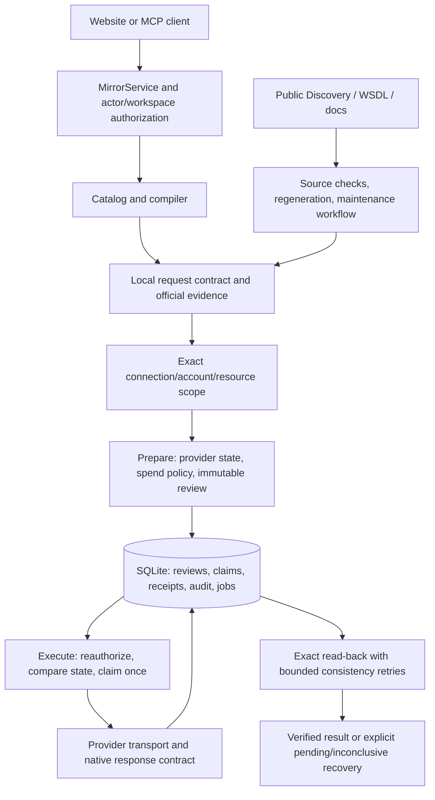

# Platform contracts: research, implementation and verification

Reviewed against the user-supplied **AMCP — Platform Contracts & Integration Guide**, dated 14 September 2026. Its SHA-256 was `be7e88513976a350b1d0770e6c8b5a5c848559314620ee133060d0ceb9fd0dc0`. The document was evidence to investigate, not permission to change provider grants, publish advertisements, apply for access or reset accounts.

Status: implementation and final disposable-release verification complete. Publication is restricted to `Codex-branch`. No live account qualification, remote CI success or deployment is claimed.

## Scope and source of truth

| Item | Verified value |
| --- | --- |
| Implementation root | `C:/Users/abdom/Downloads/AMCP Final With Claude recos - Copy/implementation-Codex-branch` |
| Branch / remote | `Codex-branch` / `https://github.com/magdyezy1/AMCP.git` |
| Original revision | `d8ece0ce91c2fb16fa33371f1cfea7842298cfb5`; initially clean; 380 tracked files |
| Separate development checkout | Parent directory, branch `codex`, `b8b34aa364e9cbae73e7c1e07396101f55744538`; pre-existing changes were not edited |
| Separate release checkout | Parent `.release/AMCP`, branch `codex/amcp-website`, `067871481d79fc59a6cb976d8a13b62d409e283a`; not edited |
| Environment | Windows/PowerShell; Node 24.19.0; npm 11.17.0; TypeScript 7.0.2; built-in Node tests |
| Deployment | Existing Node HTTP/worker application and SQLite persistence; Docker/Railway configuration retained |
| Instructions | No applicable `AGENTS.md` found in this implementation tree or its ancestors |

The implementation checkout is separate from the parent checkout's registered worktrees. Only `Codex-branch` was modified. No production credentials, private databases or unrelated files were read. Public documentation/specification fetches are distinguished from synthetic provider responses throughout this report.

This is a focused implementation follow-up covering the guide's recommendations and affected call paths. It is not a new claim that every existing repository line, website journey or platform has received a manual audit. Generated schemas were inspected structurally and mechanically validated; their entire contents were not manually reviewed.

## Assessment

The existing architecture was worth preserving: compact native gateways, per-account grants, frozen five-minute reviews, durable idempotency, independent spending policy and campaign recovery already provide useful boundaries. The guide correctly identified missing provenance, media readiness and the organization-authored LinkedIn post step. Several of its provider claims were too broad or stale.

The changes connect official contracts to existing operations without equating schema ingestion with permission to write. The most useful functional improvements are the Google v23 date correction, correct REST.li query serialization, a constrained LinkedIn DSC chain, Snapchat creative collection updates, and media handoff verification that cannot turn a successful upload into a duplicate retry.

No P0 exploit was established by this review. The confirmed defects below are material workflow failures, generally P2. The missing LinkedIn post capability blocks an important workflow, but is not evidence that authentication should be bypassed. Public schemas, green fixtures and existing catalog counts do not establish production readiness.

## Guide recommendation decisions

| Guide recommendation | Baseline and decision | Implemented result / remaining boundary |
| --- | --- | --- |
| Google Discovery ingestion | Useful, but not a one-line source addition | Pin v23 Discovery; match all 171 existing native RPCs to official methods, preserve existing 339 delegated mappings, validate nested fields/types/enums/int64 before egress. Five additional official methods remain unexposed. |
| Microsoft six WSDLs | Useful provenance; SOAP cannot safely be treated as JSON Schema | Namespace-aware standard-library parser preserves ordered XSD particles, inheritance, restrictions, qualified references and SOAP actions. Six services / 291 operations are recorded. Existing 24 JSON actions remain independently constrained. |
| Sandbox-backed tests | Full automatic media-to-ad tests require qualified isolation and approved account fixtures | Opt-in X/Microsoft runner uses the actual prepare/execute/verify path, approved fixture digest, persistent run state and isolated-host enforcement. Synthetic runner/restart tests pass. No live job, automatic reset or credential collection was enabled. |
| Deprecation watch | Remote changes should not silently alter execution contracts or make ordinary offline builds network-dependent | Deterministic regeneration/integrity checks in `check`; separate weekly/manual public schema and documentation workflow. Changes, unavailable sources and absent baselines have different result states. |
| Evidence in inspect/help | Accepted | `amcp_contract` in tool help; `contract_evidence` in inspect/prepare; generated [CONTRACTS.md](../CONTRACTS.md). Catalog capture, official source, local fixture and live qualification remain separate. |
| Additional acknowledgement for weaker evidence | Rejected as a substitute for a real contract | Existing role, account, scope, deployment, review, spending and idempotency gates remain mandatory. Acknowledging weak provenance cannot enable unsupported destructive routes. |
| Error taxonomy | Accepted | Contract, grant, provider, state, request/internal categories with owner/remedy and preserved provider details. Partial-write wrappers also carry the taxonomy. A 403 does not identify the missing scope. |
| Read consistency | Accepted with bounded retries on reads only | Up to three exact reads with 250/500 ms backoff for missing or disagreeing state. Persistent disagreement becomes `VERIFICATION_INCONCLUSIVE` with hashes, field paths, attempt count and read-only continuation. X retains its specialized parent-scoped promotion checks. |
| Media handoff | Accepted with an important correction | Persist successful upload before checking availability; `ready` requires the qualified provider read. Pending/read failure never fails or reopens the original mutation claim. Signed LinkedIn download URLs are excluded from status/review projections. |
| Shared write impact | Accepted where consequences are supported | Shared interface retains X blocking/recovery behavior and adds documented Snapchat shared-creative/re-review impact. Unknown attached-ad counts remain null, not zero; no invented automatic replay on other platforms. |
| Google Explorer application | External administrator/provider action | Explain access tier, permission and quota separately. No application was submitted; no assumption that access will be granted. |
| LinkedIn DSC chain | Accepted as a narrow new contract | Exact account/organization/media binding; recorded read/write social scopes; one AVAILABLE image/video with matching owner/author; non-feed PUBLISHED post; exact verified returned URN; later creative created PAUSED. No organic/person-post expansion. |
| Snapchat creative PUT | Official endpoint confirmed; omission resets defaults | Add the existing catalog action to reviewed collection PUT, exact per-ID state reads, unique-ID checks, immutable-field and complete-replacement checks, impact preview and execute/read-back test. Existing JSON Patch remains supported. |
| Meta breaking fields | Investigate endpoint by endpoint | Official v25 documentation confirms legacy campaign inputs to reject locally. No universal ban on `targeting_optimization` or `standard_enhancements` was inferred from historical failures. |
| TikTok identity and payload changes | Guide's blanket flat-body/pixel claims rejected | Official SDK documents native `creatives[]`; existing endpoint-specific contract retained. Reuse an authorized identity. New identity provisioning and Smart+ remain separately unqualified. |

## Architecture and execution paths

- Catalogs describe the discoverable compatibility surface. `compiler.ts` resolves existing actions. Google mapping is native; filtering in `delegated-native.ts` prevents accidentally exposing it as a second delegated surface.
- `write-review.ts`, `scope.ts` and the provider helpers enforce executable contracts independently of catalog descriptions. Credentials remain server-side. Provider names, copy and errors remain untrusted data.
- `transport.ts` uses the same Google JSON transformation for validation and egress, and dedicated REST.li query serialization for LinkedIn. Its production default is unchanged. Sandbox routing is a constructor choice in a development runner, not an MCP input.
- The only new persistence kind is a verified LinkedIn post association in the existing document store. The provider ID is first read using context tied to the completed original review; an unverified create header does not itself establish ownership.
- Media continues to move from Drive through AMCP's server-side transfer/staging pipeline. The client receives identifiers and recovery instructions, not file bytes or private download links. Existing private-Drive authorization, encrypted staging and upload recovery remain in place.

LinkedIn journey: choose account/login and explicitly bound organization → import or bind exact media → confirm AVAILABLE and matching author → prepare/execute non-feed DSC → verify exact returned full URN → prepare/execute PAUSED creative. Every review remains separate, and the user's authorization must cover the actual actions. Product approval, Page role and token grants still require live provider verification.

## Confirmed defects and concrete corrections

| ID / priority | Trigger and previous result | Correction / evidence |
| --- | --- | --- |
| C1 / P2 | Google Search recipe with date-only start/end emitted removed `start_date` / `end_date` fields. Official v23 validation rejects these. High likelihood whenever dates were supplied; campaign creation fails. | [campaign-recipes.ts](../../src/campaign-recipes.ts#L15) emits customer-local `start_date_time` at 00:00:00 and inclusive `end_date_time` at 23:59:59. `google-contracts.test.ts` exercises exact boundaries and official request validation. |
| C2 / P2 | Generic URLSearchParams/JSON encoding of REST.li List/record structures changes finder syntax, causing rejected or incorrect LinkedIn reads. | [linkedin-restli.ts](../../src/linkedin-restli.ts#L39) serializes structural punctuation and encodes scalar leaves. Tests cover nested URNs, literal commas, encoded legacy input, malformed expressions and bounds. |
| C3 / P2 | LinkedIn read-back hardcoded 202605 even when the reviewed mutation selected another version. Different response shapes could falsely fail verification. | [linkedin-version.ts](../../src/linkedin-version.ts#L2) selects and validates the version; verification copies frozen request headers. The full DSC/creative fixture asserts 202609 on every state, write and verification request. This synthetic value does not prove that version's live availability. |
| C4 / P2 | LinkedIn video defaulted to sponsoredAccount ownership, although the Videos API documents Person/Organization ownership. Predictable initialization failure for that default. | Explicit valid owner required, exact organization binding checked before source download when supplied, and repeated during execution. Existing invalid reviews are refused. Media fixtures now use a real-shaped organization grant. |
| C5 / P2 | A successful upload could be presented as ready without proving the asset was usable in the selected account. Exposing the whole LinkedIn status body also returned unnecessary signed URLs. | [media-upload.ts](../../src/media-upload.ts#L188) commits the receipt then checks provider availability. Wrong-ID read returns inconclusive while the mutation remains complete; later status verifies without another upload. Exact status projections omit signed URLs. |
| C6 / P2 | A newly created entity's temporarily missing or stale state was reported as a mismatch without a common bounded read strategy. Users could interpret this as a failed mutation. | [write-verification.ts](../../src/write-verification.ts#L88) retries only reads and retains `VERIFICATION_INCONCLUSIVE`, hashes and field diagnostics. Tests assert three reads and one original mutation under persistent disagreement. |
| C7 / P2 | Catalogued Snapchat creative collection PUT was excluded from the review allowlist. Creation and PATCH support did not make this update usable. Simply enabling sparse PUT would risk resetting fields to defaults. | [write-review.ts](../../src/write-review.ts#L120) and [write-impact.ts](../../src/write-impact.ts) qualify PUT, require immutable identity/type and explicit existing configuration (including nested settings), reject duplicate/missing IDs, read exact targets and preserve the original claim. Full prepare → update → verify → replay fixture passes; omitted false-valued and nested fields are refused before mutation. |
| C8 / P2 | Meta campaign inspection accepted legacy ASC/AAC inputs that current official v25 documentation rejects, delaying an actionable failure until provider execution. | [meta-contracts.ts](../../src/meta-contracts.ts#L5) rejects the two legacy smart-promotion values, the old customer percentage on creation, and read-only Advantage+ state fields on campaign writes. Ordinary objective-based creation still inspects successfully with zero egress. |

LinkedIn `/rest/posts` was a **capability gap**, not evidence of a broken permitted write. The new [linkedin-posts.ts](../../src/linkedin-posts.ts#L9) contract addresses it without broadening `/rest` account authority. Tests reject foreign accounts, broad bindings, another connection's media receipt, absent social scopes, missing/wrong owner, processing media, revoked grants, organic distribution, invented fields and a different full post URN with the same numeric suffix.

Unresolved hypotheses are not promoted to bugs: no live evidence establishes that Snapchat PATCH is globally broken, that the historical LinkedIn 403 identifies one exact permission, that every Meta enhancement field is invalid, or that one TikTok payload/identity pattern works for every campaign product.

## Capability and evidence matrix for this change

All rows are **live-unverified**. The fixture column means isolated local execution, not a vendor account call.

| Area | Implemented / fixture evidence | Prerequisites and limits |
| --- | --- | --- |
| Google Ads v23 | 171 exact RPC mappings; 1,443 schemas / 176 official methods; nested input checks; date recipe correction; original Google write/targeting/media suites | Discovery does not model every business rule or oneof. Existing reviewed families only. Access tier, manager routing, quotas and app/account permission still apply. |
| Microsoft v13 | Six WSDLs, 291 operations; all 24 current JSON action names/top-level fields correspond; parser/integrity tests | CampaignManagement 194, Bulk 6, Reporting 2, AdInsight 34, CustomerManagement 39, CustomerBilling 16 operations. SOAP provenance does not enable Bulk/Billing/media or prove JSON polymorphism. |
| LinkedIn | REST.li serialization; version preservation; receipt → DSC → verified post → PAUSED creative fixture; image/video upload fixtures | Exact organization binding, selected connection/account, recorded social read/write scopes, matching AVAILABLE media. Provider Page/app permissions remain external. Other post types and ownership combinations unqualified. |
| Snapchat | Existing POST/PATCH retained; creative PUT full review/execute/read-back/replay fixture; image/video availability reads | Impact warns that shared creatives affect attached ads and can trigger re-review. Attached-ad enumeration is not implemented by this contract. |
| Meta | Targeted campaign field refusals; original Page/Instagram creative and grant suites; image/video handoff fixtures | Current Advantage+ planning needs user business choices; no automatic migration. Grant versus provider permission stays distinct. |
| TikTok | Existing native `creatives[]` contract and original creative tests retained; image/video availability fixtures | Identity reuse requires authorized provider assets. Identity provisioning, Smart+, and live sandbox account proof remain unqualified. Pixels depend on objective/endpoint. |
| X | Existing creative-in-use guard, library registration, nullcast and promotion contracts retained; account-library handoff and sandbox-runner replay tests | Promotion has no fake paused state. Production upload/social hosts are blocked in sandbox mode. Full live byte-upload chain remains unverified. |
| DV360 | Upload receipt still retained; no readiness claim without a qualified provider availability read | Automatic media handoff remains unqualified (`ready:false`, `status_source:upload_receipt`); do not treat the returned upload ID alone as provider-verified availability. |
| Other registered platforms | Registry/docs retained; existing full local regression suite run | No new platform-specific implementation or live qualification in this follow-up. No claim of expanded Apple, Reddit, GA4, GTM, Search Console, Drive or Sheets capability. |

## Coverage and provenance

- Manually reviewed the attached guide and affected implementation diffs; followed compiler → scope → prepare → execution → receipt → read-back for the new LinkedIn/Snapchat paths and the changed Google/media paths. Reviewed new first-party helper modules, generators, sandbox runner and maintenance workflow. Existing large modules were reviewed by affected paths/diffs, not line-for-line in full.
- The [changed-file coverage ledger](platform-contracts-coverage-2026-09-18.csv) records each modified/added file, review method and evidence. Files outside this change are covered only by the stated regression checks or prior work; this ledger does not silently count them as manually reviewed.
- Reviewed and updated the operator skill plus Google, Meta, Microsoft, LinkedIn/X, TikTok/Snapchat and media references. Added machine-checked inspect examples for DSC and Snapchat PUT; recipe example dates exercise the Google correction.
- Mechanically validated all original catalog generation, guided examples, delegated mappings, new Google method/schema references, WSDL source hashes and normalized models, and generated contract documentation. Existing captured/third-party metadata was not relabelled as independently observed provider behavior.
- Public vendor snapshots contain source URLs, capture times and digests. Google request schemas are used at runtime. Microsoft uses a compact generated operation summary at runtime; the full XSD model supports inspection, regeneration and drift checks. No XML parser runs in production.
- The new WSDL parser uses Python 3.10+ standard library only. CI uses Python 3.12; Docker installs Python only in its build stage. No npm runtime dependency, package-lock change, new service, database migration or framework replacement was introduced.
- New source snapshots are vendor documentation/specifications, not AMCP-authored API definitions. Their source URLs and existing vendor terms continue to apply. Digests detect alteration, not provider correctness or a legal licence grant.

## Verification log

All commands ran in the pinned implementation checkout unless a disposable release path is identified. Test transport fixtures use synthetic identities/IDs/credentials and temporary SQLite stores. No provider mutation was issued.

| Stage / command | Result |
| --- | --- |
| Initial `git fetch origin Codex-branch`; branch/HEAD/worktree inventory | Remote and local identical (0/0); only the requested branch selected. Windows ownership required a per-command exact `safe.directory`, not a global trust change. |
| Baseline `npm.cmd run check` | Exit 0; 520 Node tests: 519 pass, 0 fail, 1 FFmpeg skip; 4 capture tests pass. Log `.runtime/contracts-baseline.log`. |
| Public Google source fetch and `node tools/fetch-vendor-specs.mjs --generate-only` | Official v23 revision 20260917; 1,443 schemas / 176 methods; 510 generated routes (339 existing delegated + 171 native). Three existing unmapped Criteo gaps retained. |
| `node tools/microsoft-specs.mjs` / `--generate-only --check` | Six official WSDLs fetched and reparsed; 291 operations. First parser rejected an element/type sharing a QName; fixed separate XSD symbol spaces. Subsequent regeneration passes. |
| Early focused build/tests | Missing fields in a CompiledRequest fixture corrected. Whole-expression REST.li encoding fixture corrected to preserve the distinction between structural punctuation and encoded leaf commas. No production assertion weakened. |
| First integration `npm.cmd run check` | Exit 1; 530 tests: 518 pass, 11 fail, 1 skip. Log `.runtime/contracts-integration-first.log`. Failures included the real Google date bug, native/delegated route separation, invalid old LinkedIn owner fixtures, X minimal status projection and changed inconclusive/readiness expectations. These remain visible as initial failures. |
| Second integration `npm.cmd run check` | Node tests 537: 536 pass, 0 fail, 1 skip; capture 4/4. Overall exit 1 because guidance coverage required documenting `SANDBOX_ROUTE_UNQUALIFIED`. Added guidance rather than exempting the error. Log `.runtime/contracts-check-second.log`. |
| Focused Google/media/error/WSDL command | 50/50 pass, no skips. Includes completed-upload/read-failure/recovery and exact Google date boundaries. `.runtime/contracts-focused-final.log`. |
| Strengthened media handoff fixtures | 44/44 pass; all 12 image/video paths with a qualified availability read require `ready:true` and provider evidence. The two DV360 paths explicitly retain unverified upload receipts. `.runtime/contracts-media-handoff.log`. |
| Meta/documentation-watch focused tests | 2/2 pass; legacy inputs rejected with zero network requests; unavailable documentation retains its prior baseline digest without claiming a successful fetch. |
| Snapchat focused tests | 7/7 pass, including full creative PUT preparation, impact, mutation, exact read-back and idempotency replay. |
| Final Snapchat replacement / recommendation regressions | 19/19 pass, including omitted false-valued and nested creative fields refused before mutation. Log `.runtime/contracts-snap-replacement.log`. |
| First disposable release | `.release/contracts-20260918`; source-tree hash `c04a0d5a723fffed2d399a1b4b524af7bce0b3dfa8fcce0440966778e3a17b19`; 411 packaged files. Fresh `npm.cmd ci --ignore-scripts --no-audit --no-fund --cache ../../.runtime/npm-cache` installed 107 packages. `npm.cmd run check` passed: 541 tests, 540 pass, 0 fail, 1 FFmpeg skip; capture 4/4. Logs `.runtime/contracts-release-install.log` and `.runtime/contracts-release-check.log`. |
| Full integration `npm.cmd run check` | Exit 0; 540 tests: 539 pass, 0 fail, 1 skip; capture 4/4; guidance/web/provider/contracts checks pass. `.runtime/contracts-check-final.log`. A later additional Snapchat test and documentation generator correction receive final release verification below. |
| `node deploy/check-railway.mjs`; `git diff --check` | Passed. Docker and FFmpeg/ffprobe are not installed/configured on this Windows host. Actual container build/smoke and FFmpeg conversion remain CI requirements. Local deployment HTTP/restart/token-revocation smoke runs in both write modes as part of the Node suite. |
| Final disposable release | `.release/contracts-20260918-final`; source-tree hash `2dc78c3120e3db4062b68dd2a81cb5e9f7c8cfc3ab477cc2286775169db07a58`; 411 packaged files. Fresh `npm.cmd ci --ignore-scripts --no-audit --no-fund --cache ../../.runtime/npm-cache`, then `npm.cmd run check`: exit 0; 541 Node tests, 540 pass, 0 fail, 1 FFmpeg skip; capture 4/4; generation, guidance, web, provider and contract checks pass. Logs `.runtime/contracts-final-release-install.log` and `.runtime/contracts-final-release-check.log`. The final check includes the complete-replacement refusal cases and DSC setup guidance. Only this report was finalized afterwards. |

For WSDL commands on this host, `AMCP_SCHEMA_PYTHON` pointed to `C:/Users/abdom/.cache/codex-runtimes/codex-primary-runtime/dependencies/python/python.exe`; the WindowsApps `python` alias was not usable. The focused command was `node --test dist/tests/google-contracts.test.js dist/tests/media-upload.test.js dist/tests/error-remedy.test.js tests/wsdl-model.test.mjs` after `npm.cmd run build`. The sandbox safety command was `node --test tests/sandbox-safety.test.mjs` (2/2 pass), with no real sandbox credentials supplied.

Public maintenance evidence: final refresh baselined 6 of 9 maintained pages (Google sunset, Microsoft, Meta Marketing, Meta Graph, Snapchat, X). Google release notes and LinkedIn failed in the Node fetch environment; TikTok's portal did not yield usable server-rendered content. Web research could read relevant Google/LinkedIn documentation separately. These failures remain in `lifecycle-pages.json`; they are not successful lifecycle coverage. The initial X `/versions` URL returned 404; the official Ads index identified `/versioning`, which was fetched successfully. Meta's old Marketing docs path redirected to its new `/documentation/ads-commerce/` path; the canonical page was then read successfully. One failed Windows Node fetch exited with a libuv assertion; later bounded canonical fetches succeeded. No account API was involved.

## Research corrections and official references

Sources checked on 18 September 2026 Cairo time (some capture timestamps are still 17 September UTC). Links establish documented behavior, not deployed-account acceptance.

1. [Google v23 Discovery](https://googleads.googleapis.com/$discovery/rest?version=v23), revision 20260917: method/request mapping and schema evidence. [Campaign v23](https://developers.google.com/google-ads/api/reference/rpc/v23/Campaign) documents the new date-time fields and customer timezone. [Sunset schedule](https://developers.google.com/google-ads/api/docs/sunset-dates) lists v23 sunset in February 2027; a newer version existing does not justify an untested automatic upgrade.
2. [Google access levels](https://developers.google.com/google-ads/api/docs/api-policy/access-levels), updated 11 September 2026: access tier and quota require separate operator/provider checks. The guide's proposed application is not a code fix or assurance of approval.
3. [Microsoft service addresses](https://learn.microsoft.com/en-us/advertising/guides/web-service-addresses?view=bingads-13): production/sandbox boundaries. Exact six `singleWsdl` source URLs and digests are in `tools/microsoft-specs.mjs` and `.mirror/VENDOR/microsoft-*-v13.json`. The normalized model deliberately does not claim SOAP-to-JSON equivalence.
4. [LinkedIn protocol 2.0](https://learn.microsoft.com/en-us/linkedin/shared/api-guide/concepts/protocol-version): structured finder serialization. [Videos](https://learn.microsoft.com/en-us/linkedin/marketing/community-management/shares/videos-api?view=li-lms-2026-05), [Posts](https://learn.microsoft.com/en-us/linkedin/marketing/community-management/shares/posts-api?view=li-lms-2026-05) and [post schema](https://learn.microsoft.com/en-us/linkedin/marketing/community-management/shares/post-api-schema?view=li-lms-2026-05) establish owner types, media state and post shape. The qualified AMCP subset requires matching organization owner/author; it does not claim all other combinations are forbidden by LinkedIn.
5. [LinkedIn video-ad flow](https://learn.microsoft.com/en-us/linkedin/marketing/integrations/ads/advertising-targeting/create-and-manage-video?view=li-lms-2026-05) and [landing-page/CTA fields](https://learn.microsoft.com/en-us/linkedin/marketing/integrations/ads-reporting/utm-tracking?view=li-lms-2026-06): non-feed PUBLISHED content precedes the PAUSED creative. A fake paused post would be incorrect. A successful initialization still would not prove the complete post/read/creative chain or all necessary grants.
6. [Snapchat creatives](https://developers.snap.com/marketing-api/Ads-API/creatives): collection PUT and shared-creative effects. Historical PATCH failure is not proof of universal removal. [Snapchat changelog](https://developers.snap.com/marketing-api/Ads-API/changelog) is independently monitored.
7. [Meta v25 Marketing changelog](https://developers.facebook.com/documentation/ads-commerce/marketing-api/marketing-api-changelog/version25.0), page updated 21 May 2026, and [Advantage+ campaign guidance](https://developers.facebook.com/documentation/ads-commerce/marketing-api/advantage-campaigns), updated 17 June 2026: the two legacy smart-promotion modes are no longer valid; new customer-percentage configuration needs a new plan and state flags are read-only. The [Graph/Marketing version table](https://developers.facebook.com/docs/graph-api/changelog/) lists v26 as newer; Graph and Marketing retirement schedules are different. The guide's approximate version-life assertions should not be hardcoded.
8. [TikTok's official SDK AdCreateBody](https://github.com/tiktok/tiktok-business-api-sdk/blob/main/python_sdk/docs/AdCreateBody.md) requires native `creatives[]`, contradicting the guide's universal flat-body advice. TikTok's public [account-linking guide](https://ads.tiktok.com/business/library/TikTok_FIRST_Custom_Identity_Transition_How_To_Guide.pdf) discusses authorization and identity transition; it does not independently qualify a new AMCP identity-create API. No copy of that document is redistributed here.
9. [X Ads sandbox](https://docs.x.com/x-ads-api/fundamentals/sandbox) documents non-serving sandbox campaigns; it does not qualify external media/social hosts. [X versioning](https://docs.x.com/x-ads-api/fundamentals/versioning) and the [official Ads index](https://docs.x.com/x-ads-api/llms.txt) identify the current documentation route.

## Compatibility, rollout and rollback

1. Keep the current database and encryption key. This change uses existing document/idempotency tables; there is no schema migration. Do not discard receipts or reset claims during upgrade or rollback.
2. Deploy only after release CI completes the Docker build, FFmpeg test and both container smoke modes. This task pushes source to `Codex-branch`; it does not deploy Railway or change Cloudflare. The new Python requirement applies to generation/build checks only.
3. Inspect representative existing requests first. Correct old, unsubmitted Google plans that contain removed date fields, then prepare new reviews. Do not rewrite frozen or submitted requests. Invalid legacy LinkedIn video-owner reviews are intentionally refused.
4. Clients must distinguish upload completion from `ready` and follow `next_call`. `inconclusive` verification is recoverable by reading the original review; it is never a reason to repeat the write. New evidence/remedy fields are additive. REST.li scalar escaping remains tested for compatibility with existing string expressions.
5. Organization/media bindings remain exact, administrator-controlled and connection/account-specific. Normal LinkedIn OAuth defaults stay advertising-only. After provider permission approval, use the existing `AMCP_LINKEDIN_SCOPES` override with the required advertising and social scopes and reconnect; an override does not retroactively upgrade tokens. The operator guide and `.env.example` describe this opt-in setup. No broad `/rest` binding or permission bypass is needed.
6. GitHub scheduled workflows execute from the default branch. A push solely to `Codex-branch` does not activate weekly maintenance on main. Manual workflow execution/review remains possible where GitHub exposes that workflow; no default-branch change is part of this work.
7. If rollback is necessary, first stop preparing new DSC/creative updates and retain original reviews/receipts. Older code will not understand the new DSC contract and cannot be relied on to reconcile those operations; finish reconciliation on a compatible release. Do not downgrade merely to bypass stricter validation or reset uncertain outcomes.

## Remaining work and measurable acceptance

| Priority / effort | Work and dependency | Acceptance / recovery criteria |
| --- | --- | --- |
| P1 release gate / small | Run existing Linux CI with Docker and FFmpeg; requires runner capacity, not advertising credentials | Fresh release assembly, `npm ci`, complete checks including real conversions, container non-root/storage/restart/auth smoke in both write modes; exact tested source/image digest retained. |
| P1 workflow qualification / medium | LinkedIn staging account, explicit organization/media bindings and provider product/Page/token permissions; administrator-managed | One approved media → DSC → PAUSED creative flow read back under the same login/account/version. Simulate delayed reads and verify no duplicate post/upload. Record live request IDs without secrets. Do not activate ads during qualification. |
| P2 maintenance coverage / small–medium | Review the three unavailable lifecycle sources and assign an integration maintainer | All nine public sources have reviewed baselines or a documented manual subscription/check procedure. Source failures remain visible. Detect a deliberate schema/operation/action change without altering runtime pins automatically. |
| P2 sandbox live evidence / medium | Approved synthetic X/Microsoft fixtures, dedicated credentials and persistent runner | Run the opt-in fixture twice using the same run ID: one logical mutation per step, exact verified state, no production host, retained receipts after interruption. No account deletion/reset. |
| P2 media completeness / medium | Document and qualify DV360 availability and any alternative media-owner contracts before expanding support | Provider-specific proof that returned media is usable by the intended creative/account, tested delayed/denied/expired cases; no readiness claim from an opaque ID alone. |
| P2 isolation expansion / medium | Google/TikTok test-account detection contracts and approved credentials | Fail before mutation if test-account identity cannot be established. Test genuine test account, production account, inaccessible account and changed credential. Hostname alone is insufficient. |
| P2 product design / medium | Reusable organization/identity setup diagnostics and optional task-oriented campaign recipe, after the new chain has live evidence | Discover existing authorized inputs before asking; ask only missing business facts; show precise grant versus provider prerequisites; every child waits for verified parent/media; resumable failures never duplicate existing resources. |
| P3 integration expansion / large, per family | New Microsoft JSON operations, TikTok identity provisioning/Smart+, or additional DSC formats require exact official contracts and provider eligibility | Separate fixtures, negative cases, response envelopes, scope, spend, read-back and recovery tests for each family. WSDL/catalog enumeration alone must not turn them on. |

The operating method should be: requirements and exact supported subset → official versioned source → realistic positive/negative fixtures → local review/authorization/recovery checks → isolated live qualification → release evidence. Maintain contract versions and examples together, and use changed-field diagnostics and original receipts as the recovery interface. This is implementable incrementally within the current architecture.
