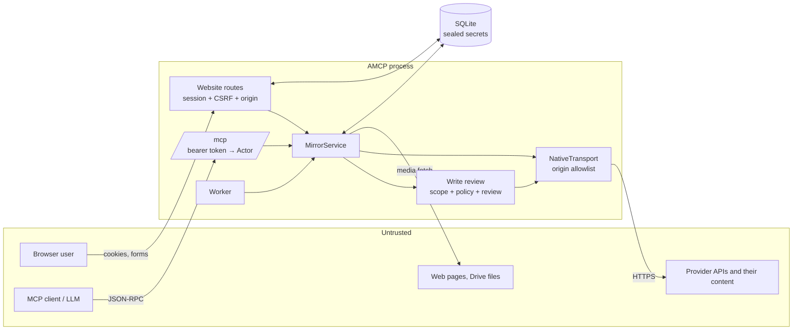
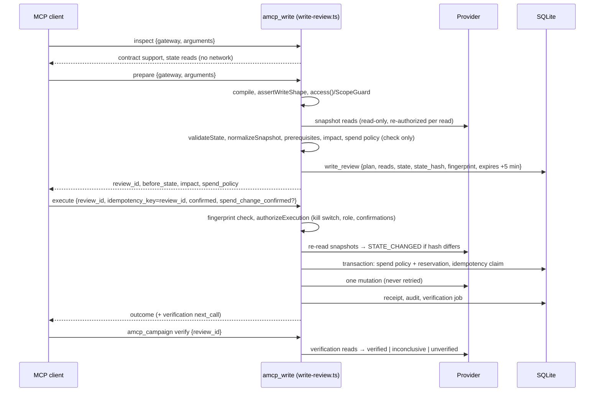

# AMCP architecture

This is the module map, request lifecycle and trust-boundary view of AMCP as of `Codex-branch`
at `03ac8d3` (2026-09-28). It describes what the code does today; line numbers refer to that
revision. For generated contract facts (pinned versions, reviewed scope) `docs/CONTRACTS.md`
stays the source of truth.

## 1. Runtime shape

One Node.js 24 process (`dist/server/http.js`) hosts three things:

| Component | Entry | What it does |
|---|---|---|
| Website | `server/website.ts` + `web/` | Accounts, MFA, sessions, platform OAuth, account selection, MCP connector page, policies, plans, reporting |
| MCP endpoint | `server/http-app.ts` (`POST /mcp`) → `server/mcp.ts` | Stateless Streamable HTTP; bearer token → `Actor`; every tool call goes to `MirrorService.call` |
| Worker loop | `server/http.ts` (`ReportWorker`) | Report jobs, scheduled exports, write verification jobs, e-mail outbox |

`server/stdio.ts` is the local stdio MCP variant with the same `MirrorService`. State lives in one
SQLite file (`MIRROR_DB`, `/data/mirror.sqlite` on Railway) opened through `node:sqlite`
(`src/store.ts`, `server/web-store.ts`).

## 2. Module map

```
server/                         website, OAuth, MCP transport, worker loop
  http.ts ─ http-app.ts ─ mcp.ts ─────────────┐
  website.ts, user-accounts.ts, account-*.ts   │
  platform-oauth.ts, social-signin.ts,         │
  mcp-oauth.ts, web-store.ts                   │
                                               ▼
src/service.ts  MirrorService.call(tool, input, actor)
  ├─ catalog.ts (Registry: generated/registry.json, validation, help)
  ├─ compiler.ts / delegated-native.ts (tool args → CompiledRequest)
  ├─ execution-risk.ts (readOnly / destructive classification)
  ├─ preflight.ts (authorizeExecution: kill switch, role, confirmations)
  ├─ scope.ts (ScopeGuard: account + resource grants, ownership bindings)
  ├─ transport.ts (NativeTransport: origin allowlist, retries for reads, limits)
  ├─ auth.ts (CredentialProvider: sealed tokens, refresh)
  ├─ write-review.ts (amcp_write: inspect / prepare / execute)
  │    ├─ reviewed-routes.ts (route → family name; also used by the ledger)
  │    ├─ review-state.ts (snapshot normalization, state hash)
  │    ├─ write-impact.ts (impact summaries)
  │    ├─ spend-policy.ts + policy-decimal.ts (owner spending policies)
  │    └─ 148 family modules (x-entity-batches.ts, google-business-lodging.ts, …)
  ├─ write-verification.ts (amcp_campaign verify: read-back comparison)
  ├─ media-upload.ts, media-routing.ts (amcp_media, Drive transfer, FFmpeg)
  ├─ workflows.ts, campaign-runner.ts, campaign-preflight.ts (plans)
  ├─ reporting*.ts, report-*.ts, decision-reporting.ts, google-sheets.ts
  ├─ workspace.ts (readiness, spend policies, contracts listing)
  └─ store.ts (SQLite: tenants, connections, documents, idempotency, jobs, audit)
```

Generated inputs (never hand-edited): `generated/registry.json` (5.5 MB, captured tools and
actions), `generated/vendor-routes.json` (5.9 MB, routes from pinned vendor documents),
`generated/microsoft-contracts.json` (6.6 MB, WSDL-derived), `generated/types.ts`.
Ledgers and `docs/CONTRACTS.md` are produced by `tools/action-contracts.ts` and
`tools/generate-contracts.ts`.

## 3. Trust boundaries



| Boundary | Crossing | Control (where) |
|---|---|---|
| Browser → website | cookie session, form/JSON posts | session cookie, CSRF token, `Origin` check, MFA (`server/website.ts`, `server/web-store.ts`, `server/account-security.ts`) |
| MCP client → `/mcp` | bearer token | `store.authenticate` (hashed token, expiry, revocation), `Origin` pinned to public origin (`server/http-app.ts:48-70`) |
| Actor → tenant data | every tool call | `Actor.tenantId` on every store query; `assertActorActive` on every call (`src/service.ts:116-120`) |
| Actor → provider account | per request | `store.resolveConnection` + `ScopeGuard.authorize` (selected accounts, resource grants, ownership bindings) |
| Server → provider | HTTPS | `NativeTransport` origin allowlist, per-family read-only checks for snapshot reads (`applyExecutionRisk(read).readOnly`) |
| Provider content → LLM | tool output | `meta.untrusted_provider_content` label on every tool except `amcp_tool_help` (`src/service.ts:81-88`, `wrap`) |
| Money | reviewed writes only | kill switch, role, review, confirmations, spending policy, idempotency claim (§4) |
| Secrets at rest | SQLite | AES-256-GCM sealing with scoped additional data (`src/security.ts`), hashed bearer/session tokens |

A compromised MCP client is the most important adversary model: it holds an operator token and
can call any tool with any arguments. Everything below `MirrorService.call` must therefore be
safe for arbitrary, adversarial input from an authenticated operator; the owner's spending policy
and the review/confirmation protocol are the controls that still apply to that actor.

## 4. Reviewed write lifecycle



Code anchors (formatted line numbers differ; search by name):

| Stage | Function | File |
|---|---|---|
| Input guard | `WriteReviewService.call` (unknown keys, delegated vs direct) | `src/write-review.ts` |
| Compile | `Compiler.compile` / `DelegatedNativeCompiler.compile` → `applyExecutionRisk` | `src/compiler.ts`, `src/delegated-native.ts`, `src/execution-risk.ts` |
| Membership | `reviewedWriteFamily(plan)` | `src/reviewed-routes.ts` |
| Validation | `assertWriteShape(plan)` (chain of family `assert…`) | `src/write-review.ts` |
| Scope | `access()` → `resolveConnection`, `assertAccountWrite`, family scope asserts, `ScopeGuard.authorize` | `src/write-review.ts`, `src/scope.ts` |
| Snapshot plan | `snapshotPlans(plan)` (chain of family `…Snapshots`) | `src/write-review.ts` |
| Snapshot read | `state()` (family readers, then an 83-level nested reader chain) | `src/write-review.ts` |
| Normalize | `validateState`, `normalizeSnapshot`, `reviewStateHash` | `src/write-review.ts`, `src/review-state.ts` |
| Prerequisites | ~100 unconditional `…Prerequisites(plan, values)` calls | `src/write-review.ts` |
| Impact | `writeImpact` (chain) | `src/write-impact.ts` |
| Policy | `checkSpendPolicy` (activation, deletion, budget amounts, daily reservation) | `src/spend-policy.ts` |
| Confirmation | `authorizeExecution` (per-family spend confirmations, generic text match) | `src/preflight.ts` |
| Execute | `transport.request` once; `writeOutcome` + `confirmedMutationResult` (chain) | `src/write-review.ts` |
| Verify | `WriteVerifier.verify` (`verificationReads`, `observed`, nested reader chain) | `src/write-verification.ts` |

Invariants the lifecycle maintains (all verified in code; see `FINDINGS.md` for exceptions):

1. A non-read provider request can only be sent by `amcp_write execute` or `amcp_media`
   (`runPlan` throws `WRITE_REVIEW_REQUIRED` for any non-read plan, `src/service.ts` `runPlan`).
2. Execute uses the plan frozen at prepare; its fingerprint binds tenant, user, connection and
   plan; `arguments` at execute are refused.
3. The idempotency key equals the review id and is claimed inside the same SQLite transaction as
   the spend reservation; a claimed key is never re-sent (`WRITE_OUTCOME_UNCERTAIN`).
4. Snapshot reads are re-read at execute; any normalized difference refuses with `STATE_CHANGED`.
5. The mutation is sent once; the outcome is stored before any post-response permission check.
6. `verified` needs every expected field to match a read-back; otherwise `inconclusive`.

## 5. Family wiring (why adding one is expensive)

A reviewed family is one module that exports some of: `…Kind`, `assert…`, `…Snapshots`,
`read…`, `is…Read`, `validate…State`, `…Prerequisites`, `…Impact`, `…Outcome`,
`…Verification`, `…Observed`, `authorize…`, `…PolicyAmounts`, `…NeedsConfirmation`. The core
dispatches each hook through hand-written, order-sensitive `if (xKind(plan)) return …` chains:

| Chain | File | Entries |
|---|---|---|
| route → family name | `src/reviewed-routes.ts` | 130+ |
| outcome | `src/write-review.ts` (`confirmedMutationResult`) | 120+ |
| state validation | `src/write-review.ts` (`validateState`) | 100+ |
| shape assertion | `src/write-review.ts` (`assertWriteShape`) | 100+ |
| snapshot plans | `src/write-review.ts` (`snapshotPlans`) | 100+ |
| scope asserts | `src/write-review.ts` (`access`), `src/write-verification.ts` | 60+ each |
| nested readers | `src/write-review.ts`, `src/write-verification.ts` | 83 levels each |
| prerequisites | `src/write-review.ts` | ~100 calls |
| impact | `src/write-impact.ts` | 100+ |
| normalization | `src/review-state.ts` (`normalizeSnapshot`) | 90+ |
| scope authorize | `src/scope.ts` | 80+ |
| spend exemptions / confirmations | `src/preflight.ts` | 80 exemptions, 40 confirmations |
| activation / policy amounts | `src/spend-policy.ts` | 45 + 11 |
| ledger metadata | `src/action-contracts.ts`, `src/provider-contracts.ts` | 148 |

The typed registry (`src/reviewed-families.ts`, see `docs/ADDING-A-REVIEWED-FAMILY.md`) replaces
these chains for migrated families; `ROADMAP.md` tracks the migration.

## 6. Data model (SQLite)

`src/store.ts`: `tenants`, `workspace_memberships`, `connections` (sealed credentials),
`documents (tenant_id, kind, id, data, revision)` — reviews, policies, plans, receipts,
reservations —, `idempotency (tenant_id, key, fingerprint, state, result)`, `jobs` (leases),
`audit` (hash chain per tenant), `resource_ownership`, `api_keys` (hashed MCP tokens),
`media_*`, `service_locks`, `provider_cooldowns`.
`server/web-store.ts`: `amcp_users`, `amcp_identities`, `amcp_web_sessions` (hashed),
`amcp_login_limits`, `amcp_oauth_states` (sealed), `amcp_mcp_clients`, `amcp_mcp_grants`,
`amcp_account_challenges`, `amcp_email_outbox`, `amcp_mfa` (sealed secret, hashed recovery codes).

Every tenant-owned table carries `tenant_id` in its primary key or first index column.

## 7. Measured baseline (2026-09-28, Linux container, Node 24.21.0)

| Measure | Value | How |
|---|---|---|
| Build (`tsc -p tsconfig.json`, TypeScript 7.0.2) | 5.1 s wall | `time node node_modules/typescript/bin/tsc -p tsconfig.json` |
| Cold start to constructed runtime | 1.08–1.14 s (import 0.32–0.38 s, construct 0.74–0.79 s) | `createRuntime()` from `dist/server/runtime.js`, 3 runs |
| Memory after start | RSS 197 MB, heap used 68 MB | same script |
| Source size | `src/` 3.65 MB in 263 modules (100,847 lines once formatted at 120 columns vs 31,750 today) | Prettier copy in scratch |

Full-check timing and counts are in `PROGRESS.md`.
