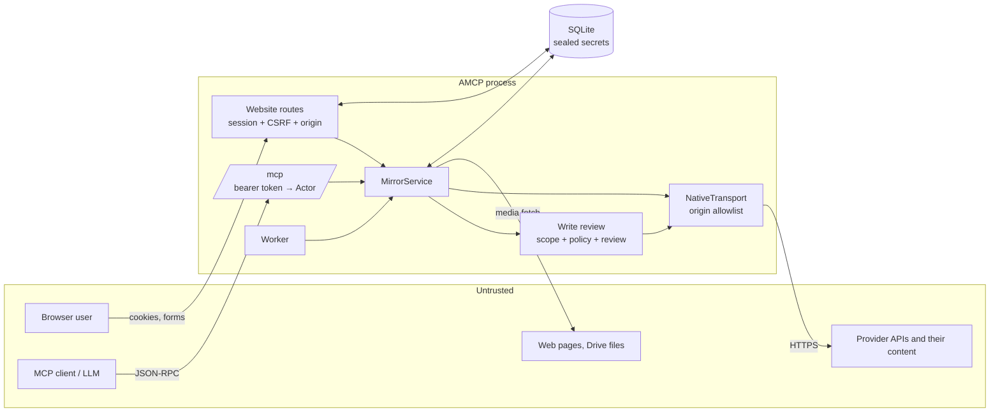
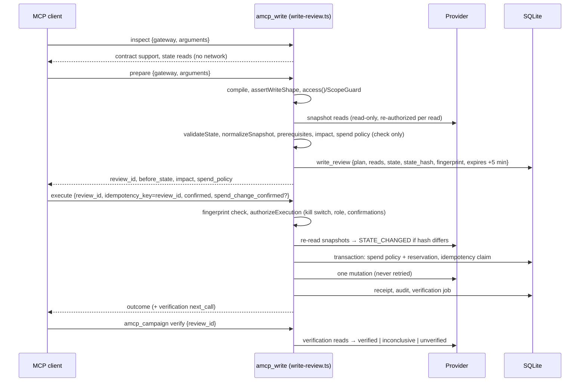

# AMCP architecture

This is the module map, request lifecycle and trust-boundary view of AMCP as of `Codex-branch`
at `03ac8d3` (2026-09-28). It describes what the code does today; line numbers refer to that
revision. For generated contract facts (pinned versions, reviewed scope) `docs/CONTRACTS.md`
stays the source of truth.

## 1. Runtime shape

One Node.js 24 process (`dist/server/http.js`) hosts three things:

| Component | Entry | What it does |
|---|---|---|
| Website | `server/website.ts` + `web/` | Accounts, MFA, sessions, platform OAuth, account selection, MCP connector page, policies, plans, reporting |
| MCP endpoint | `server/http-app.ts` (`POST /mcp`) → `server/mcp.ts` | Stateless Streamable HTTP; bearer token → `Actor`; every tool call goes to `MirrorService.call` |
| Worker loop | `server/http.ts` (`ReportWorker`) | Report jobs, scheduled exports, write verification jobs, e-mail outbox |

`server/stdio.ts` is the local stdio MCP variant with the same `MirrorService`. State lives in one
SQLite file (`MIRROR_DB`, `/data/mirror.sqlite` on Railway) opened through `node:sqlite`
(`src/store.ts`, `server/web-store.ts`).

## 2. Module map

```
server/                         website, OAuth, MCP transport, worker loop
  http.ts ─ http-app.ts ─ mcp.ts ─────────────┐
  website.ts, user-accounts.ts, account-*.ts   │
  platform-oauth.ts, social-signin.ts,         │
  mcp-oauth.ts, web-store.ts                   │
                                               ▼
src/service.ts  MirrorService.call(tool, input, actor)
  ├─ catalog.ts (Registry: generated/registry.json, validation, help)
  ├─ compiler.ts / delegated-native.ts (tool args → CompiledRequest)
  ├─ execution-risk.ts (readOnly / destructive classification)
  ├─ preflight.ts (authorizeExecution: kill switch, role, confirmations)
  ├─ scope.ts (ScopeGuard: account + resource grants, ownership bindings)
  ├─ transport.ts (NativeTransport: origin allowlist, retries for reads, limits)
  ├─ auth.ts (CredentialProvider: sealed tokens, refresh)
  ├─ write-review.ts (amcp_write: inspect / prepare / execute)
  │    ├─ reviewed-routes.ts (route → family name; also used by the ledger)
  │    ├─ review-state.ts (snapshot normalization, state hash)
  │    ├─ write-impact.ts (impact summaries)
  │    ├─ spend-policy.ts + policy-decimal.ts (owner spending policies)
  │    └─ 148 family modules (x-entity-batches.ts, google-business-lodging.ts, …)
  ├─ write-verification.ts (amcp_campaign verify: read-back comparison)
  ├─ media-upload.ts, media-routing.ts (amcp_media, Drive transfer, FFmpeg)
  ├─ workflows.ts, campaign-runner.ts, campaign-preflight.ts (plans)
  ├─ reporting*.ts, report-*.ts, decision-reporting.ts, google-sheets.ts
  ├─ workspace.ts (readiness, spend policies, contracts listing)
  └─ store.ts (SQLite: tenants, connections, documents, idempotency, jobs, audit)
```

Generated inputs (never hand-edited): `generated/registry.json` (5.5 MB, captured tools and
actions), `generated/vendor-routes.json` (5.9 MB, routes from pinned vendor documents),
`generated/microsoft-contracts.json` (6.6 MB, WSDL-derived). The unused `generated/types.ts` is no longer generated
(MCP-07); the AMCP tools' per-action contracts are `src/first-party-contracts.ts`.
Ledgers and `docs/CONTRACTS.md` are produced by `tools/action-contracts.ts` and
`tools/generate-contracts.ts`. `npm run provenance` lists every generated artifact with its generator, inputs and the
check that fails when it is stale or edited by hand (ARC-03); the registry's inputs are those of the frozen captured
catalog, whose withheld capture files are declared in `.mirror/RAW/WITHHELD.json`. `generated/route-anchors.json`
records what each route's method and path rest on, separately from the captured names it keeps for compatibility.

## 3. Trust boundaries



| Boundary | Crossing | Control (where) |
|---|---|---|
| Browser → website | cookie session, form/JSON posts | session cookie, CSRF token, `Origin` check, MFA (`server/website.ts`, `server/web-store.ts`, `server/account-security.ts`) |
| MCP client → `/mcp` | bearer token | `store.authenticate` (hashed token, expiry, revocation), `Origin` pinned to public origin (`server/http-app.ts:48-70`) |
| Actor → tenant data | every tool call | `Actor.tenantId` on every store query; `assertActorActive` on every call (`src/service.ts:116-120`) |
| Actor → provider account | per request | `store.resolveConnection` + `ScopeGuard.authorize` (selected accounts, resource grants, ownership bindings) |
| Server → provider | HTTPS | `NativeTransport` origin allowlist, per-family read-only checks for snapshot reads (`applyExecutionRisk(read).readOnly`) |
| Provider content → LLM | tool output | `meta.untrusted_provider_content` label on every tool except `amcp_tool_help` (`src/service.ts:81-88`, `wrap`) |
| Money | reviewed writes only | kill switch, role, review, confirmations, spending policy, idempotency claim (§4) |
| Secrets at rest | SQLite | AES-256-GCM sealing with scoped additional data (`src/security.ts`), hashed bearer/session tokens |

A compromised MCP client is the most important adversary model: it holds an operator token and
can call any tool with any arguments. Everything below `MirrorService.call` must therefore be
safe for arbitrary, adversarial input from an authenticated operator; the owner's spending policy
and the review/confirmation protocol are the controls that still apply to that actor.

## 4. Reviewed write lifecycle



Code anchors (formatted line numbers differ; search by name):

| Stage | Function | File |
|---|---|---|
| Input guard | `WriteReviewService.call` (unknown keys, delegated vs direct) | `src/write-review.ts` |
| Compile | `Compiler.compile` / `DelegatedNativeCompiler.compile` → `applyExecutionRisk` | `src/compiler.ts`, `src/delegated-native.ts`, `src/execution-risk.ts` |
| Membership | `reviewedWriteFamily(plan)` | `src/reviewed-routes.ts` |
| Validation | `assertWriteShape(plan)` (the family's `assert`, which may run the gateway's checks) | `src/write-shape.ts` |
| Scope | `access()` → the family's `actor`, `resolveConnection`, `assertAccountWrite`, the family's `scope`, `ScopeGuard.authorize` | `src/write-review.ts`, `src/scope.ts` |
| Snapshot plan | `snapshotPlans(plan)` (the family's `snapshots`, or its `state` reads the whole state) | `src/write-snapshots.ts` |
| Snapshot read | `state()` (`readThroughFamilies`: every registered reader, then the transport) | `src/write-review.ts` |
| Normalize | `validateState`, `normalizeSnapshot`, `reviewStateHash` | `src/write-state.ts`, `src/review-state.ts` |
| Prerequisites | the family's `prerequisites` and `stateChecks`, and the gateway's paused-parent checks | `src/write-review.ts` |
| Impact | `writeImpact` (the family's `impact`, else the gateway's) | `src/write-impact.ts` |
| Policy | `checkSpendPolicy` (activation, deletion, budget amounts, daily reservation) | `src/spend-policy.ts` |
| Confirmation | `authorizeExecution` (per-family spend confirmations, generic text match) | `src/preflight.ts` |
| Execute | `transport.request` once; `writeOutcome` (the family's `outcome`, `receipt`, `safeOutcome`) | `src/write-review.ts`, `src/write-outcome.ts` |
| Verify | `WriteVerifier.verify` (the family's `verify`, or `verificationReads`, `observed` and `readThroughFamilies`) | `src/write-verification.ts`, `src/verification-reads.ts` |

Invariants the lifecycle maintains (all verified in code; see `FINDINGS.md` for exceptions):

1. A non-read provider request can only be sent by `amcp_write execute` or `amcp_media`
   (`runPlan` throws `WRITE_REVIEW_REQUIRED` for any non-read plan, `src/service.ts` `runPlan`).
2. Execute uses the plan frozen at prepare; its fingerprint binds tenant, user, connection and
   plan; `arguments` at execute are refused.
3. The idempotency key equals the review id and is claimed inside the same SQLite transaction as
   the spend reservation; a claimed key is never re-sent (`WRITE_OUTCOME_UNCERTAIN`).
4. Snapshot reads are re-read at execute; any normalized difference refuses with `STATE_CHANGED`.
5. The mutation is sent once; the outcome is stored before any post-response permission check.
6. `verified` needs every expected field to match a read-back; otherwise `inconclusive`.

## 5. Family wiring (why adding one is expensive)

A reviewed family is one module that exports some of: `…Kind`, `assert…`, `…Snapshots`,
`read…`, `is…Read`, `validate…State`, `…Prerequisites`, `…Impact`, `…Outcome`,
`…Verification`, `…Observed`, `authorize…`, `…PolicyAmounts`, `…NeedsConfirmation`. The core
dispatches each hook through hand-written, order-sensitive `if (xKind(plan)) return …` chains:

| Chain | File | Entries |
|---|---|---|
| route → family name | `src/reviewed-routes.ts` | 130+ |
| outcome | `src/write-outcome.ts` (`confirmedMutationResult`) | 120+ |
| state validation | `src/write-state.ts` (`validateState`) | 100+ |
| shape assertion | `src/write-shape.ts` (`assertWriteShape`) | 100+ |
| snapshot plans | `src/write-snapshots.ts` (`snapshotPlans`) | 100+ |
| scope asserts | `src/write-review.ts` (`access`), `src/write-verification.ts` | 60+ each |
| nested readers | `src/write-review.ts`, `src/write-verification.ts` | 83 levels each |
| prerequisites | `src/write-review.ts` | ~100 calls |
| impact | `src/write-impact.ts` | 100+ |
| normalization | `src/review-state.ts` (`normalizeSnapshot`) | 90+ |
| scope authorize | `src/scope.ts` | 80+ |
| spend exemptions / confirmations | `src/preflight.ts` | 80 exemptions, 40 confirmations |
| activation / policy amounts | `src/spend-policy.ts` | 45 + 11 |
| ledger metadata | `src/action-contracts.ts`, `src/provider-contracts.ts` | 148 |

The typed registry replaces these chains family by family. Each family module declares one `ReviewedFamily`
(`src/reviewed-family.ts`) and `src/reviewed-families.ts` lists it; every chain above consults the registry once,
at the position of the first line it replaced, so the order of the lines still in the chain is unchanged.
`familyOf` refuses a request two registered families claim (`REVIEWED_FAMILY_CONFLICT`), and the nested reader
chains start with `readThroughFamilies`, which composes every registered reader. Pass 1 registered 41 families
and removed 734 lines of wiring from the ten lifecycle modules; pass 2 registered 16 more and removed another 310
(57 families; reader chains 83 → 42 → 26 and 80 → 39 → 23 levels; named spend-match exemptions 83 → 45 → 32).
Pass 3 (batch 31) registered 12 more, including the Snapchat families pass 2 left, and removed another 522 lines
(71 families; 27 → 17 and 23 → 13 nested readers; named exemptions 32 → 20). Its proof replays 46,187 distinct calls
of eleven lifecycle functions, recorded while the full suite ran on the previous commit, through the new build: 0
differences. Authorization is not among them, so its order was checked by hand: every authorizer the moved ones now
follow is guarded by another gateway, kind or read marker.

Pass 4 (batch 33) registered the other 72, so all 143 reviewed families are registered and the table above is
history: each stage consults the registry once and keeps only gateway logic (ADDING-A-REVIEWED-FAMILY.md, "Outside
the registry"). It removed 2,901 lines from the fifteen lifecycle modules (267 added) and both reader chains. A
family now owns what the chains could not express: whole-state reads, follow-up reads, actor checks, report-job
admission and receipts, preview delivery and its own verification. The lifecycle passes a family its read builders
and gateway fallbacks as arguments, so no family module imports a lifecycle module for them. The proof replays
46,614 distinct calls of thirteen functions (the eleven, plus spend-policy's activation decision and family amounts,
extracted as pure functions in the baseline too): 0 unintended differences; the 130 others are the two intended
ones (preview and X report redaction now inside `writeOutcome`, applied at the same point of execute; two LinkedIn
spend messages that now name `spend_change_confirmed=true`). The stateful stages (scope, review, verification) are
covered by the full suite, and the scope order by checking every generic authorizer's predicate against every family
request in the capture: none matches one.
`docs/ADDING-A-REVIEWED-FAMILY.md` is the guide, `ROADMAP.md` tracks the rest.

Families whose state reads need their own login binding or observation read through one guarded reader per side
(`WriteReviewService.guardedReader`, `WriteVerifier.guardedReader`, batch 17): the read must be read-only, and the
actor, connection and scope guard are checked again before the credentials are fetched, after, and after the
response; a family may add an actor or connection check, a login binding and an `after` step.

## 6. Data model (SQLite)

`src/store.ts`: `tenants`, `workspace_memberships`, `connections` (sealed credentials),
`documents (tenant_id, kind, id, data, revision)` — reviews, policies, plans, receipts,
reservations —, `idempotency (tenant_id, key, fingerprint, state, result)`, `jobs` (leases),
`audit` (hash chain per tenant), `resource_ownership`, `api_keys` (hashed MCP tokens),
`media_*`, `service_locks`, `provider_cooldowns`.
`server/web-store.ts`: `amcp_users`, `amcp_identities`, `amcp_web_sessions` (hashed),
`amcp_login_limits`, `amcp_oauth_states` (sealed), `amcp_mcp_clients`, `amcp_mcp_grants`,
`amcp_account_challenges`, `amcp_email_outbox`, `amcp_mfa` (sealed secret, hashed recovery codes).

Every tenant-owned table carries `tenant_id` in its primary key or first index column.

## 7. Measured baseline (2026-09-28, Linux container, Node 24.21.0)

| Measure | Value | How |
|---|---|---|
| Build (`tsc -p tsconfig.json`, TypeScript 7.0.2) | 5.1 s wall | `time node node_modules/typescript/bin/tsc -p tsconfig.json` |
| Cold start to constructed runtime | 1.08–1.14 s (import 0.32–0.38 s, construct 0.74–0.79 s) | `createRuntime()` from `dist/server/runtime.js`, 3 runs |
| Memory after start | RSS 197 MB, heap used 68 MB | same script |
| Source size | `src/` 3.65 MB in 263 modules (100,847 lines once formatted at 120 columns vs 31,750 today) | Prettier copy in scratch |

After batch 22 (F-64), measured the same way at `066739d` on 4 CPUs, median of 5: `createRuntime()` in 398 ms (import
252 ms, construction 147 ms; 860 ms before the change, when the code had grown since this baseline), RSS 146 MB, heap
used 68 MB. Generated artifacts are parsed once per process and frozen (`src/pinned-json.ts`), and tool validators
compile on first use.

Full-check timing and counts are in `PROGRESS.md`.

## 8. Architecture ratchet

`tools/architecture-map.mjs` (ARC-01 phase A, ARC-04 stage A; owner decision D26) measures the compiled backend and
compares it with `docs/review/architecture-baseline.json`. `npm run architecture:check` runs in `npm run check`, in the
qualification fast gate and in `npm run test:related`; `tests/architecture-map.test.mjs` holds its rules. It reads the
static imports of `dist/src` and `dist/server` (what Node evaluates: tsc elides type-only imports, and a dynamic
`import()` is not an evaluation edge) and the source text of `src/` and `server/`.

| Measurement (ratcheted) | What it counts |
|---|---|
| `largest_runtime_scc`, `cyclic_modules` | Modules in the largest runtime import cycle, and in any cycle |
| `shared_modules_with_gateway_literals` | Shared modules (outside the provider filename groups `meta-*`, `tiktok-*`, ...) that name a provider gateway in a string literal |
| `shared_to_provider_runtime_imports` | Runtime imports from any shared `src/` or `server/` module into a provider module |
| `local_fail_copies` | Modules that declare their own `fail` helper instead of the family kit's (§13); 0 since ARC-04 stage C |

A measurement may fall or stay. One that rises fails the check, and so does a module that joins a runtime import cycle,
even when another cycle shrinks by as much. The number of gateway literals in shared modules is reported only.
`node tools/architecture-map.mjs --write` records the current state after an intended improvement, or after a
regression the owner accepted; the commit says which. It also writes the table below from the recorded baseline (owner
direction P11: this document is partly generated), and the check fails when the table shows another baseline than the
recorded one. The review's "core to provider" count
(220 at `60ec2cc`) counted 28 core modules; `shared_to_provider_runtime_imports` counts every shared module, so its value
is larger and is compared only with its own baseline. The provider adapter registry (`src/provider-adapters.ts`, §9)
names every gateway on purpose, so the ratchet counts it with the provider modules, and an import of it is not counted
as coupling; so are the portfolio adapter registry (`src/portfolio.ts`, §11) and the report source registry
(`src/report-sources.ts`, §12), which import one module per provider so that shared code consults them. Counting them
as registries lowered `shared_to_provider_runtime_imports` from 500 to 493 by classification alone: the seven portfolio
imports, which `src/portfolio.ts` made before it became the registry, are no longer counted. The wave 3b merge recorded
88 and 496 (87 and 493 on the ARC-01/ARC-04 branch) for two packages built beside the ratchet on the same base, so
neither had run against it: ARC-02's tenant-bound repositories hold SQL that names gateways
(`src/workbook-repository.ts`, the workbook query projections; `src/audit-repository.ts`, the Google Ads legacy-alias
query that left `src/legacy-alias-usage.ts`), and CMP-03's Microsoft location lookup (`src/microsoft-locations.ts`) is
imported by `campaign-runner.ts`, `recipe-context.ts` and `service.ts`. ARC-01 phase B counts the reviewed-family
registry (`src/reviewed-families.ts`) as a registry too, as the role table (§15) already did: it imports one module per
family so that the lifecycle consults it, and the review's 220 "core to provider" edges never counted it. That lowered
`shared_to_provider_runtime_imports` from 496 to 333 by classification alone; every later fall in §9 is a migration.

<!-- architecture-map:baseline:begin -->
| Recorded baseline (written by `node tools/architecture-map.mjs --write`; do not edit) | Value |
|---|---|
| `largest_runtime_scc` | 3 |
| `cyclic_modules` | 11 |
| `shared_modules_with_gateway_literals` | 84 |
| `shared_to_provider_runtime_imports` | 319 |
| `local_fail_copies` | 0 |
| `shared_gateway_literals` (reported) | 639 |
| Runtime import cycles | `src/microsoft-associations.ts` ↔ `src/microsoft-campaign-criteria.ts` ↔ `src/microsoft-native.ts`; `src/allocation-calibration.ts` ↔ `src/report-allocation.ts`; `src/apple-entity-writes.ts` ↔ `src/measurement-writes.ts`; `src/effect-class.ts` ↔ `src/preflight.ts`; `src/reddit-creative-writes.ts` ↔ `src/reddit-writes.ts` |
<!-- architecture-map:baseline:end -->

## 9. Provider adapters

`src/provider-adapter.ts` is the gateway-level provider contract (ARC-01) and `src/provider-adapters.ts` its registry:
one adapter per provider gateway, a leaf module that imports no provider or lifecycle module. A provider supplies
facts; the review lifecycle, `ScopeGuard` and `NativeTransport` keep control (account binding, the origin allowlist,
single send, retries, spending, confirmation and idempotency never move into an adapter). Every adapter has a lifecycle
status, `active` or `parked` with a reason (`owner_parked` or `unimplemented`), and the prefixes of its reviewed family
names, so each registered family belongs to one provider (`tests/provider-adapters.test.mjs`). A parked provider is
offered only where `AMCP_PROVIDERS` names it (`src/provider-offering.ts`; a misspelt ID is a startup `config_problem`).

Parked today: Criteo and WooCommerce (`owner_parked`, PRK-01, PRK-02 and P9) and Amazon Ads (`unimplemented`, CON-06).
The status is enforced where each surface is built, not by deleting code: `MirrorService.listTools` leaves the gateway
out of `tools/list`; `MirrorService.callOnce` refuses a tool call that is, or names, a parked gateway before its
arguments are read, except `amcp_workspace history` (`localGatewayFilterActions` in `src/service.ts`), a local read of
retained audit metadata that may still filter by it; `ScopeGuard.authorize` refuses every request to it before
credentials are fetched (so a review prepared while it was offered cannot execute after it is parked), and
`NativeTransport.request` refuses to send to it, or with a parked provider's connection, whichever caller built the
request (account discovery and other reads that do not pass `ScopeGuard`), before anything is counted or sent;
contracts, capabilities and the Capability Center filter it; `/api/platforms` names the providers not offered
(`providers_not_offered`), and Commerce hides the WooCommerce store panels while an administrator can still remove a
stored connection. The provider access register (`docs/PROVIDER-ACCESS.md`) states each provider's default
(`Offered by default`, under no `AMCP_PROVIDERS`), so it and its check read the same in every deployment. The
reviewed-family registry stays complete for the ledger, by design: the listings that show families filter them by their
gateway's status, so there is no family-level offering check. `tests/provider-lifecycle-gate.test.mjs` covers each
surface in both modes; suites that exercise a parked provider offer it with `tests/helpers/parked-providers.mjs`.

An adapter has two halves, split by import layer. Its **facts** (lifecycle status, family prefixes, the account model,
body deletions, paging names) are pure data in the leaf registry, which any module may read, the lowest included
(`src/account-id.ts`, which family modules import). Its **hooks** call the provider's own modules, so they live in the
provider's adapter module (`src/<provider>-adapter.ts`, a provider module) and are registered by gateway in
`src/provider-hooks.ts`, which the shared stages consult instead of importing provider modules; no provider module
imports it, and the ratchet (§8) counts it with the providers. One registry holding both would sit in an import
cycle: the hooks' modules import shared helpers that read the facts. A hook only supplies a provider fact to the shared
stage that asks for it, at the point where that stage named the provider before: the stage keeps every rule, in its
order, and decides.

**Phase B** moves one concern at a time out of the shared modules into the adapters. Each move carries a call-replay
proof (`tools/call-replay.mjs`, `tests/call-replay.test.mjs`): the related suites (739 test files) are recorded on the
build before the change and after it, a loader hook writing every call of the moved functions with its arguments and
its result or refusal, and every request each transport sends (headers digested, never written); the two recordings
must hold the same records per test file. Run-to-run noise is learned from two recordings of the build before the
change (a calibration: a digest over clock-relative personal-data rows, a fixture's generated key) and reported
apart; fixtures that draw `Math.random()` draw a seeded sequence. The distinct pure calls of the first recording also
replay through the new build. Nothing is sent anywhere: the suites' synthetic fetchers answer.

| Concern | Now in the adapter | Shared stage that keeps the rule | Proof |
|---|---|---|---|
| Account model | `account`: the ID form, the request fields that name the account, account references inside strings (Google's `customers/<id>`, LinkedIn's sponsored account URNs), JSON Patch account fields (Snapchat), the path that names the account, and what a bound resource is (CON-05). Facts, frozen at load; `tests/provider-account-model.test.mjs` pins them. | `ScopeGuard.authorize` still walks every request and compares each place with the bound account before any authorizer; `accountKind` | 4,836,540 records before, 4,836,547 after: 0 differences beyond calibration except the 10 records of `tests/transport.test.ts`'s burst-pacing test, whose refusal count depends on elapsed time; 85,676 distinct pure calls replay with 0 differences |
| Read classification | hooks `reads`: the planning and preview POSTs a catalog marks as writes, the documented POST reads (query, report and planning RPCs), Microsoft's contract reads, Search Console's site URLs read as identifiers, the documented reads whose paths hold mutation-like words and their authorization (Meta value rule sets, TikTok catalog and status reads, LinkedIn's share-authorization check), Meta's Graph batch; facts `deletions`: the body values that delete (WRT-02) and Google's `remove` operations. `tests/provider-read-classification.test.mjs` holds the cases and pins the deletions. | `independentlyReadOnly` keeps the generic rules (personal data, path words, method overrides, REST.li methods, GET and HEAD) and consults the provider at the same points; `qualifiedProviderRead` keeps the GET preconditions; `applyExecutionRisk` and `bodyDeletion` | 4,747,579 records before, 4,747,577 after (the moved `googleGlobalRead` helper's own records set aside; its callers compare): 0 differences beyond calibration; 85,633 distinct pure calls replay with 0 differences |
| Paging | hooks `paging`: each provider's cursor rules (Meta's `after` cursor, TikTok's page numbers and cursors, Snapchat's and Reddit's next links checked against the request's scope, X's cursor, LinkedIn's page tokens and offsets, Apple's query offsets) and the collection TikTok reports whole (integrated reports: started at page one, counts and native rows checked across pages); facts `paging`: Google Ads' `page_token` and GA4's `request` argument. `tests/provider-paging.test.mjs` pins the seam. | `nextPage` asks the plan's provider first and keeps the generic page tokens; `paginate` keeps the loop, the merge, the page and size limits and the loop and shape checks; `continuationArguments` and `nextPageCall` the continuation | 4,748,257 records before, 4,748,260 after: 0 differences beyond calibration; 85,633 distinct pure calls (3,705 `nextPage`) replay with 0 differences |
| Account read | hooks `accountRead`: each advertising provider's exact account read (its route on the shared read, or Microsoft's own GetAccount contract), the readiness read of a measurement or Apple resource (GA4 property, Tag Manager account, Search Console site, Apple Ads ad account, Business Profile location or account) with the check that its response names exactly that resource (declared together, a load-time check), and where an account read's response holds the account (Snapchat's `adaccounts[0].adaccount`, Business Profile's title). `tests/provider-account-read.test.mjs` pins the requests. | `accountPlan` keeps what every account read is (AMCP_READINESS, read-only, never confirmed) and READINESS_CONTRACT_UNAVAILABLE; `readinessPlan` its own read builder and ASSET_ID_INVALID; `validateReadinessRead` STATE_TARGET_MISMATCH and the state checks of every other account read; `accountMetadata`, `accountCurrency`, `accountTimezone` | 4,748,260 records before, 4,748,262 after: 0 differences beyond calibration except the 5 records of `tests/transport.test.ts`'s burst-pacing test (one request paced in one run and refused in the other, in `NativeTransport`, which this change does not touch); 85,633 distinct pure calls (32 `accountPlan`, 94 `accountMetadata`) replay with 0 differences |

Not met yet of ARC-01's local criteria (open remainders of B18 and B27 in `docs/review/package-status.json`): the whole
suite has not run with `AMCP_PROVIDERS=criteo,woocommerce` (the tool-surface suites assert the default 25 tools; only
the gate test checks both modes), and phase B has moved four concerns so far, so 84 shared modules still name a
gateway (target 20 or fewer) and 319 shared-to-provider imports remain (target 30 or fewer), with no
authorizer-disjointness test yet.

## 10. Import cycles and leaf modules

ARC-04 stage A and B. `tests/import-order.test.mjs` imports every compiled `src/` and `server/` module first in a fresh
process (the three process entry points excepted) and fails on any load error; before stage B three modules failed
with a `ReferenceError` because they read another module's top-level value while an import cycle evaluated them
first. Stage B removed the cycles that held the family registry and the workspace tool: the largest runtime cycle fell
from 34 modules (and a separate 13-module cycle through `workspace.ts` and the reporting modules) to 3, with 11 modules
in any cycle, recorded in the ratchet baseline; `tests/architecture-map.test.mjs` keeps the registry, the lifecycle
modules and the workspace and reporting modules out of every cycle.

| Leaf | Holds | Was in |
|---|---|---|
| `src/account-id.ts` | `normalizeAccount`, from the provider adapters' account form | `scope.ts` |
| `src/review-state-core.ts` | `normalizeReviewState`, `reviewStateHash`, `changedStateFields` | `review-state.ts` |
| `src/tiktok-paths.ts` | TikTok routes read at load | `tiktok-lookalikes.ts` |
| `src/microsoft-association-contracts.ts` | the association contracts `microsoft-native.ts` reads at load | `microsoft-associations.ts` |
| `src/meta-ad-library-contract.ts` | the Ad Library read contract `ScopeGuard` authorizes by | `meta-ad-library.ts` |
| `src/google-business-notification-kind.ts` | the notification request kind and its actor check | `google-business-notifications.ts` |

The account read and its metadata readers (`accountPlan`, `accountMetadata`, `accountCurrency`, `accountTimezone`)
moved from `workspace.ts` to `src/account-metadata.ts`, so reporting reads accounts without importing the workspace
tool. Each old module re-exports what moved, so every import path keeps working. Lifecycle stages a family applies to
requests it builds arrive as hook arguments (`assert`'s `shape`, the `classify` of `snapshots` and `verification`), the
pattern of the read builders. Five function-only cycles of two or three provider or reporting modules remain (Microsoft
native and its two families, allocation calibration, Apple and measurement writes, effect class and preflight, Reddit
writes); none reads a value at load.

## 11. Portfolio adapters

ARC-04 stage E. `amcp_workspace portfolio` pages one provider's inventory through the adapter of its gateway
(`portfolioAdapters` in `src/portfolio.ts`: Google Ads, Meta, LinkedIn, Snapchat, TikTok, X, Microsoft Advertising).
Each adapter is a `PortfolioAdapter` (`src/portfolio-runner.ts`: its gateway, its three entity levels and its page),
and the parts every adapter ran the same way are shared:

- `src/signed-cursor.ts` seals and opens the five-minute continuation cursor: base64url JSON of the payload and an
  HMAC-SHA256 signature keyed by the read's login fingerprint. Opening refuses, before any read, a cursor that is
  longer than the adapter seals, not canonical base64url, unsigned or tampered (compared in constant time), of another
  version or binding (tenant, user, connection, account, hierarchy, page size, login), or expired. The adapter then
  checks its own payload fields and refuses with its own `INVALID_CURSOR` sentence. The seven copies this replaces had
  drifted: Meta accepted a non-canonical encoding.
- `portfolioAuthority` binds the read to its login, with the scopes in the fingerprint (Google Ads, TikTok, X) or with
  a per-read permission check (Meta, LinkedIn, Snapchat, Microsoft); `portfolioReader` checks it before and after every
  gateway read; `withPortfolioBudget` runs the page inside its bounded collection budget.

What stays per adapter: validation order and sentences, hierarchy and parent-observation rules, provider response
checks, row projection, the cursor payload and length cap, and the page's output. Every refusal sentence stays a
literal in the adapter, so the portfolio localization inventory still owns it. `tests/portfolio-adapter-contract.test.mjs`
holds the common refusal contract for every adapter (tampered, non-canonical, oversized, foreign, expired and
other-login cursors, a login change during a read, an unobserved parent) and `tests/signed-cursor.test.mjs` the codec.

## 12. Report sources

ARC-04 stage F. Each reporting platform has a report source (`src/report-source.ts`): the native metrics the Overview
suggests for it, the container its requested native metrics may sit in, and `normalize`, which reads one native
campaign row's identity and shared metrics. `src/report-sources.ts` registers them in the order of `reportPlatforms`
(`google-report-source.ts` holds Google Ads and Search Console; one module each for Meta, TikTok, Snapchat, LinkedIn,
X, Microsoft Advertising, Apple Ads, Reddit and GA4). `normalizeNativeRow` (`src/report-native.ts`) calls the source of
the row's platform and keeps the shared parts: the safe-identifier check, the copy of every native numeric field,
`omitted_as_zero`, the result definition and the row envelope. The rows were captured before the platform if-chain
moved (`tests/fixtures/report-source-golden.json`, written by `tools/report-source-golden.mjs`) and
`tests/report-source-golden.test.mjs` keeps them byte-identical, refusals included. `reportRange` moved to
`src/report-periods.ts` (re-exported), so the period helpers and the workbook and reporting modules no longer import
the native collector. Still in `src/report-native.ts`: collection, that is each platform's request plans, paging and
response parsing, and the async report jobs, which `src/service.ts` and `src/compiler.ts` still import directly.

## 13. Family kit

ARC-04 stage C. `src/family-kit.ts`, a leaf, holds the refusal helper family modules had copied (`fail`), the refusal
factories for modules with their own codes (`familyErrors`, `familyStateErrors`, `familyCodeError`, `failWithStatus`), a
load-time check of a family declaration (`defineFamily`) and the hook groups of `ReviewedFamily` by stage. Wave 1 (the
nine X families), wave 2 (ten TikTok and fourteen Google Ads families) and wave 3 (8 Criteo, 11 DV360, 13 LinkedIn, 15
Meta and 14 Snapchat families) import its `fail`; wave 4 moved the 58 variants onto `fail` or a factory with the codes
and statuses each helper gave, and the shared helpers other modules import (`write-common.ts`, `personal-data.ts`,
`x-catalogs.ts`) re-export the kit's `fail` under their old name. The X families declare themselves through
`defineFamily`. The localization check owns the reasons of the kit's `fail` and of a kit-built refusal as it owned each
local helper (`tools/check-locales.mjs`), so the owned reasons and their Arabic are unchanged: 2,553 reasons in the 152
modules on the kit, the same set before stage C and after each wave. Nineteen modules whose former arrow or forwarding
helper the inventory never followed stay outside it (`unlocalizedRefusalModules`; about 420 of their 430 reasons have
no Arabic), a gap now named rather than implicit (an open remainder of B24 in `docs/review/package-status.json`).
`local_fail_copies` fell from 153 to 0 and is ratcheted (§8). The `fail` that `src/errors.ts` exported moved to the kit
and is intentionally not re-exported there: `family-kit.ts` imports `MirrorError` from `errors.ts`, so a re-export
would join the two in a runtime import cycle (§8), and a second definition would be a local copy again; nothing in the
repository imported it from `errors.ts`, and a caller outside it imports `fail` from `src/family-kit.ts`. See
`docs/ADDING-A-REVIEWED-FAMILY.md`, "The family kit".

## 14. Composition tables

ARC-04 stage D. What a composite function dispatched by an if-chain becomes a table that a new case joins by one entry.
The audit record of a refused tool call keeps its arguments through `auditInputRedactors` (`src/service.ts`), applied in
order: the people of a request that carries them, the links and cursors of a Meta existing-post read, private links of
a Business Profile place action, the OAuth code and state of a connection diagnostic, and reporting credentials. It
replaced five nested calls in `MirrorService.callOnce`; `tests/audit-input-redaction.test.mjs` keeps the table equal to
that nesting.

A composite tool's actions are entries of action tables (`src/tool-actions.ts`, a leaf): each entry receives one
`ToolContext` (the call's arguments and the caller, extended with what the tool's actions share) and `actionHandler`
answers only a table's own entries, so an inherited name such as `constructor` is no action. `amcp_reporting` is the
first: `DecisionReporting.handle` (899 lines, an if-chain over 24 actions) is now its two guards and three tables,
consulted in the order of the checks the chain ran between them: the actions that take no page bounds (presets,
serving diagnostics, the launch check), then, after the page bounds, those that list, read or capture evidence, then,
after the read of the report the call names and the check of its connection, the 13 actions on that report. Each long
action is a method (`capture` 342 lines, `analyze` 203); their bodies are the chain's blocks unchanged.
`tests/tool-actions.test.mjs` holds the stage of every action and the order of the checks, and the reporting suites
are unchanged.

Not yet tables (each a separate change, so that it does not collide with work that edits the same lines): the
dispatch of the composite tools in `MirrorService.callOnce` and the actions of `amcp_media`
(`MediaUploadService.handle`), both edited by packages running alongside this one; and the route modules of
`server/website.ts` (`createWebsite`). WEB-07, merged beside this work, has split `web/account-workflows.js` behind
`web/route-assets.js`: a shared helper and the portfolio, measurement and commerce modules.

## 15. Module structure

ARC-04 (§8 and §10 to §14) leaves each backend module a role, and the role decides what it may import. The ratchet (§8)
and `tests/import-order.test.mjs` hold the rules that can be measured.

| Role | Modules | May import |
|---|---|---|
| Leaf | `errors.ts`, `types.ts`, `security.ts`, `account-id.ts`, `review-state-core.ts`, `family-kit.ts`, `signed-cursor.ts`, `tool-actions.ts`, `provider-adapter.ts`, `report-source.ts`; values read at load: `tiktok-paths.ts`, `microsoft-association-contracts.ts`, `meta-ad-library-contract.ts`, `google-business-notification-kind.ts` | Other leaves only: a provider's version module such as `meta-version.ts`, and the provider adapter registry, are leaves too |
| Provider module | `<provider>-*.ts`: reviewed families (on the family kit, §13), portfolio adapters (on `portfolio-runner.ts`, §11), report sources (§12) | Leaves, shared helpers and modules of its own provider; never a lifecycle module (§10) |
| Registry | `provider-adapters.ts` (§9), `portfolio.ts` (§11), `report-sources.ts` (§12) and `reviewed-families.ts`, the family registry, which the ratchet counts with the providers | One module per provider, so that shared code consults the registry instead of naming providers |
| Shared | the review lifecycle (`review-state.ts`, `scope.ts`, `write-review.ts`, ...), the composite tools (`service.ts`, `decision-reporting.ts`, ...), `server/` | Registries, leaves and other shared modules; a composite tool's actions are table entries (§14) |

Against the review (`60ec2cc`) and the start of ARC-04: the largest runtime import cycle fell from 33 modules (34 when
stage A measured it) to 3, and no cycle holds the family registry, the lifecycle or the workspace tool; modules that
fail when imported first, from 2 (3) to 0; local `fail` helpers, from 126 by the review's count (153 by the
ratchet's) to 0, ratcheted; the seven portfolio adapters share one signed cursor and one `PortfolioAdapter` contract;
each reporting platform has one report source behind a registry. In the functions ARC-04 restructured none is longer
than 400 lines (`DecisionReporting.handle` was 899, now 30). Thirteen backend functions still are, such as
`createWebsite` (1,816), `CampaignRunner.handle` (1,306), `NativeCampaignReports.collectSource` (978), `errorRemedy`
(841) and `MediaUploadService.handle` (739); the review's target of three or fewer needs the Stage D changes listed in
§14 and the same treatment of the rest. These are open remainders of B18 and B27 in `docs/review/package-status.json`,
so neither package is closed by ARC-04. Also left by ARC-04: family remedies declared by each family for `errorRemedy`
to consult first (today `familyRemedy` in `src/errors.ts`, which other packages are extending), and a `readsFor`
helper, which stage B made unnecessary for the import cycle because a family receives its read builders as hook
arguments.
