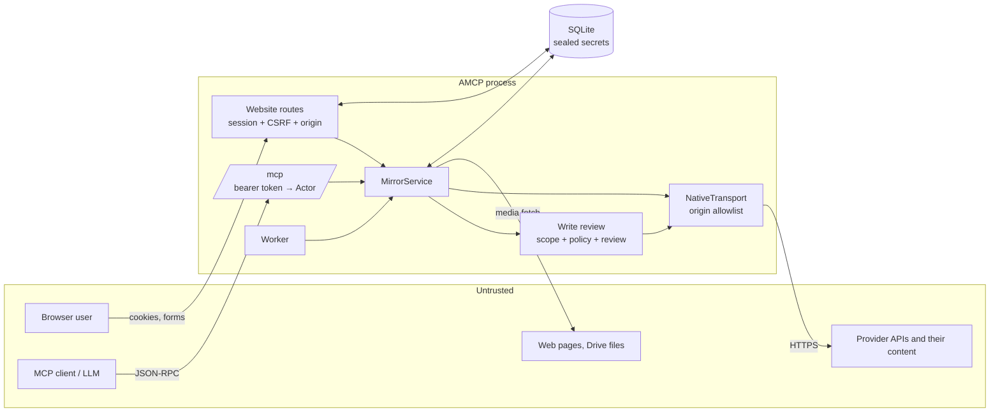
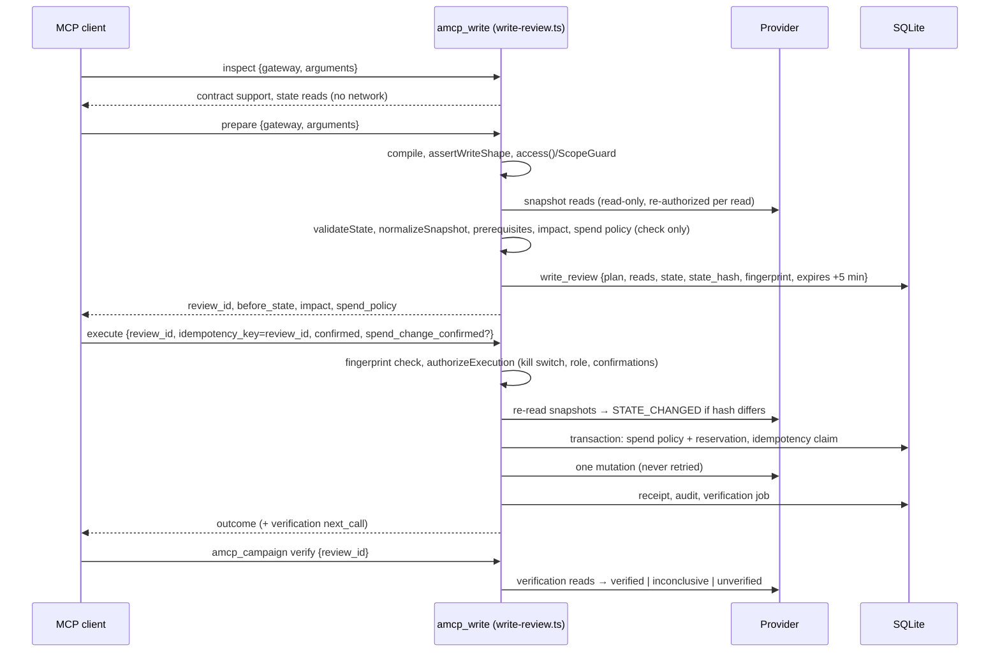

# AMCP architecture

This is the module map, request lifecycle and trust-boundary view of AMCP. It is a dated baseline: sections 1 to 7 were
written at `03ac8d3` (2026-09-28), where its line numbers point, and are corrected where the 2026-10-08 engineering
review found them wrong (the audit chain, the family count); sections 8 onward record the October 2026 architecture
work. Two parts are generated and checked, so they cannot drift: the ratchet table of section 8
(`tools/architecture-map.mjs`) and the family count (`tools/doc-facts.mjs`). For generated contract facts (pinned
versions, reviewed scope) `docs/CONTRACTS.md` stays the source of truth, and the current tool surface, providers and
package status are in [current readiness](../CURRENT-READINESS.md).

## 1. Runtime shape

One Node.js 24 process (`dist/server/http.js`) hosts three things:

| Component | Entry | What it does |
|---|---|---|
| Website | `server/website.ts` (route registry, §14), its route modules + `web/` | Accounts, MFA, sessions, platform OAuth, account selection, MCP connector page, policies, plans, reporting |
| MCP endpoint | `server/http-app.ts` (`POST /mcp`) → `server/mcp.ts` | Stateless Streamable HTTP; bearer token → `Actor`; every tool call goes to `MirrorService.call` |
| Worker loop | `server/http.ts` (`ReportWorker`) | Report jobs, scheduled exports, write verification jobs, e-mail outbox |

`server/stdio.ts` is the local stdio MCP variant with the same `MirrorService`. State lives in one
SQLite file (`MIRROR_DB`, `/data/mirror.sqlite` on Railway) opened through `node:sqlite`
(`src/store.ts`, `server/web-store.ts`).

## 2. Module map

```
server/                         website, OAuth, MCP transport, worker loop
  http.ts ─ http-app.ts ─ mcp.ts ─────────────┐
  website.ts (route registry), *-routes.ts,    │
  website-*.ts, user-accounts.ts, account-*.ts │
  platform-oauth.ts, social-signin.ts,         │
  mcp-oauth.ts, web-store.ts                   │
                                               ▼
src/service.ts  MirrorService.call(tool, input, actor)
  ├─ catalog.ts (Registry: generated/registry.json, validation, help)
  ├─ compiler.ts / delegated-native.ts (tool args → CompiledRequest)
  ├─ execution-risk.ts (readOnly / destructive classification)
  ├─ preflight.ts (authorizeExecution: kill switch, role, confirmations)
  ├─ scope.ts (ScopeGuard: account + resource grants, ownership bindings)
  ├─ transport.ts (NativeTransport: origin allowlist, retries for reads, limits)
  ├─ auth.ts (CredentialProvider: sealed tokens, refresh)
  ├─ write-review.ts (amcp_write: inspect / prepare / execute)
  │    ├─ reviewed-routes.ts (route → family name; also used by the ledger)
  │    ├─ review-state.ts (snapshot normalization, state hash)
  │    ├─ write-impact.ts (impact summaries)
  │    ├─ spend-policy.ts + policy-decimal.ts (owner spending policies)
  │    └─ the reviewed-family modules (x-entity-batches.ts, google-business-lodging.ts, …; §5)
  ├─ write-verification.ts (amcp_campaign verify: read-back comparison)
  ├─ media-upload.ts, media-routing.ts (amcp_media, Drive transfer, FFmpeg)
  ├─ workflows.ts, campaign-runner.ts, campaign-preflight.ts (plans)
  ├─ reporting*.ts, report-*.ts, decision-reporting.ts, google-sheets.ts
  ├─ workspace.ts (readiness, spend policies, contracts listing)
  └─ store.ts (SQLite: tenants, connections, documents, idempotency, jobs, audit)
```

Generated inputs (never hand-edited): `generated/registry.json` (5.5 MB, captured tools and
actions), `generated/vendor-routes.json` (5.9 MB, routes from pinned vendor documents),
`generated/microsoft-contracts.json` (6.6 MB, WSDL-derived). The unused `generated/types.ts` is no longer generated
(MCP-07); the AMCP tools' per-action contracts are `src/first-party-contracts.ts`.
Ledgers and `docs/CONTRACTS.md` are produced by `tools/action-contracts.ts` and
`tools/generate-contracts.ts`. `npm run provenance` lists every generated artifact with its generator, inputs and the
check that fails when it is stale or edited by hand (ARC-03); the registry's inputs are those of the frozen captured
catalog, whose withheld capture files are declared in `.mirror/RAW/WITHHELD.json`. `generated/route-anchors.json`
records what each route's method and path rest on, separately from the captured names it keeps for compatibility.

## 3. Trust boundaries



| Boundary | Crossing | Control (where) |
|---|---|---|
| Browser → website | cookie session, form/JSON posts | session cookie, CSRF token, `Origin` check, MFA (the route modules of `server/website.ts` and their gates in `server/website-gates.ts`, `server/web-store.ts`, `server/account-security.ts`) |
| MCP client → `/mcp` | bearer token | `store.authenticate` (hashed token, expiry, revocation), `Origin` pinned to public origin (`server/http-app.ts:48-70`) |
| Actor → tenant data | every tool call | `Actor.tenantId` on every store query; `assertActorActive` on every call (`src/service.ts:116-120`) |
| Actor → provider account | per request | `store.resolveConnection` + `ScopeGuard.authorize` (selected accounts, resource grants, ownership bindings) |
| Server → provider | HTTPS | `NativeTransport` origin allowlist, per-family read-only checks for snapshot reads (`applyExecutionRisk(read).readOnly`) |
| Provider content → LLM | tool output | `meta.untrusted_provider_content` label on every tool except `amcp_tool_help` (`src/service.ts:81-88`, `wrap`) |
| Money | reviewed writes only | kill switch, role, review, confirmations, spending policy, idempotency claim (§4) |
| Secrets at rest | SQLite | AES-256-GCM sealing with scoped additional data (`src/security.ts`), hashed bearer/session tokens |

A compromised MCP client is the most important adversary model: it holds an operator token and
can call any tool with any arguments. Everything below `MirrorService.call` must therefore be
safe for arbitrary, adversarial input from an authenticated operator; the owner's spending policy
and the review/confirmation protocol are the controls that still apply to that actor.

## 4. Reviewed write lifecycle



Code anchors (formatted line numbers differ; search by name):

| Stage | Function | File |
|---|---|---|
| Input guard | `WriteReviewService.call` (unknown keys, delegated vs direct) | `src/write-review.ts` |
| Compile | `Compiler.compile` / `DelegatedNativeCompiler.compile` → `applyExecutionRisk` | `src/compiler.ts`, `src/delegated-native.ts`, `src/execution-risk.ts` |
| Membership | `reviewedWriteFamily(plan)` | `src/reviewed-routes.ts` |
| Validation | `assertWriteShape(plan)` (the family's `assert`, which may run the gateway's checks) | `src/write-shape.ts` |
| Scope | `access()` → the family's `actor`, `resolveConnection`, `assertAccountWrite`, the family's `scope`, `ScopeGuard.authorize` | `src/write-review.ts`, `src/scope.ts` |
| Snapshot plan | `snapshotPlans(plan)` (the family's `snapshots`, or its `state` reads the whole state) | `src/write-snapshots.ts` |
| Snapshot read | `state()` (`readThroughFamilies`: every registered reader, then the transport) | `src/write-review.ts` |
| Normalize | `validateState`, `normalizeSnapshot`, `reviewStateHash` | `src/write-state.ts`, `src/review-state.ts` |
| Prerequisites | the family's `prerequisites` and `stateChecks`, and the gateway's paused-parent checks | `src/write-review.ts` |
| Impact | `writeImpact` (the family's `impact`, else its provider's `writes.impact`) | `src/write-impact.ts` |
| Policy | `checkSpendPolicy` (activation, deletion, budget amounts, daily reservation) | `src/spend-policy.ts` |
| Confirmation | `authorizeExecution` (per-family spend confirmations, generic text match) | `src/preflight.ts` |
| Execute | `transport.request` once; `writeOutcome` (the family's `outcome`, `receipt`, `safeOutcome`, else its provider's `writes.confirms`) | `src/write-review.ts`, `src/write-outcome.ts` |
| Verify | `WriteVerifier.verify` (the family's `verify`, or `verificationReads`, `observed` and `readThroughFamilies`) | `src/write-verification.ts`, `src/verification-reads.ts` |

Invariants the lifecycle maintains (all verified in code; see `FINDINGS.md` for exceptions):

1. A non-read provider request can only be sent by `amcp_write execute` or `amcp_media`
   (`runPlan` throws `WRITE_REVIEW_REQUIRED` for any non-read plan, `src/service.ts` `runPlan`).
2. Execute uses the plan frozen at prepare; its fingerprint binds tenant, user, connection and
   plan; `arguments` at execute are refused.
3. The idempotency key equals the review id and is claimed inside the same SQLite transaction as
   the spend reservation; a claimed key is never re-sent (`WRITE_OUTCOME_UNCERTAIN`).
4. Snapshot reads are re-read at execute; any normalized difference refuses with `STATE_CHANGED`.
5. The mutation is sent once; the outcome is stored before any post-response permission check.
6. `verified` needs every expected field to match a read-back; otherwise `inconclusive`.

## 5. Family wiring (why adding one is expensive)

A reviewed family is one module that exports some of: `…Kind`, `assert…`, `…Snapshots`,
`read…`, `is…Read`, `validate…State`, `…Prerequisites`, `…Impact`, `…Outcome`,
`…Verification`, `…Observed`, `authorize…`, `…PolicyAmounts`, `…NeedsConfirmation`. The core
dispatches each hook through hand-written, order-sensitive `if (xKind(plan)) return …` chains:

| Chain | File | Entries |
|---|---|---|
| route → family name | `src/reviewed-routes.ts` | 130+ |
| outcome | `src/write-outcome.ts` (`confirmedMutationResult`) | 120+ |
| state validation | `src/write-state.ts` (`validateState`) | 100+ |
| shape assertion | `src/write-shape.ts` (`assertWriteShape`) | 100+ |
| snapshot plans | `src/write-snapshots.ts` (`snapshotPlans`) | 100+ |
| scope asserts | `src/write-review.ts` (`access`), `src/write-verification.ts` | 60+ each |
| nested readers | `src/write-review.ts`, `src/write-verification.ts` | 83 levels each |
| prerequisites | `src/write-review.ts` | ~100 calls |
| impact | `src/write-impact.ts` | 100+ |
| normalization | `src/review-state.ts` (`normalizeSnapshot`) | 90+ |
| scope authorize | `src/scope.ts` | 80+ |
| spend exemptions / confirmations | `src/preflight.ts` | 80 exemptions, 40 confirmations |
| activation / policy amounts | `src/spend-policy.ts` | 45 + 11 |
| ledger metadata | `src/action-contracts.ts`, `src/provider-contracts.ts` | 148 |

The typed registry replaces these chains family by family. Each family module declares one `ReviewedFamily`
(`src/reviewed-family.ts`) and `src/reviewed-families.ts` lists it; every chain above consults the registry once,
at the position of the first line it replaced, so the order of the lines still in the chain is unchanged.
`familyOf` refuses a request two registered families claim (`REVIEWED_FAMILY_CONFLICT`), and the nested reader
chains start with `readThroughFamilies`, which composes every registered reader. Pass 1 registered 41 families
and removed 734 lines of wiring from the ten lifecycle modules; pass 2 registered 16 more and removed another 310
(57 families; reader chains 83 → 42 → 26 and 80 → 39 → 23 levels; named spend-match exemptions 83 → 45 → 32).
Pass 3 (batch 31) registered 12 more, including the Snapchat families pass 2 left, and removed another 522 lines
(71 families; 27 → 17 and 23 → 13 nested readers; named exemptions 32 → 20). Its proof replays 46,187 distinct calls
of eleven lifecycle functions, recorded while the full suite ran on the previous commit, through the new build: 0
differences. Authorization is not among them, so its order was checked by hand: every authorizer the moved ones now
follow is guarded by another gateway, kind or read marker.

Pass 4 (batch 33) registered the other 72, so every family of that time (143) was registered and the table above is
history: each stage consults the registry once and keeps only gateway logic (ADDING-A-REVIEWED-FAMILY.md, "Outside
the registry"). Families added since are registered the same way; the registry holds
<!-- fact:reviewed_families -->170<!-- /fact --> today (`reviewedFamilies()`, listed by provider in
ADDING-A-REVIEWED-FAMILY.md). It removed 2,901 lines from the fifteen lifecycle modules (267 added) and both reader chains. A
family now owns what the chains could not express: whole-state reads, follow-up reads, actor checks, report-job
admission and receipts, preview delivery and its own verification. The lifecycle passes a family its read builders
and gateway fallbacks as arguments, so no family module imports a lifecycle module for them. The proof replays
46,614 distinct calls of thirteen functions (the eleven, plus spend-policy's activation decision and family amounts,
extracted as pure functions in the baseline too): 0 unintended differences; the 130 others are the two intended
ones (preview and X report redaction now inside `writeOutcome`, applied at the same point of execute; two LinkedIn
spend messages that now name `spend_change_confirmed=true`). The stateful stages (scope, review, verification) are
covered by the full suite, and the scope order by checking every generic authorizer's predicate against every family
request in the capture: none matches one.
`docs/ADDING-A-REVIEWED-FAMILY.md` is the guide, `ROADMAP.md` tracks the rest.

Families whose state reads need their own login binding or observation read through one guarded reader per side
(`WriteReviewService.guardedReader`, `WriteVerifier.guardedReader`, batch 17): the read must be read-only, and the
actor, connection and scope guard are checked again before the credentials are fetched, after, and after the
response; a family may add an actor or connection check, a login binding and an `after` step.

## 6. Data model (SQLite)

`src/store.ts`: `tenants`, `workspace_memberships`, `connections` (sealed credentials),
`documents (tenant_id, kind, id, data, revision)` — reviews, policies, plans, receipts,
reservations —, `idempotency (tenant_id, key, fingerprint, state, result)`, `jobs` (leases),
`audit` (one append-only hash chain across all workspaces: `Store.appendAudit` links each row to the last row of the
whole table, and `Store.verifyAudit` walks that single chain; reads such as Activity select one workspace's rows; an
account erasure leaves receipted tombstones, SEC-07), `resource_ownership`, `api_keys` (hashed MCP tokens),
`media_*`, `service_locks`, `provider_cooldowns`.
`server/web-store.ts`: `amcp_users`, `amcp_identities`, `amcp_web_sessions` (hashed),
`amcp_login_limits`, `amcp_oauth_states` (sealed), `amcp_mcp_clients`, `amcp_mcp_grants`,
`amcp_account_challenges`, `amcp_email_outbox`, `amcp_mfa` (sealed secret, hashed recovery codes).

Every tenant-owned table carries `tenant_id` in its primary key or first index column.

## 7. Measured baseline (2026-09-28, Linux container, Node 24.21.0)

| Measure | Value | How |
|---|---|---|
| Build (`tsc -p tsconfig.json`, TypeScript 7.0.2) | 5.1 s wall | `time node node_modules/typescript/bin/tsc -p tsconfig.json` |
| Cold start to constructed runtime | 1.08–1.14 s (import 0.32–0.38 s, construct 0.74–0.79 s) | `createRuntime()` from `dist/server/runtime.js`, 3 runs |
| Memory after start | RSS 197 MB, heap used 68 MB | same script |
| Source size | `src/` 3.65 MB in 263 modules (100,847 lines once formatted at 120 columns vs 31,750 today) | Prettier copy in scratch |

After batch 22 (F-64), measured the same way at `066739d` on 4 CPUs, median of 5: `createRuntime()` in 398 ms (import
252 ms, construction 147 ms; 860 ms before the change, when the code had grown since this baseline), RSS 146 MB, heap
used 68 MB. Generated artifacts are parsed once per process and frozen (`src/pinned-json.ts`), and tool validators
compile on first use.

Full-check timing and counts are in `PROGRESS.md`.

## 8. Architecture ratchet

`tools/architecture-map.mjs` (ARC-01 phase A, ARC-04 stage A; owner decision D26) measures the compiled backend and
compares it with `docs/review/architecture-baseline.json`. `npm run architecture:check` runs in `npm run check`, in the
qualification fast gate and in `npm run test:related`; `tests/architecture-map.test.mjs` holds its rules. It reads the
static imports of `dist/src` and `dist/server` (what Node evaluates: tsc elides type-only imports, and a dynamic
`import()` is not an evaluation edge) and the source text of `src/` and `server/`.

| Measurement (ratcheted) | What it counts |
|---|---|
| `largest_runtime_scc`, `cyclic_modules` | Modules in the largest runtime import cycle, and in any cycle |
| `shared_modules_with_gateway_literals` | Shared modules (outside the provider filename groups `meta-*`, `tiktok-*`, ...) that name a provider gateway in a string literal |
| `shared_to_provider_runtime_imports` | Runtime imports from any shared `src/` or `server/` module into a provider module |
| `local_fail_copies` | Modules that declare their own `fail` helper instead of the family kit's (§13); 0 since ARC-04 stage C |

A measurement may fall or stay. One that rises fails the check, and so does a module that joins a runtime import cycle,
even when another cycle shrinks by as much. The number of gateway literals in shared modules is reported only.
`node tools/architecture-map.mjs --write` records the current state after an intended improvement, or after a
regression the owner accepted; the commit says which. It also writes the table below from the recorded baseline (owner
direction P11: this document is partly generated), and the check fails when the table shows another baseline than the
recorded one. The review's "core to provider" count
(220 at `60ec2cc`) counted 28 core modules; `shared_to_provider_runtime_imports` counts every shared module, so its value
is larger and is compared only with its own baseline. The provider adapter registry (`src/provider-adapters.ts`, §9)
names every gateway on purpose, so the ratchet counts it with the provider modules, and an import of it is not counted
as coupling; so are the portfolio adapter registry (`src/portfolio.ts`, §11), the report source registry
(`src/report-sources.ts`, §12) and the report job registry (`src/report-jobs.ts`, §12), which import one module per
provider so that shared code consults them. Counting them as registries lowered `shared_to_provider_runtime_imports`
from 500 to 493 by classification alone: the seven portfolio imports, which `src/portfolio.ts` made before it became
the registry, are no longer counted. The report job registry lowered it from 496 to 488: `src/service.ts` and
`src/compiler.ts` no longer import the five job modules (eight edges). The website route modules (ARC-04 stage D)
lowered `shared_modules_with_gateway_literals` from 88 to 87 and `shared_to_provider_runtime_imports` from 488 to 487:
the three gateways the website treats by name (Google Ads, Microsoft Advertising, WooCommerce) come from the provider
adapter registry, so `server/website.ts` names no gateway and no longer imports `src/microsoft-native.ts`. The wave 3b
merge recorded
88 and 496 (87 and 493 on the ARC-01/ARC-04 branch) for two packages built beside the ratchet on the same base, so
neither had run against it: ARC-02's tenant-bound repositories hold SQL that names gateways
(`src/workbook-repository.ts`, the workbook query projections; `src/audit-repository.ts`, the Google Ads legacy-alias
query that left `src/legacy-alias-usage.ts`), and CMP-03's Microsoft location lookup (`src/microsoft-locations.ts`) is
imported by `campaign-runner.ts`, `recipe-context.ts` and `service.ts`. ARC-01 phase B counts the reviewed-family
registry (`src/reviewed-families.ts`) as a registry too, as the role table (§15) already did: it imports one module per
family so that the lifecycle consults it, and the review's 220 "core to provider" edges never counted it. That lowered
`shared_to_provider_runtime_imports` by 163 by classification alone (from 496 to 333 on the phase B branch, built
beside ARC-04 stages C, D and F on the same base); every later fall of phase B (§9) is a migration. Merged, the two
packages' falls add up: 76 and 235. Phase B's server discovery configurations (§9) lowered them to 75 and 229:
`server/asset-discovery.ts` no longer names the LinkedIn and Reddit gateways nor imports the six provider modules its
discovery read; it consults the provider login registry (`src/provider-logins.ts`, counted with the providers). The
OAuth flow steps lowered the imports to 226: `server/platform-oauth.ts` no longer imports Apple's, Microsoft's and
Meta's modules. The website server modules (§9) lowered them further: the Google renewal's steps to 74 and 224
(`server/google-reauthorization.ts` no longer names the Google Ads gateway nor imports Google's version module, and
`server/google-account-discovery.ts` re-exports the hierarchy from Google Ads' login steps), Facebook sign-in's
endpoints to 223 (`server/social-signin.ts` no longer imports Meta's version module) and the startup checks to 220
(`server/runtime.ts`, the composition root, consults the provider startup registry, `src/provider-startup.ts`,
counted with the providers, instead of LinkedIn's, Meta's and Google's version modules), and Commerce's store sources
to 219 (`server/platform-routes.ts` lists them from WooCommerce's keyed logins instead of importing its source
module). One server edge was left on that branch: `server/report-download-routes.ts` took the CSV export from
`src/google-sheets.ts`, where the report table it shares with the Sheets export lived; wave 4c's reporting package moved
that table to the shared `src/report-table.ts` (§12), which the route imports, so merged no `server/` module names a
gateway or imports a provider module. The login and connection modules the website and the MCP service share (§9)
lowered the literals to 68: the client access sets (`src/access-sets.ts`), the disconnect with provider revocation
(`src/provider-revocation.ts`), the store (`src/store.ts`: connection resolution and its check of manager routes), the
deployment's app credentials (`src/app-credentials.ts`, which reads each provider adapter's OAuth app, as the website
platforms do), the private Drive source (`src/private-drive.ts`, which takes Drive's gateway from its adapter) and
credential health (`src/connection-health.ts`, which reads each provider's renewal) name no gateway. Merged with wave
4c's writes, reporting and family packages (48 and 147 together), the falls add up: 40 and 131. Wave 4c's transport
and catalog package (70 and 157 on its own branch) counts the provider workflows registry (`src/provider-workflows.ts`,
§9) with the registries and empties the catalog compiler, the delegated compiler, the action contract ledger, the
service, the token renewal, the help tool and the catalog versions of provider names and imports; merged with the
other four packages, the falls add up again: 34 and 53.

<!-- architecture-map:baseline:begin -->
| Recorded baseline (written by `node tools/architecture-map.mjs --write`; do not edit) | Value |
|---|---|
| `largest_runtime_scc` | 3 |
| `cyclic_modules` | 11 |
| `shared_modules_with_gateway_literals` | 30 |
| `shared_to_provider_runtime_imports` | 53 |
| `local_fail_copies` | 0 |
| `shared_gateway_literals` (reported) | 143 |
| Runtime import cycles | `src/microsoft-associations.ts` ↔ `src/microsoft-campaign-criteria.ts` ↔ `src/microsoft-native.ts`; `src/allocation-calibration.ts` ↔ `src/report-allocation.ts`; `src/apple-entity-writes.ts` ↔ `src/measurement-writes.ts`; `src/effect-class.ts` ↔ `src/preflight.ts`; `src/reddit-creative-writes.ts` ↔ `src/reddit-writes.ts` |
<!-- architecture-map:baseline:end -->

## 9. Provider adapters

`src/provider-adapter.ts` is the gateway-level provider contract (ARC-01) and `src/provider-adapters.ts` its registry:
one adapter per provider gateway, a leaf module that imports no provider or lifecycle module. A provider supplies
facts; the review lifecycle, `ScopeGuard` and `NativeTransport` keep control (account binding, the origin allowlist,
single send, retries, spending, confirmation and idempotency never move into an adapter). Every adapter has a lifecycle
status, `active` or `parked` with a reason (`owner_parked` or `unimplemented`), and the prefixes of its reviewed family
names, so each registered family belongs to one provider (`tests/provider-adapters.test.mjs`). A parked provider is
offered only where `AMCP_PROVIDERS` names it (`src/provider-offering.ts`; a misspelt ID is a startup `config_problem`).

Parked today: Criteo and WooCommerce (`owner_parked`, PRK-01, PRK-02 and P9) and Amazon Ads (`unimplemented`, CON-06).
The status is enforced where each surface is built, not by deleting code: `MirrorService.listTools` leaves the gateway
out of `tools/list`; `MirrorService.callOnce` refuses a tool call that is, or names, a parked gateway before its
arguments are read, except `amcp_workspace history` (`localGatewayFilterActions` in `src/service.ts`), a local read of
retained audit metadata that may still filter by it; `ScopeGuard.authorize` refuses every request to it before
credentials are fetched (so a review prepared while it was offered cannot execute after it is parked), and
`NativeTransport.request` refuses to send to it, or with a parked provider's connection, whichever caller built the
request (account discovery and other reads that do not pass `ScopeGuard`), before anything is counted or sent;
contracts, capabilities and the Capability Center filter it; `/api/platforms` names the providers not offered
(`providers_not_offered`), and Commerce hides the WooCommerce store panels while an administrator can still remove a
stored connection. The provider access register (`docs/PROVIDER-ACCESS.md`) states each provider's default
(`Offered by default`, under no `AMCP_PROVIDERS`), so it and its check read the same in every deployment. The
reviewed-family registry stays complete for the ledger, by design: the listings that show families filter them by their
gateway's status, so there is no family-level offering check. `tests/provider-lifecycle-gate.test.mjs` covers each
surface in both modes; suites that exercise a parked provider offer it with `tests/helpers/parked-providers.mjs`.

An adapter has two halves, split by import layer. Its **facts** (lifecycle status, family prefixes, the account model,
body deletions, entity writes, paging names) are pure data in the leaf registry, which any module may read, the lowest
included (`src/account-id.ts`, which family modules import). Its **hooks** call the provider's own modules, so they
live in the provider's adapter module (`src/<provider>-adapter.ts`, a provider module) and are registered by gateway in
`src/provider-hooks.ts`, which the shared stages consult instead of importing provider modules; no provider module
imports it, and the ratchet (§8) counts it with the providers. One registry holding both would sit in an import
cycle: the hooks' modules import shared helpers that read the facts. A hook only supplies a provider fact to the shared
stage that asks for it, at the point where that stage named the provider before: the stage keeps every rule, in its
order, and decides. A third part, the provider's **website login steps** (contract `src/provider-login.ts`), is split
off the hooks by import layer again: only the website's server consults it, so it lives in
`src/<provider>-login.ts`, registered by gateway in `src/provider-logins.ts` (a registry the ratchet counts with the
providers), which the reviewed-write path never loads; `tests/provider-asset-discovery.test.mjs` holds that boundary.
Besides a platform's OAuth flow and asset discovery, the login steps hold the reads of a renewal that verifies a login's
selected accounts first (Google Ads) and the endpoints of AMCP's own sign-in with a provider's accounts (Facebook
Login, Meta's); a provider whose logins an administrator sets up with a key on its own page has keyed logins instead
(WooCommerce's store sources, which Commerce lists: `registeredKeyedLogins`, beside the website platforms' list);
`tests/server-provider-seams.test.mjs` pins the website server modules' seams. The composition root
(`server/runtime.ts`), which every entry point runs, consults a fourth, small registry instead: each provider's
startup checks (`src/provider-startup.ts`: the version pins, in their order, and the configuration warnings).

**Phase B** moves one concern at a time out of the shared modules into the adapters. Each move carries a call-replay
proof (`tools/call-replay.mjs`, `tests/call-replay.test.mjs`): the related suites (739 test files) are recorded on the
build before the change and after it, a loader hook writing every call of the moved functions with its arguments and
its result or refusal, and every request each transport sends (headers digested, never written); the two recordings
must hold the same records per test file. Run-to-run noise is learned from two recordings of the build before the
change (a calibration: a digest over clock-relative personal-data rows, a fixture's generated key) and reported
apart; fixtures that draw `Math.random()` draw a seeded sequence. An outcome flip (a result against a refusal) and
every record of a function whose call count varied in the calibration are never noise: since the wave 4a merge review
they are unsettled, each one printed, and fail the comparison, unless `--timing-dependent` names the test file and the
refusal its clock decides (`tests/transport.test.ts=TENANT_RATE_LIMIT`, the burst-pacing test, whose records the
proofs below report apart); the proofs below were compared under the earlier rule, which could absorb such a record
as noise. The distinct pure calls of the first recording also replay through the new build. Nothing is sent
anywhere: the suites' synthetic fetchers answer.

| Concern | Now in the adapter | Shared stage that keeps the rule | Proof |
|---|---|---|---|
| Account model | `account`: the ID form, the request fields that name the account, account references inside strings (Google's `customers/<id>`, LinkedIn's sponsored account URNs), JSON Patch account fields (Snapchat), the path that names the account, and what a bound resource is (CON-05). Facts, frozen at load; `tests/provider-account-model.test.mjs` pins them. | `ScopeGuard.authorize` still walks every request and compares each place with the bound account before any authorizer; `accountKind` | 4,836,540 records before, 4,836,547 after: 0 differences beyond calibration except the 10 records of `tests/transport.test.ts`'s burst-pacing test, whose refusal count depends on elapsed time; 85,676 distinct pure calls replay with 0 differences |
| Read classification | hooks `reads`: the planning and preview POSTs a catalog marks as writes, the documented POST reads (query, report and planning RPCs), Microsoft's contract reads, Search Console's site URLs read as identifiers, the documented reads whose paths hold mutation-like words and their authorization (Meta value rule sets, TikTok catalog and status reads, LinkedIn's share-authorization check), Meta's Graph batch; facts `deletions`: the body values that delete (WRT-02) and Google's `remove` operations. `tests/provider-read-classification.test.mjs` holds the cases and pins the deletions. | `independentlyReadOnly` keeps the generic rules (personal data, path words, method overrides, REST.li methods, GET and HEAD) and consults the provider at the same points; `qualifiedProviderRead` keeps the GET preconditions; `applyExecutionRisk` and `bodyDeletion` | 4,747,579 records before, 4,747,577 after (the moved `googleGlobalRead` helper's own records set aside; its callers compare): 0 differences beyond calibration; 85,633 distinct pure calls replay with 0 differences |
| Paging | hooks `paging`: each provider's cursor rules (Meta's `after` cursor, TikTok's page numbers and cursors, Snapchat's and Reddit's next links checked against the request's scope, X's cursor, LinkedIn's page tokens and offsets, Apple's query offsets) and the collection TikTok reports whole (integrated reports: started at page one, counts and native rows checked across pages); facts `paging`: Google Ads' `page_token` and GA4's `request` argument. `tests/provider-paging.test.mjs` pins the seam. | `nextPage` asks the plan's provider first and keeps the generic page tokens; `paginate` keeps the loop, the merge, the page and size limits and the loop and shape checks; `continuationArguments` and `nextPageCall` the continuation | 4,748,257 records before, 4,748,260 after: 0 differences beyond calibration; 85,633 distinct pure calls (3,705 `nextPage`) replay with 0 differences |
| Account read | hooks `accountRead`: each advertising provider's exact account read (its route on the shared read, or Microsoft's own GetAccount contract), the readiness read of a measurement or Apple resource (GA4 property, Tag Manager account, Search Console site, Apple Ads ad account, Business Profile location or account) with the check that its response names exactly that resource (declared together, a load-time check), and where an account read's response holds the account (Snapchat's `adaccounts[0].adaccount`, Business Profile's title). `tests/provider-account-read.test.mjs` pins the requests. | `accountPlan` keeps what every account read is (AMCP_READINESS, read-only, never confirmed) and READINESS_CONTRACT_UNAVAILABLE; `readinessPlan` its own read builder and ASSET_ID_INVALID; `validateReadinessRead` STATE_TARGET_MISMATCH and the state checks of every other account read; `accountMetadata`, `accountCurrency`, `accountTimezone` | 4,748,260 records before, 4,748,262 after: 0 differences beyond calibration except the 5 records of `tests/transport.test.ts`'s burst-pacing test (one request paced in one run and refused in the other, in `NativeTransport`, which this change does not touch); 85,633 distinct pure calls (32 `accountPlan`, 94 `accountMetadata`) replay with 0 differences |
| Wire profile | hooks `wire`: the path and query a provider's requests take (TikTok's `/open_api`, LinkedIn's Rest.li encoding), the checks before and after its wire contract (Google's Discovery and generation contracts, DV360's targeting search), its connection and authentication headers and their refusals (Reddit's User-Agent, TikTok's Access-Token, Google Ads' login customer, Microsoft's developer token and customer, Amazon's client and scope, Apple's context, X's OAuth 1.0a signature), its multipart upload contracts and body encoding (Meta's and X's forms, Google's ProtoJSON and Data Manager login, Snapchat's JSON Patch), its rate keys and reset headers (X), single-attempt reads, bounded reads and their deadlines (LinkedIn, X, Snapchat, TikTok, Criteo, Adjust, the asset syncs), documented empty writes, CSV, whole-byte and 64-bit responses, report data routes, and its error envelope (`errors`: request references, provider codes and documented classifications); two new adapter modules (Adjust, Amazon; the ratchet counts `amazon` with the providers) and two leaves (`src/oauth1.ts`, `src/provider-error-core.ts`). `tests/provider-wire.test.mjs` pins the allowlist and the seam. | `NativeTransport` keeps the origin allowlist (one table, unchanged: no adapter names an origin), the sandbox table, the single send, attempts and retries, the deadline loop and its codes, rate limits, cooldowns, circuits, size limits and every refusal of a response; `buildUrl`, `losslessReportNumbers`, `providerRetryDelay`; `provider-error-taxonomy.ts` keeps the generic error shapes, the classification of every refusal a provider does not document, and the error types | 4,748,262 records before, 4,748,270 after: 0 differences beyond calibration except 10 records of the burst-pacing test (of its 80 concurrent requests, the pacing budget refused 64 in one run and 62 in the other; each served request's URL, request and retry records are identical to those served in both); 85,644 distinct pure calls (11,672 `losslessReportNumbers`, 316 `providerErrorCode`) replay with 0 differences |
| Read authorizers and resource scope | hooks `scope`: thirteen read authorizers (`ReadAuthorizer`: a name, a stage, `claims(plan)` and `authorize`), the nine ScopeGuard ran before the reviewed families' own authorizers (TikTok's and LinkedIn's qualified reads, Meta's dataset reads, LinkedIn's conversion evidence, Business Profile's place-action discovery, DV360's targeting search and audience reads, X's audience estimate, Reddit's planning reads, Snapchat's catalog comparison) and the three after them (LinkedIn's ad previews and DSC, media and post reads, Google Ads' global planning reads); each provider's scope checks before them (Google's generation scope, Meta's label scope) and its public read (Meta's Ad Library); its resource scope after the account path (Search Console sites, Business Profile accounts and locations, LinkedIn's account filters and planning accounts, TikTok's advertiser parameters, Microsoft's contracts and report polls, Amazon's and Apple's mandatory account headers, Reddit's reference reads and owned entities, Criteo's preferred line items, Meta's and Snapchat's owned global IDs); its ownership reads, observation and creation observation. Snapchat's scoped paths moved to the leaf `src/snapchat-scope.ts` (re-exported until wave 4c, when `src/scope.ts` dropped that last provider import). `tests/provider-read-authorizers.test.mjs` is the authorizer-disjointness test. | `ScopeGuard.authorize` keeps the offering gate, the account binding, the walk that compares every account a request names, the order of every stage and both authorizer stages around the families, the account path, the resource bindings and RESOURCE_SCOPE_REQUIRED with its ownership reads; `claimingAuthorizer` refuses a request two authorizers claim (READ_AUTHORIZER_CONFLICT, 500, before anything is sent); `observe` and `observeCreated` keep the families' own first | 4,725,691 records before, 4,725,676 after (the two moved Snapchat helpers' own records set aside; their callers compare): 0 differences beyond calibration except 15 records of the burst-pacing test (its pacing budget refused 62 of 80 requests in one run and 65 in the other); 85,633 distinct pure calls (73 `ownershipReads`, 169 `snapchatScopedResource` through the re-export) replay with 0 differences |
| Gateway checks: write shape and state | hooks `checks`: in the write-shape stage, each provider's request contracts first (Google's Discovery schema, Meta's campaign and v26 rules), a write contract that decides alone (Microsoft's), the measurement providers' resource write contract before the reviewed routes (GA4, Tag Manager, Search Console, Apple), its checks before the generic ones (Snapchat's creative paths), its one concurrency query parameter (DV360's `updateMask`, Tag Manager's `fingerprint`), its checks after the query parameters (LinkedIn's PARTIAL_UPDATE patches) and after the method checks, given the stage's paused-creation rule (paused or draft creation for Meta, TikTok, Snapchat, X, LinkedIn, DV360 and Google Ads, the native record structure, TikTok's conversion and CTA references, X's targeting criteria, Google's atomic homogeneous operations); in the state stage, its response contract (Microsoft's), the documented results that settle a read (a measurement resource's 404, Tag Manager's status read), the envelope its success check reads (Search Console's sitemap error counts, Google's omitted empty results, a failed GA4 job's message), a read complete by its own contract (TikTok's published Instant Forms) and its exact-target check (Microsoft's and the measurement providers' whatever a family supplies); facts `executionOptions` (Meta) and `reviewedWriteGateways`, from which `writeContractGateways` is made. `tests/provider-gateway-checks.test.mjs` pins the seam. | `assertWriteShape` keeps the refusal of every other gateway, MUTATION_REQUIRED, the execution_options refusal, the special-transport refusal, the families' own `assert`, the method-override check, the reviewed routes with their withheld reasons, the query, batch, method-tunnelling and GET/HEAD refusals, the paused-creation rule and then the wire contract; `validateState` keeps the families' identity checks, the success check, the pagination checks, the exact-ID comparison and the final STATE_READ_FAILED; `metaValidationOptions`. Wave 4c moved the two remainders the stages had kept: Reddit's write contract and state check (`contract` and `state.target`; its creative family reads its profile pages with Reddit's own page step, the leaf `src/reddit-paging.ts` that its paging hook is too, instead of `src/pagination.ts`, which consults the provider hooks: that import cycle had kept them in the stages) and Meta's first write checks (`shape.before`, `src/meta-write-shape.ts`: they name `budget_schedule_specs`, a field v26.0 removed, only to refuse it, so `tests/meta-version.test.mjs`, which reads every string literal of a Meta module as a name AMCP may send and never read the write-shape stage, accepts that one name in that one module and checks that the stage refuses it) | 4,748,255 records before, 4,748,258 after: 0 differences beyond calibration (the 3 more are `platform()` lookups of `tests/measurement-apple.test.ts`, whose number varies between runs of one build: 13 and 11 in the calibration pair); the final build, recorded after a UTC midnight, compared with calendar dates masked: 0 differences beyond calibration but 5 verification fingerprints that digest two suites' dated plans; 85,633 distinct pure calls (6,854 `assertWriteShape`, 530 `metaValidationOptions`) replay with 0 differences |
| Review projections | hooks `review`: the state a review keeps of a read no family projects (`snapshot`: Google's state-query rows, each requested resource once, sorted and canonical, with STATE_RESOURCE_INVALID and STATE_RESOURCE_MISMATCH; TikTok's pixel, Smart+, Instant Form, CTA portfolio, conversion and list states; Snapchat's rows, segments and ad accounts; X's and Reddit's records; Microsoft's contract result; Apple's results without status observations; Tag Manager's safe configuration; Search Console's sitemaps without crawl fields), the write headers a verification read keeps (LinkedIn's versioning headers), the reads that verify a write no family verifies (Google's state queries, given `snapshotPlans` as an argument, Meta's node reads, TikTok's get routes, Snapchat's, Reddit's, X's, LinkedIn's and DV360's entity reads), what each such read shows (`observed`: Google's removals as REMOVED and its implicit zero bidding targets, TikTok's and Snapchat's projections, Microsoft's contract rows, Apple's results and absences, X's and Reddit's records) and Google's value-bidding verification version. `tests/provider-review-projections.test.mjs` pins the seam. | `normalizeSnapshot` keeps the families' `snapshotState` first and the shared normalization; `verificationReads` the families' `verification` first, the read builder (read-only, AMCP_VERIFY_READ) and the empty verification of a DELETE or of a provider without reads; `entity` the families' `observed` first and absent resources; `verificationContractVersion`, `googleValueVerificationVersion` (now the provider's version), `normalize` and `differing` | the builds before and after recorded back to back (the clock had crossed a UTC midnight since the last recording): 4,748,257 records before, 4,748,255 after, 0 differences beyond calibration (the 2 fewer are `platform()` lookups of `tests/measurement-apple.test.ts`); 85,633 distinct pure calls (5,740 `normalizeSnapshot`, 1,532 `entity`, 1,142 `googleValueVerificationVersion`) replay with 0 differences |
| Review: the provider's parts of a reviewed write (wave 4c) | hooks `writes`: in the access check, the other accounts a write changes (Apple's shared budget), the write scopes before the family's scope check (Reddit's adsread and adsedit), the write grant after it (Microsoft's msads.manage) and the write permission after ScopeGuard (Search Console, GA4, Apple, Tag Manager); in the state stage, a provider's own state (a Meta creative's identity sources, read through the review's access check), ScopeGuard's observation of its state reads (Snapchat), the reads a read shows the write depends on (an ad's Snapchat lead form) and the rest of a read's pages (TikTok's Instant Forms), the accounts a shared budget's read shows (Apple), its prerequisites (Snapchat's creatives; TikTok's conversions, CTA portfolios and identities; Apple's organization; Google's targeting and paused parents) and its checks after the paused-parent check (Meta's ad set audience choice, X's paused line item); in preparation and execution, the request a review shows (Business Profile's place-action links made safe), the concurrency token a route takes from the state (Tag Manager's fingerprint), the resources the state names that the account must own (Snapchat's creative references) and the ads a creative edit changes (Snapchat's bounded read, now the leaf `src/snapchat-affected-ad-pages.ts`, given the review's state-read builder; `src/snapchat-affected-ads.ts` keeps its signature). The optional-state rule every family's AMCP_STATE_OPTIONAL reads use (`optionalMissingState`) is the lifecycle's: it moved to `src/write-common.ts`, re-exported by `src/measurement-writes.ts`. `tests/provider-review-hooks.test.mjs` pins the seam. | `WriteReviewService` keeps the actor, deployment, role and account-grant checks, the family hooks, ScopeGuard, every read's authority checks, the follow-up de-duplication, the paused-parent read and check, the state hash, the spending policy, the approvals, the claim and the single send, in their order; `access`, `state`, `prepareReview` and `submit` ask the provider where they named it, so `src/write-review.ts` names no gateway and imports no provider module (17 imports fewer) | the wave 4c comparison (below) |
| Review: state reads (wave 4c) | hooks `writes`: the state reads of a write no family plans (`snapshots`: X's targeting criteria, Google Ads' mutations, TikTok's campaign, ad group and ad writes, Meta's account-edge creations and node edits, Snapchat's updates and patches; moved verbatim to `src/google-state-reads.ts`, `src/tiktok-state-reads.ts`, `src/meta-state-reads.ts` and `src/snapchat-state-reads.ts`, each given the stage's read builder), the path that names a write's account (`accountPath`: Snapchat, X, LinkedIn, DV360) and a provider's reads of a create by that account (`accountSnapshots`: Snapchat's create outside an account and its account creates' owned dependencies); a state read keeps the write's headers its verification reads keep (`review.verificationHeaders`: LinkedIn's versioning headers). `tests/meta-version.test.mjs` now reads the Meta module and accepts the removed `execution_options` there only because it checks that the node read leaves it out. `tests/provider-review-hooks.test.mjs` pins the seam. | `snapshotPlans` keeps the families' snapshots first, the read builder (`stateRead`: read-only, AMCP_STATE_READ, the plan's account and connection), the catalog's matching GET, the account read of a collection create and the final WRITE_CONTRACT_UNAVAILABLE, and asks the provider where it named it, so `src/write-snapshots.ts` names no gateway and imports no provider module (8 imports fewer) | the wave 4c comparison (below) |
| Review: disclosures (wave 4c) | hooks `writes`: what a write makes live for everyone once executed (`publishesLive`: Tag Manager's container publish, Search Console's sitemap submission, Business Profile's place action links), how many records one request writes (`recordCount`: Snapchat's record lists), a write its provider documents as a deletion on a route that is not one (`deletes`: TikTok's status update to DELETE) and what a write changes beyond its target (`impact`: Snapchat's creative edits, with their complete-replacement check moved verbatim to `src/snapchat-write-impact.ts`, and segment replacements; Meta's shop destination and creative feature choices). `tests/provider-review-hooks.test.mjs` pins the seam. | `writeEffects` keeps the families' `publishes` first, the destructive and irreversible effects, the delivery stops and a single target's current status; `writeImpact` the families' `impact` first; so `src/write-effects.ts` and `src/write-impact.ts` name no gateway and import no provider module | the wave 4c comparison (below) |
| Review: the mutation's outcome (wave 4c) | hooks `writes`: each provider's response contract for the one mutation (`confirms`: Meta's account-edge IDs and node successes, Google's one result per operation, TikTok's code and created IDs, Snapchat's per-record success and IDs, LinkedIn's 201 with `x-restli-id` or 204, X's records and target, DV360's entity IDs and empty deletes; given the response and request as the stage reads them, moved verbatim to each adapter), the top-level error lists that hold none under its contract (`emptyErrors`: Microsoft's batch PartialErrors and NestedPartialErrors of null slots) and what an outcome shows of the response and its failures (`outcomeData`: Tag Manager's safe configuration). `tests/provider-review-hooks.test.mjs` pins the seam. | `writeOutcome` keeps the generic error walk, the families' `outcome`, `receipt` and `safeOutcome`, the unconfirmed-mutation failure and the outcome's shape; a provider without a response contract confirms nothing, as before; so `src/write-outcome.ts` names no gateway and imports no provider module | the wave 4c comparison (below) |
| Review: grouped writes (wave 4c) | hooks `writes.batch`: the record list a long request is split along into parts of 25 under one approval (Google Ads' operations, unless temporary resource IDs link them; Snapchat's one record list), moved verbatim to the two adapters. `tests/provider-review-hooks.test.mjs` pins the seam. | `splittableBatch` keeps the payload check and asks the gateway's provider; `needsGroup`, `groupParts`, `groupLimitRefusal` and `WriteGroups` keep the part size, the 40-part limit, the single approval and the parts' order; so `src/write-groups.ts` names no gateway | the wave 4c comparison (below) |
| Review: the rejected outcome (wave 4c) | hooks `writes.rejectionIsNonApplied`: a provider's proof that a definitive refusal of a dispatched write applied nothing, for the requests no family proves (Google Ads' per-service and `googleAds:mutate` requests without partial failure or validate-only, moved verbatim to `src/google-write-rejection.ts`); the definitive refusal statuses moved to the leaf `src/write-rejection-core.ts` (re-exported), which the proof reads without importing a lifecycle module. `tests/provider-review-hooks.test.mjs` pins the seam. | `nonAppliedRejection` keeps the rollback switch, the definitive statuses, the rate-limit and retry refusals, the provider error body, the family's proof first and the uncertain outcome of a provider without one; `rejectedError` the rejected marker; so `src/write-rejection.ts` names no gateway | the wave 4c comparison (below) |
| Review: verification (wave 4c) | hooks `writes`: the other accounts a write changes, each checked like the selected one before and after every verification read (`sharedAccounts`, Apple's shared budget, the hook its review's access check asks), and the phase a consistent verification read shows of what the write started (`verificationPhase`: GA4's report tasks and audience exports, running pending and failed failed; `measurementVerificationPhase`, unchanged). The optional-state rule is the lifecycle's `src/write-common.ts` one. `tests/provider-review-hooks.test.mjs` pins the seam. | `WriteVerifier.verify` keeps the owner and outcome checks, the family's `verify` and read checks first, the cache, every read's authority checks, the read-optional fields, the consistent reads and the settled mismatch, and a phase of `verified` for a provider without one; so `src/write-verification.ts` imports no provider module (2 imports fewer) | the wave 4c comparison (below) |
| Review: reconciliation (wave 4c) | hooks `writes`: the lookup that finds what an uncertain create made (`createdLookup`: Google Ads' named campaigns, budgets, ad groups and asset groups by one bounded search of the frozen names; Meta's campaign, ad set and ad creates by name and creation time; moved verbatim to `src/google-write-reconciliation.ts` and `src/meta-write-reconciliation.ts`, given the stage's state-read builder) and the receipt an update or removal names (`namedTargets`: Google's operations' resource names, a Meta node edit's ID). The read normalization (`normalize`, `snake`) moved to the leaf `src/verification-core.ts` (re-exported). `tests/provider-review-hooks.test.mjs` pins the seam. | `WriteReconciler` keeps the uncertain-claim check, the delay, the two rounds of reads through the review's own connection with every read's authority checks, the classification and its reasons, the advisory record and every refusal of acceptance and replacement; `findCreated` and `namedTargets` keep their names, a family's own verification first and no lookup for a provider without one; so `src/write-reconciliation.ts` names no gateway and imports no provider module | the wave 4c comparison (below) |
| Review: the spending policy (wave 4c) | hooks `writes`: the owner policy's activation and deletion switches applied to the access a write grants or removes (`accessPolicy`: Business Profile's administrators, Google Ads' users, their modules' checks), the reviewed state whose amounts are current (`policyState`: an Apple shared budget's own value), the field a route spells activation with (`activationRule`: LinkedIn's creatives, `intendedStatus`), the money fields of a provider's pinned contract (`moneyFields`: Google Ads' Discovery classification, `googleMoneyFields`, moved verbatim to its adapter) and the refusal of a currency cap the provider's unit cannot convert (`currencyCapRefusal`: Meta's currency offsets, the same INVALID_POLICY reason and details); the other accounts of a shared budget are the hook the review's access check asks (`sharedAccounts`). `tests/provider-review-hooks.test.mjs` pins the seam. | `checkSpendPolicy`, `saveSpendPolicy` and their stages keep every rule, its order and its refusals: the shared-budget scope, the governing policy and its requirement, the deletion and activation switches and the activation table, the measured amounts, bids, baselines, currencies, the daily cap, the cap confirmation, the audit and the reservation; so `src/spend-policy.ts` names no gateway and imports no provider module (3 imports fewer) | the wave 4c comparison (below) |
| Campaigns: clones (wave 4c) | hooks `campaign.clone`: each provider's clone builder (`build`: the source reads and the paused copy's steps of Snapchat's campaigns, ad squads and ads, Google Search's campaigns, TikTok's campaigns, ad groups and ads, LinkedIn's campaign groups, campaigns and creatives; moved verbatim to `src/<provider>-campaign-clone.ts`, the source read and field helpers to `src/campaign-clone-core.ts`) and Google's one all-or-nothing build (`allOrNothing`, `composeGoogleBuild` of the customer without its display dashes). `tests/provider-campaign-hooks.test.mjs` pins the seam. | `clonePlan` keeps the source and name checks, CLONE_UNSUPPORTED with the supported gateways in their order (a load-time check: exactly the listed providers declare a clone) and the grouping of what was not copied; `applyCloneChanges` the spec's changes; `CampaignRunner` the creation key, the 50-step limit and `atomic`, asking the provider for its build where it named Google Ads; so `src/campaign-clone.ts` names no gateway and imports no provider module | the wave 4c comparison (below) |
| Campaigns: guided activation (wave 4c) | hooks `campaign.activation`: each activation platform's steps from the launch's verified results (`steps`: Meta's and Google's campaign, TikTok's campaign status, Snapchat's campaign, ad squad and ad, Microsoft's campaign, ad group, keywords and ad, LinkedIn's campaign group, campaign and creative), what the activation record keeps for the gates (`record`: Meta's ad and pixel, LinkedIn's lead form, a Google conversion launch's goal reads) and the read-only gates (`gates`: Snapchat's creative review, Meta's ad review and pixel, LinkedIn's lead form state, Google's account-default goals, Microsoft's positive location criteria); moved verbatim to `src/<provider>-recipe-activation.ts`, the result checks and the blocked-gate shape to `src/campaign-activation-core.ts`. `tests/provider-campaign-hooks.test.mjs` pins the seam. | `activationSteps` keeps the platforms offered (a load-time check: each has its provider's activation), the step builder (the platform's gateway, the launch's account and login) and ACTIVATION_UNAVAILABLE for a platform without one, an inherited name included; `activationGates` the gates' scope and their single set; `CampaignRunner.activationPlan` the activation record's plan, platform and recipe and the gates' place in the preflight; so `src/campaign-activation.ts` names no gateway and imports no provider module, and the runner names no platform | the wave 4c comparison (below) |
| Campaigns: refused builds and recipe lookups (wave 4c) | hooks `campaign`: whether a write step its provider refused outright after submission provably created nothing (`refusedBuild`: Google's googleAds:mutate builds without partial failure refused with a definitive 4xx, moved verbatim to its adapter) and the recipe lookups by `lookup_kind` (`lookups`: Google's country and language constants, searched through the ordinary account-scoped calls, moved verbatim to `src/google-search-recipes.ts`; Microsoft's locations, which the service answers from its geographical locations file, with Microsoft's refusal while that file's request is not pinned), a load-time check that each kind is one provider's and one lookup the service's own. `tests/provider-campaign-hooks.test.mjs` pins the seam. | `CampaignRunner` keeps the failed-write checks before the provider's, the uncertain key and the amendment under a new one, and `recipe_lookup`'s order of checks: the service's own lookup first, then the query's form and INVALID_LOOKUP for any other kind, then the searched lookup; the runner names no gateway but the example in a malformed step's refusal ("a write step needs gateway, e.g. ..."), whose text does not change, and imports one provider module fewer | the wave 4c comparison (below) |
| Campaigns: plan bindings (wave 4c) | hooks `campaign.planBinding`: the binding a provider's preview makes on a plan, saved under its key (Tag Manager's consent preview, `gtm_consent`: made at creation and checked against the current tag before each step's review and execution; X's selected catalog removal, `catalog_removal`: made at creation, each unsent step's review and execution run under the product it expects, with its refusal when that evidence changed), their modules' functions unchanged; a load-time check that each key is one provider's and that they are the two the runner keeps a place for. `tests/provider-campaign-hooks.test.mjs` pins the seam. | `CampaignRunner` keeps where each binding is made (after the allocation and search-exclusion bindings, before the catalog lineage and retirement), saved and fingerprinted, and when it is checked (after the allocation and search-exclusion checks, the removal's expectation before the retirement's), with the codes that refuse a changed removal at review and at execution; so `src/campaign-runner.ts` imports no provider module (4 imports fewer with the row above) | the wave 4c comparison (below) |
| Campaigns: recipe eligibility (wave 4c) | hooks `campaign.dependencyEvidence`: the evidence of a dependency a provider's recipes declare (Snapchat's reused creative and its lead form, TikTok's identity, post and pixel, LinkedIn's lead form, Meta's Page, pixel and attribution windows, Google's explicit bidding settings and Performance Max asset counts), each from the read-only preflight's checked assets or the compiled brief; moved verbatim to each provider's recipe module, so the account-owned pixel is the recipe provider's own (TikTok's or Meta's) without naming a gateway. `tests/provider-campaign-hooks.test.mjs` pins the seam. | `recipeEligibility` keeps the inputs, the graph and preflight reads with their freshness checks, the Google conversion settings, the account currency, the blockers, the reuse record and every key in its order; so `src/recipe-eligibility.ts` names no gateway (351 lines, now 261) | the wave 4c comparison (below) |
| Campaigns: plan preflight (wave 4c) | hooks `campaign.preflight`: the placeholder a declared predecessor's `$ref` takes while a step's contract is checked (`reference`: Google's resource name of the predecessor's compiled mutation, given the preflight's compiler; X's media key and card URI; Snapchat's symbolic ID), the compiled step's own contract checks (`contract`: Meta's creative contract; Snapchat's ad squad pixels, read once per account and login, deferred to the ad squad's review when the list cannot be read) and its existing dependencies (`prerequisites`: Meta's Page and media, Snapchat's creatives and lead forms, TikTok's launch packs, LinkedIn's lead form); Google's and Snapchat's helpers moved verbatim to `src/google-preflight.ts` and `src/snapchat-preflight.ts`. Snapchat's ad prerequisites take the preflight's state check (`validateState`) as an argument, so its adapter imports no lifecycle module. `tests/provider-campaign-hooks.test.mjs` pins the seam. | `campaignPreflight` keeps every check a step passes and their order: the deployment and role, the account grant, read and currency, media preparation, the declared predecessors and the LinkedIn URN placeholder, the catalog's validation, execution risk, write shape and state reads, the provider's parts where it named the provider, the 25-record parts, the deferrals and the spending-policy notice; so `src/campaign-preflight.ts` names no gateway and imports no provider module (5 imports fewer) | the wave 4c comparison (below) |
| Campaigns: recipe context (wave 4c) | hooks `campaign.recipes[].context`: what `recipe_context` says of each recipe beyond its definition, declared beside its builder (`limitations`: Snapchat's, TikTok's, LinkedIn's, Microsoft's, Performance Max's, the Google conversion and value recipes' and the Meta conversion recipes' with their pixel event; `prerequisite`: Performance Max's, Snapchat's, TikTok's and LinkedIn's own inputs; `extra`: Microsoft's location lookup availability, from the lookup's pinned request, now the leaf `src/microsoft-location-pin.ts`, re-exported by `src/microsoft-locations.ts`); a recipe's gateway is its declaring provider's (`recipeGateway`, a load-time check that each recipe's platform is that provider's ID) and the Drive logins its media may come from are the Drive provider's (the leaf registry). The conversion tables are no longer re-exported by `src/campaign-recipes.ts`: nothing imports them from there. `tests/provider-campaign-hooks.test.mjs` pins the seam. | `recipeContext` keeps the actor check, RECIPE_NOT_FOUND, the playbook's visibility, the bound accounts and their metadata, the defaults, the conventions, the Pages and Drive logins, the shared prerequisites and every key in its order (a comparison of every recipe, with and without logins and Pages, before and after: identical); so `src/recipe-context.ts` and `src/campaign-recipes.ts` name no gateway and import no provider module (3 imports fewer) | the wave 4c comparison (below) |
| OAuth configuration: grants and website platforms | facts `grant`: each provider's OAuth grant (CON-02, CON-03: requested read and write scopes, the read and write requirements, the grant source, whether readiness has an exact account read, the website platform that authorizes it) and the scope names they use, in the registry with `grantOrder`, the order the grant registry lists them in (a load-time check: every adapter with a grant, once). `tests/provider-oauth-configs.test.mjs` pins the seam. | `src/provider-grants.ts` lists the grants (`providerGrants`, gateway first, the facts in their order), keeps `providerGrant`, `requestedScopes`, `missingScopes`, `recordedWriteGrant`, `publicGrants` and `grantedScopes`, and re-exports the scope names; `server/platform-oauth.ts` keeps the website platforms (names, copy, asset kinds), each taking its gateway and default scopes from the adapter its ID names, and every OAuth flow step. The flows' provider steps and endpoints followed in the OAuth flow steps concern (below) | the builds before and after recorded back to back: 4,748,259 records before, 4,748,263 after, 0 differences beyond calibration except 5 records of the burst-pacing test (one request more of its 80 served in one run; its records are those served in both), with 1,257 `PlatformOAuth.config`, 364 `platform`, 73 `exchange` and 122 asset-sync records; 85,638 distinct pure calls (17 `selectionKind`, 16 `selectableKinds`) replay with 0 differences |
| Asset discovery (the server discovery configurations) | login steps `discovery` (`src/<provider>-login.ts`): each website platform's reads that list what a login reaches, as a step per selected kind (`kind`) or one bounded pass over every kind (`all`: Business Profile), with the provider's discovery headers (LinkedIn's version headers), the check of a next link before its cursor (Reddit: only the cursor may change) and the next offset of a start/count listing (LinkedIn); a provider whose accounts sit beneath parents (Reddit's businesses, DV360's partners) declares the parents and accounts it lists (`DiscoveryParents`). Google Ads' hierarchy discovery moved to `src/google-account-discovery.ts` (re-exported from `server/google-account-discovery.ts`). `tests/provider-asset-discovery.test.mjs` pins the seam and `tests/website-discovery-steps.test.mjs` the TikTok, Snapchat, X and Meta reads no other suite reached with a successful answer. | `AssetDiscovery` (`server/asset-discovery.ts`, which names no gateway and imports no provider module) keeps the platform and kind checks, the connection, scope and login checks before and after every request, the page rules (25 pages, 10,000 rows, the next-link origin and path, repeated cursors), the asset rules, the walk beneath parents (100 parents, 10,000 accounts, each inside its parent, a parent's failure as a diagnostic), each kind's failure group, the order of the groups and ASSET_DISCOVERY_UNAVAILABLE; `AssetDiscovery.discover` fell from 693 lines to 64 | the 113 related suites recorded on the build before and after: 201,457 records before, 201,464 after, 0 differences beyond calibration except 5 records of the burst-pacing test and 3 more `platform()` lookups of `tests/measurement-apple.test.ts` (their number varies between runs of one build), with 122 `AssetDiscovery.sync` and 3 `discoverWith` records over all 16 platforms and 1,982 provider requests; the new steps suite recorded on both builds: 145 records each, 0 differences (23 provider requests); 7,500 distinct pure calls replay with 0 differences |
| OAuth flow steps (the server OAuth configurations) | login steps `oauth` (`OAuthSteps`, `src/<provider>-login.ts`): each provider's authorization and token endpoints, which the website platforms take (Meta's versioned ones included), and the steps only it takes: X's OAuth 1.0a request token and access token (`begin`, `complete`, signed by `src/oauth1-authorization.ts`, re-exported as `signOAuth1`), TikTok's `app_id`, callback parameter, missing response type, `auth_code`, JSON token request and result code, Meta's comma-joined scopes, re-request, login configuration, GET exchange and long-lived token, Reddit's permanent duration, Basic authentication, User-Agent (also kept on its connection: `connectionFields`) and renewable-login check, Microsoft's developer-token setting, offline scope and offline check, Apple's server key, fixed scope and client-credentials connection (`connect`), Google's offline access and consent prompt (`src/google-oauth.ts`, shared by the eight Google surfaces) and Google Ads' client binding and developer token. `tests/provider-oauth-steps.test.mjs` pins the seam, `tests/website-oauth-steps.test.mjs` every provider's authorization parameters, state, token requests, exchange results and refusals. | `PlatformOAuth` (`server/platform-oauth.ts`, which branches on no platform, names no endpoint and imports no provider module) keeps the configuration check, the state, the PKCE verifier and challenge, the requested scopes and what the state records, the shared authorization parameters in their order, the client-change refusal, the code and the token request's form, every send (one fetcher call: `redirect: 'error'`, a 15-second timeout), the 1 MiB bounded read of each answer, every token and lifetime check, the saved credentials, the Google ID-token identity and the recorded grant; `PlatformOAuth.exchange` fell from 240 lines to 110 | the 113 related suites recorded on the build before (twice, calibration) and after: 201,457 records before, 201,459 after, 0 differences beyond calibration except 2 more `platform()` lookups of `tests/measurement-apple.test.ts`; no allow-versus-refuse flip; 85 `start`, 73 `exchange` and 1 `connectService` records over every platform, 1,981 provider requests; the new OAuth steps suite recorded on both builds: 154 records each (22 `start`, 17 `exchange`, 2 `connectService`, 20 provider requests), 0 differences beyond calibration (the session's random CSRF and ID, and the state inside X's signed callback); 7,500 distinct pure calls replay with 0 differences |
| The website server modules | login steps `renewal` (`RenewalSteps`): Google Ads' renewal reads, the account hierarchy a fresh authorization reaches (the one its asset discovery reads) and the read of a selected account the hierarchy did not verify (`googleSelectedAccountRead`, `src/google-account-discovery.ts`); `server/google-account-discovery.ts` re-exports the hierarchy from them. Login steps `signIn` (`SignInEndpoints`): Facebook Login's versioned dialog, token endpoint and Graph API profile, Meta's (`src/meta-login.ts`). The provider startup registry (`src/provider-startup.ts`): LinkedIn's and Meta's version pins (`ProviderVersionPin`: the setting and its check, in that order) and Google's developer-token warning (`ProviderStartupWarning`). Login steps `keyed` (`KeyedLogins`, `src/woocommerce-login.ts`): WooCommerce's store sources, the items of `wooCommerceSources`. `tests/server-provider-seams.test.mjs` pins the seams and `tests/website-server-steps.test.mjs` Facebook sign-in's three requests and the startup checks' refusals, order and warning. | `reauthorizeGoogleConnection` (`server/google-reauthorization.ts`, which takes Google Ads' gateway from the adapter registry through `server/website-site.ts` and imports no provider module) keeps the administrator, revision, scope, offline-access and identity checks, the login check before and after every read, the sends with each account's recorded login customer, every refusal, the refresh lock and the saved connection; `SocialSignIn` (`server/social-signin.ts`) keeps Google's and Apple's OpenID Connect endpoints, the client settings, the state and browser binding, every request's parameters, the 12-second bounded reads, the app-secret proof and every identity check; `createRuntime` (`server/runtime.ts`) keeps the order of its stages (the version pins first, then the wire-contract mode, the configuration problems and the warnings, the quota policy, the volume, the store), each refusal's text (`<setting> is not a reviewed provider version: …`) and the `startup_failed` line naming its stage; `/api/platforms` (`server/platform-routes.ts`) keeps its fields, their order and the signed-in check of `commerce_sources` | Google renewal: the 140 related and website suites (the cross-build `tests/website-server-steps.test.mjs` included) recorded on the build before (twice) and after: 207,634 records each in the 136 suites that passed in every recording, 0 differences beyond calibration except 4 more `platform()` lookups of `tests/measurement-apple.test.ts` (re-recorded: their number varies between runs of one build) and one sign-in record whose random PKCE verifier had no digit, so normalization missed it (re-recorded: 0 differences); the 4 suites that hit a time limit under load in one recording, re-recorded on both builds: 0 differences; no allow-versus-refuse flip; 20 `reauthorizeGoogleConnection`, 17 `googleAuthorizationInfo` and 2,259 provider requests; 7,717 distinct pure calls replay with 0 differences. Facebook sign-in, the same suites and calibration: 207,634 records before, 207,638 after, 0 differences beyond calibration except one more `platform()` lookup of `tests/measurement-apple.test.ts` and the 5 burst-pacing records, with 27 `SocialSignIn.start`, 17 `identity` and 34 `json` records (Google's, Apple's and Facebook's sign-in requests); the 4 suites re-recorded on both builds: 0 differences; the cross-build pins pass on both builds. Startup checks, the same suites and calibration: 207,634 records before, 207,631 after, 0 differences beyond calibration except 2 `platform()` lookups of `tests/measurement-apple.test.ts` and the 5 burst-pacing records, with 14 `createRuntime` records; the 4 suites re-recorded: 0 differences (5 more `createRuntime` records, `tests/startup-preconditions.test.mjs`'s). Commerce's store sources, the same suites and calibration: 207,634 records before, 207,631 after, 0 differences beyond calibration except 2 `platform()` lookups of `tests/measurement-apple.test.ts` and the 5 burst-pacing records, with 56 `wooCommerceSources` records; the 4 suites re-recorded: 0 differences; 7,717 distinct pure calls replay with 0 differences |
| The login and connection modules | facts `account.routes` (`AccountModel`): the connection field that keeps how each selected account is reached, Microsoft's parent customers (`accountCustomers`) and Google Ads' manager routes (`accountLoginCustomers`); login steps `routes` (`AccountRoutes`, `src/microsoft-login.ts`, `src/google-ads-login.ts`) read them from the discovered accounts, and the login registry's load-time check pairs each with its fact. Login steps `revocation` (`OAuthRevocation`): Google's revocation endpoint, in Google's shared OAuth steps (`src/google-oauth.ts`), which each of the eight Google logins declares. The adapters' account form (`normalizeAccount`, `src/account-id.ts`), in which client access sets and connection resolution compare accounts. Facts `app` (`ProviderApp`, SEC-07 S2): each website platform's OAuth app, the environment stem of its client (`AMCP_<stem>_CLIENT_ID` and `_CLIENT_SECRET`), which the website platform's `env` takes, and the login fields the deployment's secrets fill (X's consumer key and secret, Microsoft's developer token, Apple's signing key, in that order) or never seal (Google Ads' developer token). Facts `renewal` (`ProviderRenewal`, CON-02): how a provider's logins renew without the user, at its token endpoint with the login's refresh token (the eight Google logins, Snapchat, LinkedIn, Microsoft, Reddit, Amazon) or with the client's own credentials (Apple). `tests/connection-module-seams.test.mjs` pins the seams, and `tests/app-credential-golden.test.mjs` and `tests/connection-renewal-golden.test.mjs` what the app credentials resolve for every gateway, environment and login and where and when each login renews, on the builds before and after. | `accountKey` and `bindingKey` (`src/access-sets.ts`) and `Store.resolveConnection` keep every comparison's result, the order of resolution's checks, its refusals and the default choice; `Store.putConnection` keeps INVALID_ACCOUNT_BINDING for a manager route on any other login; the asset selection (`server/connection-routes.ts`) and the sync (`server/website-connections.ts`) keep every rule of the selection and every other field as saved; `disconnectWithProviderRevocation` (`src/provider-revocation.ts`) keeps the switch, the test-account and administrator refusals, the token read and its login check, the one bounded request, the audit and the fenced disconnect; `src/app-credentials.ts` keeps the client lookup (the shared Google client, Business Profile's approval), the same-client rule, the copy and reference modes and what a login keeps; the private Drive source (`src/private-drive.ts`) keeps every rule and takes Drive's gateway from its adapter; credential health (`src/connection-health.ts`: `refreshEndpoints`, `renewsAutomatically`) and the token refresh (`src/auth.ts`) keep every check, the refresh request and its refusals | Access sets and resolution: 94 suites recorded on the build before (twice) and after, 244,043 records each, 0 differences, 0 unsettled, with 13,010 `accountKey` and 25,804 `Store.resolveConnection` records; 7,258 distinct pure calls replay with 0 differences. Revocation: the 119 related suites, 254,095 records before, 254,085 after, 0 differences, with 561 `revocationTarget`, 531 `providerRevocationOffer` and 16 `disconnectWithProviderRevocation` records (2 `platform()` lookups of `tests/measurement-apple.test.ts` unsettled: their number varies between runs of one build); 7,572 distinct pure calls replay with 0 differences. Account routes, app credentials, the private Drive source and renewal, compared with the whole ARC-01/ARC-04 server branch: its 788 related suites recorded on the branch's base (twice, calibration) and on its final build, 3,212,182 records each (`normalizeAccount`'s own records set aside: the access sets gave it callers; its code is unchanged), 0 differences, 0 unsettled, no allow-versus-refuse flip, with 12,237 `Store.putConnection`, 501,892 `Store.resolveConnection`, 77 `Store.updateConnection`, 33 `saveWebsiteAssets`, 39,256 `CredentialProvider.get` and 55,846 provider requests (an intermediate build had one more `platform()` lookup of `tests/measurement-apple.test.ts`, whose number varies between runs of one build: 12 and 13 in the two recordings of the base); 92,140 distinct pure calls (438 `normalizeAccount`, 60 `accountKey`) replay with 0 differences; `tests/app-credential-golden.test.mjs` and `tests/connection-renewal-golden.test.mjs` pass on both builds |
| Catalog compiler (wave 4c) | hooks `compile`: Microsoft's compilation from its own contracts; Google Ads' legacy actions, compiled as the routed requests they stand for; DV360's route lookup by resource and RPC; Meta's comma-joined `fields`; the request values the account sets besides its aliases (Google Ads' `customer_id` without dashes, Meta's `act_` path ID); how the catalog's required fields are checked (Google Ads in every call mode, under their camelCase names too, except the content the Drive importer supplies, refused with its action's version change; TikTok's preview types left to their own plan step); parameters sent in the query whatever the method (LinkedIn's Rest.li, DV360); the request rules once the query and body are formed (TikTok's advertiser and lead region, and the comment scope that rides beside the request; Google Ads' body mapping; LinkedIn's version, Rest.li method and method override); Meta's Graph batch, never a read; and each provider's plan steps before and after its report job's controls, in the order the compiler applied them (Apple's v1 checks; Google's route evidence and generation drafts; LinkedIn's conversions, tracking parameters, planning reads, message ads and insight domains; DV360's targeting search; X's audience estimate; Snapchat's planning reads; TikTok's previews). The account comparison uses the account model's form (`normalizeAccount`). `tests/provider-compile.test.mjs` pins the seam. | `Compiler.compile` keeps the input guards, the catalog and supplemental lookup, UNKNOWN_ACTION and CONTRACT_UNAVAILABLE, the alias, account, body, path, template and query rules, ACCOUNT_SCOPE_MISMATCH, the generic required-field refusal, the GET/HEAD and array-body refusals, the query method tunnelling, the report job's controls and the order of every step | 5,097,743 records before (the wire pipeline's build), 5,176,948 after: the 79,226 more are the `normalizeAccount` calls the compiler's account comparison now makes; with that helper's own records set aside (its callers compare), 2,883,963 and 2,883,942 records, 0 differences beyond calibration except one `platform()` record of `tests/measurement-apple.test.ts` (its count varies between runs of one build) and 5 records of the burst-pacing test; 92,046 distinct pure calls replay with 0 differences; and every catalogued action of every direct gateway compiled in seven input shapes under three call options, with every delegated route in four (58,045 results), is byte-identical |
| Catalog registry (wave 4c) | hooks `catalog`: AMCP's additions to captured tool definitions, by tool name (X's report jobs; Reddit's, DV360's, Business Profile's and Adjust's extensions; Meta's post workflow in `amcp_native_action`; a load-time check that no two providers extend one tool), Meta's documented action overrides, the actions providers document beyond the captured catalog (Meta's rule update and delete, Google's Data Manager, Apple's v1 actions, each registered only with the catalog or tool it extends), Microsoft Advertising's own tool and catalog with its help arguments and help, and Apple's help; each captured catalog's version move (Google Ads', Meta's and LinkedIn's, which `src/catalog-versions.ts` lists for the registry, introspection and the capture verification; LinkedIn's version is read when it is read), and the help tool's extension gateways (`src/tool-help.ts`: the providers whose tool and catalog are AMCP's own); facts `listsActions` (DV360). `tests/provider-catalog.test.mjs` pins the seam. | `Registry` keeps how tools, schemas, catalogs and routes are built and in what order, the version moves, validation, lookups, listings and help; `currentCapture`; `toolHelp` | the whole-branch comparison below; the version moves and extension gateways, the package's final comparison |
| Delegated compiler (wave 4c) | hooks `delegated`: the routes a provider compiles by its own entry point (Google Ads); Reddit's audience and read routes, argument aliases, comma-joined arrays, v3 body schemas and report rules, and its account argument and path; GA4's `request` body, query body, property scope and resource-name hint; Search Console's top-level inspection fields and site scope; Business Profile's required `readMask` and location scope; Criteo's pinned campaign schemas. `tests/provider-delegated.test.mjs` pins the seam. | `DelegatedNativeCompiler` keeps the route lookup, the version, path, query and body rules, the vendor schema checks, ACCOUNT_SCOPE_MISMATCH and the order of every step; `delegatedParameterMatches` | the whole-branch comparison below |
| Action contract ledger (wave 4c) | hooks `contracts`: what a provider's own native reads add to their rows (DV360's targeting search, X's audience estimate and report status, TikTok's report tasks, Google's draft generation), the raw steps of Snapchat's chunked upload, Google Ads' legacy actions; the provider workflows registry (`src/provider-workflows.ts`, counted with the providers, §8) holds each workflow's row at the stage the ledger applied it (WooCommerce's store listing, Tag Manager's diagnostics, GA4's and Search Console's sync, Business Profile's sync, Adjust's reporting, Meta's Ad Library and existing posts, Business Profile's place-action reads). The localization inventory reads the moved reasons (`contractDeclarationTypes` in `tools/check-locales.mjs`). `tests/provider-action-contracts.test.mjs` pins the seam. | `actionContracts` keeps how every captured, supplemental and delegated action is classified, in what order, and every shared row | the whole-branch comparison below |
| Service steps (wave 4c) | the provider workflows registry: the workflow that answers a provider tool's operation (or AMCP's native tool's, on a provider's behalf) at its dispatch stage; a native read's provider steps (`nativeReadSteps`: Snapchat's result IDs and by-ID checks, Google's draft generation, DV360's targeting search, X's audience estimate, Business Profile's place actions, Apple's and Microsoft's response contracts, Reddit's account history without people, Google Ads' legacy limit disclosure); the asset usage readers; the campaign runner's provider steps; the audit redactors; the website's store connection; hooks `scope.lapsedResource` (Snapchat's scoped entities). `tests/provider-workflows.test.mjs` pins the seam. | `MirrorService` keeps the call order, AMCP's own operations, the connection disconnect and diagnostics, the Drive inspection and the platform upload, the report jobs' steps, pagination and every refusal | the whole-branch comparison below |
| Token renewal (wave 4c) | hooks `refresh`: Apple's own client-credentials request (its login holds no app secret a renewal must check), X's OAuth 1.0a consumer secret as the app secret a renewal after an app change needs, and the provider's parts of the refresh-token request: Microsoft's scope with `offline_access`, Snapchat's registered callback (refused without it), Reddit's descriptive User-Agent and HTTP Basic authentication (refused without the User-Agent). `tests/provider-refresh.test.mjs` pins the seam and the request each provider sends. | `CredentialProvider` keeps the expiry window, one renewal per connection and its store lock, the refresh gate, the app-change refusal, the refresh-token grant and its endpoint (`refreshEndpoints`), the single attempt, the response checks, the health records and the order of every step | the package's final comparison |
| Workbook resource selectors (reporting) | hooks `reportScope`: which account a saved native report query's resource selector names (GA4's property selectors and `properties/{property}/...` resource names, Search Console's domain and URL-prefix sites, Reddit's ad account, Tag Manager's account selectors and `accounts/{id}/...` resources, Business Profile's accounts, locations and resources with its location consistency rule) and the selector kind of a run's resource-form account anchor. `tests/reporting-architecture.test.mjs` pins the seam. | `reportingResourceAccount` keeps the selector bounds first and the one refusal (REPORT_SCOPE_UNAVAILABLE, 403); `reportingResourceAccounts` and `reportRunScope` the order of the checks; the workbook selectors' SQL projections stay in `src/workbook-repository.ts` (ARC-02) | the reporting branch's comparison with `Work-here` (194 reporting test files, both recorded on one UTC date): 350,705 records before, 350,678 after, 0 differences beyond calibration but 27 `breakdownValue` calls the moved Meta breakdown key no longer makes; the 353 `reportingResourceAccount`, 3,020 `reportingResourceAccounts` and 3,020 `reportRunScope` records identical; 2,713 selector cases give the same results and refusals on both builds; 34,932 distinct pure calls (154 of the selectors) replay with 0 differences |
| Entity writes | facts `entityWrites`: the generic entity writes of seven platforms (Google Ads, Meta, TikTok, Snapchat, LinkedIn, X and DV360), the creations, edits and deletions of their campaigns, ad groups, ads and creatives that no registered family claims: each the ledger name of its reviewed route (`google_entities`, ...) and `claims`, which reads only the write's method, path and action, in one table of the registry by provider ID. `tests/provider-entity-writes.test.mjs` compares every reviewed route with the branches as they were. | `reviewedWriteFamily` (`src/reviewed-routes.ts`) keeps the read-only and special-transport exclusions and the registered families first (with their conflict refusal), then asks the write's adapter, and names no gateway; `assertWriteShape`, the structural spend effects and the action ledger consult it unchanged | one comparison of the branch with `Work-here` for this row, the four below and the family kit (§13), in the paragraph after this table |
| Offline-upload rehearsal | not an adapter: the conversion families' facts, `rehearsal` of their personal-data specs (`OfflineRehearsal`, `src/personal-data.ts`), frozen in `src/google-data-manager.ts` and `src/meta-offline-conversions.ts`: the provider request an offline conversion upload rehearses, its documented no-execution flag (Data Manager's `validateOnly` on `events:ingest`) or none (Meta's `test_event_code` events are production events), and what the review says of it. `tests/offline-upload-rehearsal-route.test.mjs` compares every rehearsal with the function as it was. | `offlineUploadRehearsal` (`src/offline-upload-rehearsal.ts`, MSR-03 slice E) takes the rehearsal of the family whose request it is (`familyOf`, the registry) whatever spec its caller passes, and keeps the dry run: the people hashed with the provider's time limits, the execution and rehearsal bodies built and hashed, nothing sent, reviewed or saved; it imports no provider module | the same comparison: its records differ only in the spec argument, which now carries the moved `rehearsal` |
| Review summary | facts `reviewOperations`: how the one-line review summary names a provider's writes, Google Ads' `:mutate` operations (each a create, a remove or an update, the entity its service names, how many), in the registry's table of review stage facts by provider ID. `tests/provider-review-stages.test.mjs` compares every summary with the branch as it was. | `reviewSummary` (`src/review-summary.ts`, WRT-05 stage E) asks the request's adapter first and keeps the generic operation from the path, method and action, the account, the money with its exact decimals and the status changes | the same comparison: 1,907 distinct `reviewSummary` calls replay with 0 differences |
| Spending confirmation | facts `everyWriteConfirmsSpend`: a provider each of whose writes needs `spend_change_confirmed=true` once no structural or family rule has decided its spending (Reddit: its writes change targeting, serving and shared lists), in the same table. `tests/provider-review-stages.test.mjs` compares every spending refusal with the function as it was. | `spendConfirmationError` (`src/preflight.ts`) keeps its order (numeric statuses, delivery edits, the family's own confirmation, then the provider's fact, then the status patches and the generic field-name match) and the refusal's wording | the same comparison: 3,219 distinct `spendConfirmationError` calls replay with 0 differences |
| Structural spend effects | facts `spendNeutralCreation`: a creation field whose value names a budget but moves no money (Meta's new campaign with `is_adset_budget_sharing_enabled: false`, each ad set spending only its own budget, CMP-01): its path, field and value, frozen in the same table. `tests/provider-review-stages.test.mjs` compares the field-name match with the function as it was. | `namesSpendField` (`src/spend-effects.ts`) reads such a creation without that one field and keeps every rule: the changed names, the spending words, the active statuses, and any other value, method, path or placement still naming a budget | the same comparison: 1,333 distinct `namesSpendField` calls replay with 0 differences |

The last five rows and the family kit's reads and declarations (§13) were proved by one comparison of the branch that
made them with `Work-here`, both recorded with the same targets over the 764 related test files of every file the
branch changes (the six test files it adds or changes left out): 5,597,171 records before, 5,597,161 after. Against
the base recorded on the same UTC date, with two base recordings as the calibration (they span a UTC midnight, so
2,493 records with date-relative inputs are noise), there are 0 differences and no allow/refuse flip, except records
read one by one: the 11 rehearsal records whose spec argument now carries the moved fact, identical with that member
set aside; the media suite that failed under load in the branch's run (an FFmpeg conversion timeout) and the
date-relative LinkedIn planning compiles of two suites recorded on either side of the midnight, which show 0
differences when their test files are recorded again back to back; and the `platform()` lookups of
`tests/measurement-apple.test.ts`, whose number varies between runs of one build. The burst-pacing test's 40 records
are counted apart. 110,086 distinct pure calls (5,130 `reviewedWriteFamily`) replay through the branch with 0
differences.

Wave 4c's review and campaign rows, and its three ARC-04 restructurings (§15: `campaignRecipe`, `inspectGoogleRecipeGoals`,
`checkAccountSpendPolicy`), are proven by one comparison of the whole branch rather than one per row: the related
suites of every file the branch changes (775 test files, all but the six it adds or changes) recorded on Work-here
(with the branch's call-replay targets) and on the branch, on one UTC day (a recording across a UTC midnight differs in
every report window and date-relative fixture): 5,219,858 records before and 5,218,655 after. A calibration (Work-here
recorded again over the 127 test files with differences) separates run-to-run noise: random plan and preview IDs and
the hashes derived from them, personal-data digests, `elapsed_ms`, and signatures and clock values inside form bodies.
With the calibration's noisy fields masked, every record of every test file and function is identical, and each
function's outcomes (results and refusal codes) are the same in each test file: 0 request differences and 0 outcome
flips (the 16 the pairing showed are plans with random IDs paired across their outcomes). Three differences of call
counts remain, each explained: 1,011 fewer `normalizeAccount` calls (the generic state-read stage no longer normalizes
the account of a write whose provider does not use it; Google Ads' and TikTok's state reads normalize it themselves,
and the function is total, so no outcome depends on the call), 194 `nextPage` calls of Reddit's profile and post reads
now made by Reddit's own page step (`src/reddit-paging.ts`, which the comparison records: each of the 194 is one of
its calls with the same read, response and result, a refusal included; the requests and the callers' records are
identical), and 4 `platform()` lookups of `tests/measurement-apple.test.ts`, whose number varies between runs of one
build (19, 18, 17 and 17 in four recordings of Work-here). The 101,898 distinct pure calls of the recording before
replay through the build after with 0 differences (392 `campaignRecipe`, 394 `recipeMissing`, 3,649 `writeEffects`,
3,793 `writeImpact`, 6,857 `assertWriteShape`, 19 `applyCloneChanges`).

**The whole-branch comparison (wave 4c).** The catalog registry, delegated compiler, action contract ledger and
service concerns were proven together, with the wire pipeline and the catalog compiler before them, by one comparison
of the whole branch against Work-here: the 780 test files related to the branch's changes that both builds hold (the
branch's new seam tests run on their own), recorded twice on Work-here (with the branch's recording targets) for
calibration and once on the branch head before this package's last concerns: 5,097,744 records before and 5,176,965 after, the
79,221 more being the `normalizeAccount` calls the catalog compiler's account comparison makes. With that helper's own
records set aside (its callers compare), 2,883,964 and 2,883,959 records: 0 outcome flips, 0 unsettled records, 1,553
records within calibration and 5 of the burst-pacing test counted apart. The 5,395 records that differ beyond
calibration differ in calendar dates only, because the head was recorded before a UTC midnight and Work-here after it:
with the dates masked, 5,383 are identical, 2 more differ in the URL-encoded dates of the same Meta report window and
5 in verification fingerprints that digest dated plans; the 5 unpaired records are 3 `platform()` lookups of
`tests/measurement-apple.test.ts` (their count varies between runs of one build) and 2 audit redactions of a refused
call in `tests/mcp-handoff-links.test.mjs`, whose media conversion timed out under the recording's load (it passes
alone). A direct check of both builds is byte-identical: every tool definition, catalog and listing, the help of every gateway,
operation and catalogued action name with its help argument checks, the tool validation of up to 400 catalogued actions
of each tool, every catalogued action of every direct gateway compiled in seven input shapes under three call options,
every delegated route in four shapes, and the action contract rows with their summary and pages (73,811 results or
refusals).

**The package's final comparison.** After the package's last three concerns (`src/scope.ts`'s last provider import,
the token renewal, the catalog version moves with the help tool's extension gateways), the same 780 test files were
recorded on the head on the UTC day of the two Work-here recordings: 5,097,744 records before and 5,176,968 after
(79,226 more `normalizeAccount` calls); with those set aside, 2,883,964 and 2,883,962 records, 0 differences beyond
calibration but 2 `platform()` lookups of `tests/measurement-apple.test.ts`, and 7,726 records within calibration.
Eight records are unsettled by rule, outcome flips the calibration pair shows too, each in a window computed from the
clock (LinkedIn's media planning `startDateOn`, which must lie in the future, a conditional program's plan and
Adjust's `date_period`); recorded back to back on both builds, twice each, those four test files show 0 differences
beyond calibration and no outcome flip, and the one record left unsettled is the `platform()` count, which varies
between two runs of Work-here. The direct check above is byte-identical on the final head too.

Seven exports moved with their code and are not re-exported from the shared modules that held them, since a re-export
would import the provider module again and raise the ratchet's counts: `metaImageSources` and `metaConversionRecipes`
(from `src/campaign-recipes.ts` to `src/meta-website-recipes.ts`), `googleConversionRecipes` (from
`src/campaign-recipes.ts` to `src/google-search-recipes.ts`), `googleMoneyFields` (from `src/spend-policy.ts` to
`src/google-ads-adapter.ts`), `googleServiceMutate` and `googleRejectionIsNonApplied` (from `src/write-rejection.ts` to
`src/google-write-rejection.ts`), and `composeGoogleBuild`, which `src/campaign-clone.ts` re-exported from
`src/google-atomic-builds.ts`, where it is defined. They are intentional internal moves, not public import paths: before
wave 4c nothing in `tests/`, `tools/`, `server/` or `web/` imported them, and their callers in `src/` import the new
modules. No other export left a module that wave 4c's writes, reporting and family packages changed (the exports of
every changed `src/` and `server/` module compared with the base), so every other move keeps its import path through a
re-export, as ARC-04's manual criterion asks.

One more path is removed on purpose, for the manual reviewer to sign off with the `src/scope.ts` diff: `src/scope.ts`
no longer re-exports `snapchatScopedResource` and `snapchatOrganizationPixels` (wave 4c's transport and catalog
package). The re-export was the shared guard's last import of a provider module, which ARC-01 removes, so restoring it
is not the fix; the supported path is the leaf `src/snapchat-scope.ts`, where both are defined and from which
Snapchat's adapter, `tests/provider-workflows.test.mjs` and `tools/call-replay.mjs` import them, and nothing imported
them through `src/scope.ts`. Compared the same way, none of the 41 `src/` and `server/` modules wave 4c's server
package changed or added, nor any of the other 27 of its transport and catalog package, lost an export.

Not met yet of ARC-01's local criteria (open remainders of B18 and B27 in `docs/review/package-status.json`): phase B
moves one concern at a time (the rows above), so on the merged wave 4c tree 34 shared modules still name a gateway
(target 20 or fewer) and 53 shared-to-provider imports remain (target 30 or fewer). Of the fall from 496 imports, 163 are the reviewed-family registry's, no longer counted since phase B counts
it as a registry (§8), and 9 are ARC-04's report job registry and website route modules; the rest are phase B's
migrations, after which the shared stages consult the provider registries (the provider hooks, `src/provider-hooks.ts`,
which imports the 17 adapter modules; the provider workflows, `src/provider-workflows.ts`; the website login steps,
`src/provider-logins.ts`; the startup checks, `src/provider-startup.ts`), or the family registry for a family's own
facts, instead of provider modules. The transport and catalog modules (`src/transport.ts`, `src/compiler.ts`,
`src/delegated-native.ts`, `src/catalog.ts`, `src/action-contracts.ts`, `src/service.ts`, `src/scope.ts`,
`src/auth.ts`, `src/tool-help.ts`, `src/catalog-versions.ts`), the review's stages and `server/` name no gateway and
import no provider module. The largest remaining are the workspace tool (`src/workspace.ts`, 11 of the imports), the
provider tables of shared modules (`src/retired-provider-actions.ts`, `src/tool-notes.ts`, `src/parameters.ts`,
`src/wire-contracts.ts`, `src/provider-validation.ts`), the allocation plan (`src/allocation-plan.ts`), the ad
previews (`src/ad-previews.ts`), the workbook selectors' SQL projections (`src/workbook-repository.ts`, ARC-02) and the
shared modules that read a provider's version module (`src/media-upload.ts`, `src/owner-operations.ts`,
`src/provider-contracts.ts`). The whole suite also passes with `AMCP_PROVIDERS=criteo,woocommerce`, where the
tool-surface suites count the tools it offers. ARC-01's native and manual criteria are
the owner's: read-only `verify-reads` per migrated gateway on existing test accounts, and a security reviewer's
sign-off of every `src/scope.ts` and `src/transport.ts` diff.

## 10. Import cycles and leaf modules

ARC-04 stage A and B. `tests/import-order.test.mjs` imports every compiled `src/` and `server/` module first in a fresh
process (the three process entry points excepted) and fails on any load error; before stage B three modules failed
with a `ReferenceError` because they read another module's top-level value while an import cycle evaluated them
first. Stage B removed the cycles that held the family registry and the workspace tool: the largest runtime cycle fell
from 34 modules (and a separate 13-module cycle through `workspace.ts` and the reporting modules) to 3, with 11 modules
in any cycle, recorded in the ratchet baseline; `tests/architecture-map.test.mjs` keeps the registry, the lifecycle
modules and the workspace and reporting modules out of every cycle.

| Leaf | Holds | Was in |
|---|---|---|
| `src/account-id.ts` | `normalizeAccount`, from the provider adapters' account form | `scope.ts` |
| `src/review-state-core.ts` | `normalizeReviewState`, `reviewStateHash`, `changedStateFields` | `review-state.ts` |
| `src/tiktok-paths.ts` | TikTok routes read at load | `tiktok-lookalikes.ts` |
| `src/microsoft-association-contracts.ts` | the association contracts `microsoft-native.ts` reads at load | `microsoft-associations.ts` |
| `src/meta-ad-library-contract.ts` | the Ad Library read contract `ScopeGuard` authorizes by | `meta-ad-library.ts` |
| `src/google-business-notification-kind.ts` | the notification request kind and its actor check | `google-business-notifications.ts` |
| `src/oauth1.ts` | the OAuth 1.0a signature that `transport.ts` re-exports and X's wire profile signs with (ARC-01 phase B) | `transport.ts` |
| `src/provider-error-core.ts` | the closed-set error value helpers the taxonomy and the wire profiles read (ARC-01 phase B) | `provider-error-taxonomy.ts` |
| `src/snapchat-scope.ts` | Snapchat's scoped-resource paths, which `scope.ts` re-exports and Snapchat's scope hooks read (ARC-01 phase B) | `scope.ts` |

The account read and its metadata readers (`accountPlan`, `accountMetadata`, `accountCurrency`, `accountTimezone`)
moved from `workspace.ts` to `src/account-metadata.ts`, so reporting reads accounts without importing the workspace
tool. Each old module re-exports what moved, so every import path keeps working. Lifecycle stages a family applies to
requests it builds arrive as hook arguments (`assert`'s `shape`, the `classify` of `snapshots` and `verification`), the
pattern of the read builders. Five function-only cycles of two or three provider or reporting modules remain (Microsoft
native and its two families, allocation calibration, Apple and measurement writes, effect class and preflight, Reddit
writes); none reads a value at load.

## 11. Portfolio adapters

ARC-04 stage E. `amcp_workspace portfolio` pages one provider's inventory through the adapter of its gateway
(`portfolioAdapters` in `src/portfolio.ts`: Google Ads, Meta, LinkedIn, Snapchat, TikTok, X, Microsoft Advertising).
Each adapter is a `PortfolioAdapter` (`src/portfolio-runner.ts`: its gateway, its three entity levels and its page),
and the parts every adapter ran the same way are shared:

- `src/signed-cursor.ts` seals and opens the five-minute continuation cursor: base64url JSON of the payload and an
  HMAC-SHA256 signature keyed by the read's login fingerprint. Opening refuses, before any read, a cursor that is
  longer than the adapter seals, not canonical base64url, unsigned or tampered (compared in constant time), of another
  version or binding (tenant, user, connection, account, hierarchy, page size, login), or expired. The adapter then
  checks its own payload fields and refuses with its own `INVALID_CURSOR` sentence. The seven copies this replaces had
  drifted: Meta accepted a non-canonical encoding.
- `portfolioAuthority` binds the read to its login, with the scopes in the fingerprint (Google Ads, TikTok, X) or with
  a per-read permission check (Meta, LinkedIn, Snapchat, Microsoft); `portfolioReader` checks it before and after every
  gateway read; `withPortfolioBudget` runs the page inside its bounded collection budget.

What stays per adapter: validation order and sentences, hierarchy and parent-observation rules, provider response
checks, row projection, the cursor payload and length cap, and the page's output. Every refusal sentence stays a
literal in the adapter, so the portfolio localization inventory still owns it. `tests/portfolio-adapter-contract.test.mjs`
holds the common refusal contract for every adapter (tampered, non-canonical, oversized, foreign, expired and
other-login cursors, a login change during a read, an unobserved parent) and `tests/signed-cursor.test.mjs` the codec.

## 12. Report sources

ARC-04 stage F. Each reporting platform has a report source (`src/report-source.ts`): the native metrics the Overview
suggests for it, the container its requested native metrics may sit in, and `normalize`, which reads one native
campaign row's identity and shared metrics. `src/report-sources.ts` registers them in the order of `reportPlatforms`
(`google-report-source.ts` holds Google Ads and Search Console; one module each for Meta, TikTok, Snapchat, LinkedIn,
X, Microsoft Advertising, Apple Ads, Reddit and GA4). `normalizeNativeRow` (`src/report-native.ts`) calls the source of
the row's platform and keeps the shared parts: the safe-identifier check, the copy of every native numeric field,
`omitted_as_zero`, the result definition and the row envelope. The rows were captured before the platform if-chain
moved (`tests/fixtures/report-source-golden.json`, written by `tools/report-source-golden.mjs`) and
`tests/report-source-golden.test.mjs` keeps them byte-identical, refusals included. `reportRange` moved to
`src/report-periods.ts` (re-exported), so the period helpers and the workbook and reporting modules no longer import
the native collector.

Collection moved too: a source's `collect` reads one period of its report (its request plans, paging and response
parsing) through the `ReportCollection` the shared collector gives it, and `NativeCampaignReports.collectSource` (978
lines before, 85 now) keeps every shared check: the native metric names, the connection before and after, the account
lookup and its per-job cache, each request's read path (`runPlan`, its refusals and lineage), the row bound and the
result envelope. A source also declares its report day boundary (`fixedTimezone`, `timezoneRead`, read by
`src/report-windows.ts`) and the provider rule changes that refuse saved queries (`savedQueryRules`, Reddit's
breakdown rules, read by the reporting bootstrap). The collected rows of every platform and level were captured on the
source before the move (`tests/fixtures/report-collect-golden.json`, 72 scenarios, written by
`tools/report-collect-golden.mjs`), and `tests/report-collect-golden.test.mjs` keeps them byte-identical.

The five guided platforms (`guidedReportSources`: Google, Snapchat, TikTok, LinkedIn, Meta) declare their guided
reporting (`GuidedReporting`, in `src/<platform>-guided-reports.ts`): the capture presets and their native requests,
the evidence row checks, the breakdown dimensions, the allocation models (DEC-01), and how a capture of one of their
presets is collected and checked (its collector and source collection, its provenance, the report date formats and
documented dimensions a mapping may retain, LinkedIn's conversion rules). `src/report-presets.ts`,
`src/report-breakdowns.ts`, `src/report-allocation.ts` and `src/decision-reporting.ts` consult the registry in its
order and name no gateway; each keeps its checks, their order and its refusals. A saved workbook query's resource
selectors are the providers' adapter hooks (`reportScope`, §9). `tests/reporting-architecture.test.mjs` pins each moved
table to the one it replaced and the provider names the reporting modules still hold: `src/overview-parents.ts` (the
TikTok, Snapchat and LinkedIn parent reads of detailed rows; it imports LinkedIn's version and campaign metadata),
`src/overview-levels.ts` (Meta's attribution windows) and `src/reporting-overview.ts` (the Sheets client). The
workbook selectors' SQL projections in `src/workbook-repository.ts` (ARC-02's store layer) still name their gateways.

The asynchronous report jobs a reviewed write creates and native reads then poll or retrieve are a contract of their
own (`src/report-job.ts`, a leaf), registered one per gateway in `src/report-jobs.ts`: X analytics jobs and their
validated result download (`src/x-report-download.ts`), TikTok report tasks, Criteo report exports, Meta Insights jobs
and Microsoft Advertising's generated-report download (`src/microsoft-report-download.ts`). The compiler adds the
request controls of a request's gateway's job (Meta's fields list, an X download page), and `MirrorService.runPlan`
consults the same job at each step it branched on before: the argument checks before anything is sent (an X or TikTok
job read is never aggregated, an X status read has a 60-second deadline), whether the read keeps its login from the
first request to the last (Criteo, TikTok, X), a page before the scope observes it (a job's status or result, with the
run it retains) or after (a Microsoft report download), and the job's own read (TikTok and Criteo outputs fenced by two
status reads, Meta's bounded result pages). The read path keeps its checks: ScopeGuard, the native authority check and
the transport reach a job's own requests as the hooks of `ReportJobPage`. Neither `src/service.ts` nor
`src/compiler.ts` imports a job module (`tests/report-jobs.test.mjs`); the X and Microsoft retrievals moved from
`MirrorService` with their reasons, and the provider suites run them through `MirrorService` unchanged.

## 13. Family kit

ARC-04 stage C. `src/family-kit.ts`, a leaf, holds the refusal helper family modules had copied (`fail`), the refusal
factories for modules with their own codes (`familyErrors`, `familyStateErrors`, `familyCodeError`, `failWithStatus`), a
load-time check of a family declaration (`defineFamily`) and the hooks of `ReviewedFamily` by stage. Wave 1 (the
nine X families), wave 2 (ten TikTok and fourteen Google Ads families) and wave 3 (8 Criteo, 11 DV360, 13 LinkedIn, 15
Meta and 14 Snapchat families) import its `fail`; wave 4 moved the 58 variants onto `fail` or a factory with the codes
and statuses each helper gave, and the shared helpers other modules import (`write-common.ts`, `personal-data.ts`,
`x-catalogs.ts`) re-export the kit's `fail` under their old name. Every registered family declares itself through
`defineFamily` (the nine X families first, then the other 161 declarations by a codemod that wrapped each object
literal unchanged), so each declaration is checked when its module loads; its parameter is the five stages together
(`FamilyDeclaration`), so a member that is no hook of any stage fails to compile, which the earlier generic signature
let through, and the load refuses one that a spread brought in, where that type check does not look (`familyStages`,
each hook in one stage, is the same list at run time). The localization check owns the reasons of the kit's `fail`
and of a kit-built refusal as it owned each local helper (`tools/check-locales.mjs`), so the owned reasons and their
Arabic are unchanged: 2,553 reasons in the 152 modules on the kit, the same set before stage C and after each wave.
Nineteen modules whose former arrow or forwarding helper the inventory never followed stay outside it
(`unlocalizedRefusalModules`; about 420 of their 430 reasons have no Arabic), a gap now named rather than implicit (an
open remainder of B24 in `docs/review/package-status.json`).
`local_fail_copies` fell from 153 to 0 and is ratcheted (§8). The `fail` that `src/errors.ts` exported moved to the kit
and is intentionally not re-exported there: `family-kit.ts` imports `MirrorError` from `errors.ts`, so a re-export
would join the two in a runtime import cycle (§8), and a second definition would be a local copy again; nothing in the
repository imported it from `errors.ts`, and a caller outside it imports `fail` from `src/family-kit.ts`. See
`docs/ADDING-A-REVIEWED-FAMILY.md`, "The family kit".

A refusal's remedy (`errorRemedy`, `src/errors.ts`) was one function of 867 lines, an if-chain whose provider rules sat
among the shared ones, so every provider's remedy was an edit of the shared chain. Each provider now declares the
remedies of its own refusals in its table (`src/<provider>-remedies.ts`: Google Ads, Business Profile, Meta, TikTok,
Snapchat, LinkedIn, X, Microsoft Advertising and Reddit, 27 rules), registered by provider ID in
`src/provider-remedies.ts`, and `errorRemedy` consults them before its shared rules. The registry and the tables are
leaves (a table imports only the `ProviderRemedy` type), so `errors.ts` stays one, and the ratchet counts the registry
with the providers (§8). The shared rules keep their order in three functions `errorRemedy` consults in turn
(`workflowRemedy` 242 lines, `reviewRemedy` 215, `workspaceRemedy` 214), then the code-family remedies
(`familyRemedy`) and the default; `errorRemedy` is 17 lines. Every remedy text moved from its source line unchanged.
Over 3,507 codes (every code literal of the sources and tests, and one synthetic code per prefix and pattern rule)
with 20 detail variants each, the remedies and error results equal those before the change but for one class: a
provider rule that came after the shared rule for provider replies now answers its code even when the refusal carries
the provider's reply (`details.upstream`). Of the nine codes that moved from after that rule, only
`BUSINESS_PROFILE_API_NOT_APPROVED` is raised with the reply (the transport's provider error taxonomy derives it from
Google's 429 or 403), so an MCP caller was told to inspect the native error instead of the owner action CON-06 wrote
for it; the other eight are raised only by AMCP's own checks. `tests/provider-remedies.test.mjs` holds that no two
providers answer one code, that no rule of a table is hidden by an earlier one, that no table answers a code a shared
rule names, and that every declared code is one AMCP raises; `tests/business-profile-connection.test.mjs` holds the
corrected remedy of the refusal the transport raises. The localization inventory reads the tables' remedies as shared
recovery hints, as it read them in `errorRemedy` (the same 167 hints, 140 of them in `src/errors.ts`).

The kit's `stateReadOf` (the review's `readsFor`) builds a state read from a write request: the request with the
read's action and a GET of its path and query, without what only a write carries, then the family's own fields. The
seven X list-attachment families, five DV360 families and four Criteo families had each copied that builder, identical
but for the action and state fields; their `read` wrappers now call the kit, with the same fields in the same order
(`tests/family-kit.test.mjs` compares its keys, values and order with each group's copy). The other builders differed
in what they reset (a POST search with a body, another query encoding, no special-transport reset): wave 4a counted 93
that differ from `stateReadOf`, and a scan of every registered family module for an object literal that spreads a
request and sets `readOnly: true` found 128 in 121 modules, 33 of them with `stateReadOf`'s exact layout. The kit's
`readOf` takes what they varied as parameters: the method and a posted search body, headers (LinkedIn's version
headers), fields set before the read's own (`before`: an account or host the read binds, no `personalData`, Meta's
state fields first) and the write-only fields it clears, in its order (`clears`: most Google Ads searches kept the
special transport, Apple and GTM cleared it first, Reddit cleared neither); `stateReadOf` is now `readOf` with its
defaults. Each builder is now one kit call in its module's own wrapper (145 calls in 137 modules; the other 30 build
no read of their own), produced by a codemod that moved each member's expression unchanged. For every compiled request
(each carries CompiledRequest's required members, so where a builder wrote those does not change its read) each call
gives the builder's keys, values and key order: a static comparison of the 127 builders the codemod rewrote with their
calls found no difference (the lodging reads' shared base, the 128th, became two calls by hand), and the call replay
over the families' suites (186 test files, 2,955,676 recorded calls and requests) shows no difference. Three more
builders sat in provider modules that family modules import, where that scan did not look: google_configuration's
feed and keyword plan searches (`src/google-asset-set-writes.ts`, `src/google-keyword-plan-writes.ts`) and the X
catalog families' shared read (`src/x-catalogs.ts`). They are kit calls too; the feed search, which reset the
family's state before the write-only fields, uses the kit's `after`. `tests/family-reads.test.mjs` compares the kit
with each of the 28 layouts the builders had for all 1,024 combinations of the optional fields a request may carry,
and fails when a family module, or a provider module one imports, builds a read of its own (X's audience estimate, a
read tool whose literals are no family's reads, is the one helper it leaves out). The whole branch's call replay,
re-run on that build against the base recorded the same UTC day (5,597,171 records before, 5,597,169 after), shows 0
differences but the rehearsal records whose spec argument carries the moved fact and the `platform()` lookups of §7,
and 110,086 distinct pure calls replay with 0 differences.

## 14. Composition tables

ARC-04 stage D. What a composite function dispatched by an if-chain becomes a table that a new case joins by one entry.
The audit record of a refused tool call keeps its arguments through `auditInputRedactors` (`src/service.ts`), applied in
order: the people of a request that carries them, the links and cursors of a Meta existing-post read, private links of
a Business Profile place action, the OAuth code and state of a connection diagnostic, and reporting credentials. It
replaced five nested calls in `MirrorService.callOnce`; `tests/audit-input-redaction.test.mjs` keeps the table equal to
that nesting.

A composite tool's actions are entries of action tables (`src/tool-actions.ts`, a leaf): each entry receives one
`ToolContext` (the call's arguments and the caller, extended with what the tool's actions share) and `actionHandler`
answers only a table's own entries, so an inherited name such as `constructor` is no action. `amcp_reporting` is the
first: `DecisionReporting.handle` (899 lines, an if-chain over 24 actions) is now its two guards and three tables,
consulted in the order of the checks the chain ran between them: the actions that take no page bounds (presets,
serving diagnostics, the launch check), then, after the page bounds, those that list, read or capture evidence, then,
after the read of the report the call names and the check of its connection, the 13 actions on that report. Each long
action is a method (`capture` 342 lines, `analyze` 203); their bodies are the chain's blocks unchanged.
`tests/tool-actions.test.mjs` holds the stage of every action and the order of the checks, and the reporting suites
are unchanged.

`amcp_media` is the second: `MediaUploadService.handle` (732 lines, an if-chain over 20 actions) keeps its guards and
consults three tables in the same way: the actions that name no review (sources, the listing, the library, plans,
reuse, variants, eligibility, prepare); after the frozen-review checks (no fresh-file argument, the review read, its
owner, account access, its integrity and its idempotency claim) the five actions on that review (`prepare_library`,
`job_status`, `cancel`, `recovery`, `status`); after the confirmation, the claim and resume checks and the review's
window, the executions (`execute_async`, `execute`, `resume`). An action in no table, `asset_usage` among them (which
`MirrorService` answers first), is refused as the chain refused it. The long actions are methods whose bodies are the
chain's blocks unchanged, token for token (`transfer` 218 lines, `prepareUpload` 197); `handle` is 98 lines and no
function of `src/media-upload.ts` is over 400. `tests/media-actions.test.mjs` holds the stage of every action and the
order of the checks; the media suites are unchanged.

`amcp_campaign` is the third: `CampaignRunner.handle` (1,311 lines, an if-chain over 28 actions) keeps the checks the
chain ran between its actions and consults seven tables in their order: the recipe catalog and its lookups; after the
recipe-argument checks, the reads (eligibility, recipe previews and creations, verification, provider validation,
`list`, `get`); after the write check, the creations (`clone`, `create`); on a saved plan, after the right the action
needs and the expected revision, its archive and collaborators; while the plan is neither archived, superseded nor
cancelled, its confirmations, activation plans and step recoveries; after the account write grants, the draft checks
and the preflight, approval and the runs it allows; and after the next step is found, `prepare_next` and
`execute_next`. `continue_as_new` and `cancel` stay single dispatch lines between the plan-state checks, and
`preflight` is the shared preflight check. An action in no table is refused where the chain refused it ("Unknown
campaign action." after the next-step checks). The long actions are methods whose bodies are the chain's blocks
unchanged, token for token (`prepareNext` 221 lines, `createPlan` 185); `handle` is 239 lines.
`tests/campaign-actions.test.mjs` holds the stage of every action and the order of the checks, with behaviour tests
that pass on the code before the change and after it; the campaign suites are unchanged.

`amcp_write` is the fourth: `WriteReviewService.call` (507 lines) consults `retainedActions` (`status`, `reconcile`,
which take only their own arguments) before the argument checks, then, after them and the evidence form,
`reviewActions` (`prepare`, `inspect`), then executes the one action left with its review; its blocks are methods
unchanged (`prepareReview` 301 lines, `executeReview` 167) and `call` is 38 lines. `tests/write-actions.test.mjs` holds
the stages and the order of the checks; the write suites are unchanged.

The tools `MirrorService` answers itself are entries of one table, `compositeTools` (`src/service.ts`): the seven
composite tools and `amcp_tool_help`, each with the service-timing category its calls count under. `callOnce` runs the
checks every call passes (an active actor, an offered gateway, the action's own arguments), then the table's entry for
the tool, awaited so that its refusal is audited like any other, then the native gateways. It replaced an if-chain of
eight branches and a second list naming the timing categories; `callOnce` fell from 315 lines to 186.
`tests/composite-tools.test.mjs` holds the entries, their categories and that an inherited name is no tool.

The website's routes are route modules registered through one registry, `websiteRoutes` (`server/website.ts`).
`createWebsite` registered every route itself (1,816 lines). It now builds the website's parts once (`websiteSite`, in
the order it built them: the web store, the OAuth services, accounts, the public asset snapshot and the login views of
`server/website-connections.ts`) and calls each route module in registration order, which is the order Express
matches routes in: the security headers and the test-account and two-step enrollment gates (`server/website-gates.ts`),
the account pages, `/api` no-store, the MCP token budgets and authorization server (`server/mcp-token-routes.ts`),
report downloads and the workspace tools (only where the MCP service runs), the session, AI-client consent, platform
logins and provider returns (before the connection routes, so `/api/connections/callback` is a provider return),
connections, connector tokens and client access sets, activity, and the public pages with the not-found page last
(`server/page-routes.ts`). A new route joins the module of its area, in that module's order. The routes' SQL moved
into the store layer (`server/website-repository.ts`), and the gateways the website treats by name (Google Ads and
WooCommerce) come from the provider adapter registry. The modules' code is the function's code unchanged (a token comparison shows no other
difference), and the router has the same layers as before in every deployment shape: the same 98 layers (85 without
the MCP service) in the same order, with the same paths, methods and handlers. `tests/website-routes.test.mjs` holds
the registry order, the orderings that decide a match and the fall-through answers (404, never 405), and compares the
router with the one recorded from the function before the split (`tests/fixtures/website-router-layers.json`: each
layer's path, methods and handler names or middleware reach, in each deployment shape), so a route moved inside a
module fails too; a commit that adds or moves a route updates that recording deliberately. `createWebsite`
is 7 lines. `connectionRoutes` (378) registers the asset selection and the write-access change from their own steps
(`selectAssets`, 105 lines, and `changeWriteAccess`, 57; their code unchanged, the routes in the same order), which
left it 198 lines; `platformRoutes` (294) registers the start of a connection and the provider's return from theirs
(`startConnection`, 73, and `oauthCallback`, 155), which left it 60; and the login views (`connectionViews`, 326, in
`server/website-connections.ts`) build a login's public view and its asset sync in their own steps
(`publicConnectionView`, 74, and `assetSync`, 148), which left them 137 (each step's body is the removed closure's,
token for token, and the branch's comparison with Work-here, §9, recorded the same saves, syncs and OAuth flows). The
longest function of a route module is now `accountRoutes` (244). WEB-07, merged beside this work, has split
`web/account-workflows.js` behind `web/route-assets.js`: a shared helper and the portfolio, measurement and commerce
modules.

## 15. Module structure

ARC-04 (§8 and §10 to §14) leaves each backend module a role, and the role decides what it may import. The ratchet (§8)
and `tests/import-order.test.mjs` hold the rules that can be measured.

| Role | Modules | May import |
|---|---|---|
| Leaf | `errors.ts`, `types.ts`, `security.ts`, `account-id.ts`, `review-state-core.ts`, `family-kit.ts`, `signed-cursor.ts`, `tool-actions.ts`, `provider-adapter.ts`, `report-source.ts`, `report-job.ts`, `oauth1.ts`, `provider-error-core.ts`, `provider-remedies.ts` and its remedy tables (§13); values read at load: `tiktok-paths.ts`, `microsoft-association-contracts.ts`, `meta-ad-library-contract.ts`, `google-business-notification-kind.ts` | Other leaves only: a provider's version module such as `meta-version.ts`, and the provider adapter registry, are leaves too |
| Provider module | `<provider>-*.ts`: reviewed families (on the family kit, §13), portfolio adapters (on `portfolio-runner.ts`, §11), report sources and report jobs (§12), each provider's adapter hooks (`<provider>-adapter.ts`, §9) | Leaves, shared helpers and modules of its own provider; never a lifecycle module (§10) |
| Registry | `provider-adapters.ts` and `provider-hooks.ts` (§9), `portfolio.ts` (§11), `report-sources.ts` and `report-jobs.ts` (§12), `provider-remedies.ts` (§13) and `reviewed-families.ts`, the family registry, which the ratchet counts with the providers | One module per provider, so that shared code consults the registry instead of naming providers |
| Shared | the review lifecycle (`review-state.ts`, `scope.ts`, `write-review.ts`, ...), the composite tools (`service.ts`, `decision-reporting.ts`, ...), `server/` | Registries, leaves and other shared modules; a composite tool's actions are table entries (§14) |

Against the review (`60ec2cc`) and the start of ARC-04: the largest runtime import cycle fell from 33 modules (34 when
stage A measured it) to 3, and no cycle holds the family registry, the lifecycle or the workspace tool; modules that
fail when imported first, from 2 (3) to 0; local `fail` helpers, from 126 by the review's count (153 by the
ratchet's) to 0, ratcheted; the seven portfolio adapters share one signed cursor and one `PortfolioAdapter` contract;
each reporting platform has one report source behind a registry. In the functions ARC-04 restructured none is longer
than 400 lines (`DecisionReporting.handle` was 899, now 30; `createWebsite` 1,816, now 7; `CampaignRunner.handle`
1,311, now 239; `errorRemedy` 867, now 17; `MediaUploadService.handle` 732, now 98; `WriteReviewService.call` 507, now
38). Wave 4c restructured the nine that were left, in the same order of checks and with the same refusals:
`campaignRecipe` (706, now 20) is a table of per-recipe builders its providers declare (§9, the longest
`buildGoogleSearchRecipe`, 302), `inspectGoogleRecipeGoals` (463, now 137) and `checkAccountSpendPolicy` (430, now 52)
run as staged steps, and stage F shortened the three reporting ones: `NativeCampaignReports.collectSource` (978, now
85: each platform's collection is its report source's, §12), `adjustReporting` (465, now 53) and
`GoogleSheetsExports.write` (416, now 45), each now staged steps; no reporting function is 400 lines or more (the
longest, `ReportingOverview.handle`, is 374). ARC-01 phase B made each provider's asset discovery its login steps (§9),
leaving `AssetDiscovery.discover` 64 lines of its 693, and the WooCommerce store setup became staged steps, leaving
`connectWooCommerce` 28 lines of its 402 and none of its steps over 46. `NativeTransport.request` (464; 670 before
ARC-01 phase B moved its wire profile into the adapters, §9) is 42 lines: a staged wire pipeline inside
`src/transport.ts`, whose stages are its methods in the order the function ran them (the offering gate, `checkWire`,
the tenant budget, `route`, then per attempt `admitAttempt`, `send`, and `receive` or `failed`), sharing a read-only
route and attempt clock; the transport keeps what never moves into an adapter (the origin allowlist, the single send,
attempts, retries and the deadline loop), and its longest function is now `uploadGoogleVideo` (137). No backend
function is 400 lines or more (counted from its first line to its last; fourteen were before the website, media,
campaign and write tables and the provider remedies, nine before wave 4c; the longest now is `gtmDiagnostics`, 398),
within the review's target of three or fewer. Every family read builder is now a kit call (§13).
